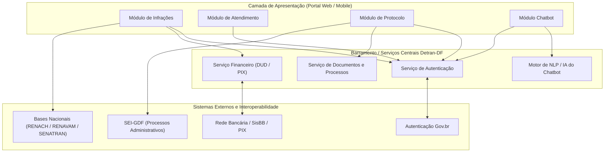

# Arquitetura e Módulos do Detran Digital DF

## 1. Visão Geral da Arquitetura

O portal **Detran Digital DF** ([portal.detran.df.gov.br](https://portal.detran.df.gov.br/#/home)) é estruturado sobre uma arquitetura web moderna do tipo *Single Page Application* (SPA), comunicando-se de forma assíncrona com microsserviços de backend e barramentos governamentais externos.

A camada de apresentação atende a múltiplos perfis de dispositivos (desktop, smartphones e tablets), demandando integração contínua com serviços de autenticação unificada, bases de dados nacionais de trânsito e redes de liquidação financeira.

### Diagrama Arquitetural e Integrações Externas

---

## 2. Módulos em Escopo

Para garantir a viabilidade técnica e a profundidade empírica da avaliação, a equipe delimitou a análise em **quatro módulos funcionais fundamentais**, sobre os quais todas as duplas aplicam suas respectivas características de qualidade:

### 2.1 Módulo de Infrações
* **Descrição Funcional:** Permite ao cidadão consultar débitos, infrações e autos vinculados a condutores (CNH) e veículos (RENAVAM). O módulo oferece a visualização do detalhamento do auto de infração e a emissão de guias de recolhimento (DUD) e códigos de pagamento instantâneo (PIX).
* **Integrações e Dependências:** Comunicação direta com a base nacional da SENATRAN/RENAINFC e integração com barramentos da rede bancária e do Banco do Brasil (SisBB).

### 2.2 Módulo de Atendimento
* **Descrição Funcional:** Viabiliza o agendamento prévio de serviços presenciais nos postos e núcleos do Detran-DF, oferecendo seleção interativa de unidades de atendimento, datas, horários disponíveis e gerenciamento de senhas e cancelamentos.
* **Integrações e Dependências:** Serviço de autenticação com dados cadastrais e barramento de alocação de postos físicos.

### 2.3 Módulo de Protocolo
* **Descrição Funcional:** Permite ao cidadão protocolar petições, recursos administrativos de multas, defesas prévias e realizar o envio (*upload*) de documentações comprobatórias em formato digital, acompanhando o trâmite processual.
* **Integrações e Dependências:** Integração direta com o Sistema Eletrônico de Informações do Governo do Distrito Federal (SEI-GDF) para autuação e tramitação de processos administrativos.

### 2.4 Módulo Chatbot
* **Descrição Funcional:** Assistente virtual interativo posicionado como canal de autoatendimento, sanando dúvidas frequentes, prestando orientações imediatas sobre documentação e direcionando o usuário para os serviços específicos do portal.
* **Integrações e Dependências:** Comunicação assíncrona com motor de Processamento de Linguagem Natural (NLP) e serviços de redirecionamento interno.
