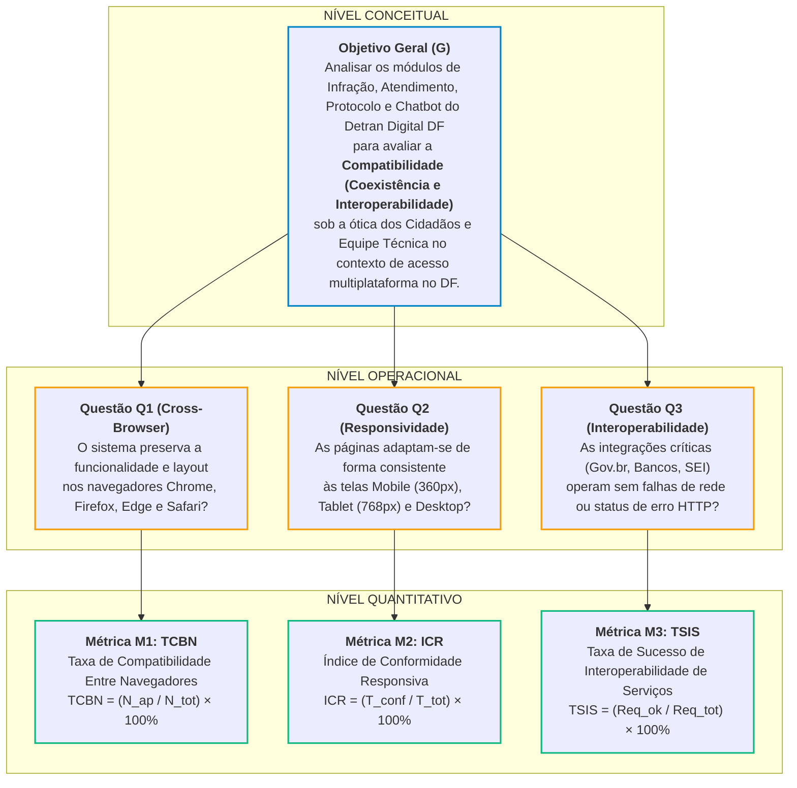

# GQM – Característica: Compatibilidade

**Responsáveis:** Artur Fernandes Galdino e Nicole Jovita Fernandes

A avaliação da característica de **Compatibilidade** fundamenta-se na norma **ISO/IEC 25010:2023**, sendo desdobrada em suas duas subcaracterísticas essenciais:

* **Coexistência (*Co-existence*):** Capacidade de o sistema executar de forma eficiente em um ambiente compartilhado com outros softwares, adaptando-se sem degradação a múltiplos navegadores (*Cross-browser*) e resoluções de tela (*Cross-device* / responsividade).

* **Interoperabilidade (*Interoperability*):** Capacidade de dois ou mais sistemas ou componentes trocarem informações e utilizarem os dados trocados sem erros de comunicação ou perda de integridade.

---

## 1. Objetivo de Medição (Nível Conceitual)

O objetivo de medição foi estruturado seguindo rigorosamente o template formal da abordagem Goal-Question-Metric (GQM):

| Elemento GQM | Descrição Estruturada |
| :--- | :--- |
| **Analisar** | Os módulos de Infração, Atendimento, Protocolo e Chatbot do Portal Detran Digital DF |
| **Para o propósito de** | Avaliar |
| **Com respeito a** | Compatibilidade (Coexistência e Interoperabilidade - ISO/IEC 25010:2023) |
| **Do ponto de vista do** | Cidadão usuário e dos Engenheiros de Software avaliadores |
| **No contexto de** | Acessos multiplataforma em ambiente web e mobile no Distrito Federal |

---

## 2. Questões Operacionais e Hipóteses (Nível Operacional)

### Questão Q1 (Coexistência / Cross-Browser)

* **Pergunta:** O sistema preserva a funcionalidade e a integridade de layout nos navegadores modernos mais difundidos no mercado (Google Chrome, Mozilla Firefox, Microsoft Edge e Safari)?
* **Hipótese H1:** Espera-se conformidade superior a 90% nos navegadores base Chromium (Chrome e Edge), porém com degradação visual e falhas em componentes dinâmicos no Firefox e Safari (especialmente no calendário interativo de Atendimento e no widget do Chatbot).

---

### Questão Q2 (Coexistência / Responsividade Multi-resolução)

* **Pergunta:** As páginas e componentes dos quatro módulos adaptam-se de forma consistente às dimensões de tela mobile (360px a 414px), tablet (768px) e desktop (1366px e 1920px), sem quebras de layout ou sobreposição de controles?
* **Hipótese H2:** O portal apresenta boa adaptação em ambiente desktop, porém exibe falhas de coexistência mobile (scroll horizontal indesejado, truncamento de textos no Protocolo e sobreposição do botão do Chatbot sobre campos de formulário).

---

### Questão Q3 (Interoperabilidade / Comunicação com Serviços Externos)

* **Pergunta:** Os fluxos de comunicação e troca de dados dos quatro módulos com serviços externos e barramentos (autenticação Gov.br, emissão de DUD bancário, integração com SEI-GDF) ocorrem de maneira íntegra e padronizada (códigos de status HTTP adequados)?
* **Hipótese H3:** As integrações apresentam taxas de sucesso superiores a 95% em cenários nominais, ocorrendo falhas de sessão e timeout principalmente no redirecionamento do Gov.br e na geração de boletos de multas em lote.

---

## 3. Definição Formal das Métricas (Nível Quantitativo)

As métricas foram estruturadas conectando o GQM com o modelo de informação do **Practical Software Measurement (PSM)**, detalhando medidas básicas, derivadas, procedimentos de coleta e interpretação:

### Métrica M1: Taxa de Compatibilidade Entre Navegadores (TCBN) – Associada a Q1
Avalia a proporção de fluxos de teste operacionais executados com sucesso em múltiplos navegadores de mercado.

* **Medidas Básicas (PSM):**
  * **N_ap:** Número de cenários de teste aprovados em todos os navegadores testados (Google Chrome, Mozilla Firefox, Microsoft Edge e Apple Safari).
  * **N_tot:** Total de cenários de teste planejados transversalmente nos 4 módulos (N_tot = 4 × casos por módulo).
* **Medida Derivada (Fórmula):**
  > **TCBN = (N_ap / N_tot) × 100%**
* **Procedimento de Coleta:** Execução manual assistida dos casos de teste de cada módulo nos quatro navegadores em suas versões estáveis mais recentes, inspecionando renderização visual e erros de script no console (`F12`).
* **Critério de Interpretação:** Quanto maior a porcentagem, maior a independência de plataforma e navegador do portal.

---

### Métrica M2: Índice de Conformidade Responsiva (ICR) – Associada a Q2
Mede a aderência dos componentes e interfaces aos requisitos de adaptação dinâmica de viewport em dispositivos móveis e desktops.

* **Medidas Básicas (PSM):**
  * **T_conf:** Total de pontos de inspeção de layout aprovados (ausência de quebra de grade, inexistência de barra de rolagem horizontal não planejada e sem sobreposição de controles visuais) nas três faixas de viewport: Mobile (360px a 414px), Tablet (768px) e Desktop (1366px a 1920px).
  * **T_tot:** Total de pontos de inspeção realizados nos 4 módulos.
* **Medida Derivada (Fórmula):**
  > **ICR = (T_conf / T_tot) × 100%**
* **Procedimento de Coleta:** Inspeção visual via ferramentas de desenvolvimento de navegadores (DevTools Device Emulation) complementada por testes em smartphones reais (Android e iOS).
* **Critério de Interpretação:** Valores inferiores a 80% evidenciam severa fragilidade de coexistência em ecossistemas móveis.

---

### Métrica M3: Taxa de Sucesso de Interoperabilidade de Serviços (TSIS) – Associada a Q3
Avalia a robustez e integridade da troca de dados entre os módulos avaliados e os serviços externos essenciais.

* **Medidas Básicas (PSM):**
  * **Req_ok:** Quantidade de requisições de rede disparadas nos fluxos de integração que retornaram status code HTTP de sucesso (família 2xx ou 3xx) com carga de dados íntegra.
  * **Req_tot:** Quantidade total de requisições de integração monitoradas nos fluxos dos 4 módulos.
* **Medida Derivada (Fórmula):**
  > **TSIS = (Req_ok / Req_tot) × 100%**
* **Procedimento de Coleta:** Monitoramento de tráfego de rede via DevTools (aba *Network*, filtro `Fetch/XHR`) registrando códigos de resposta HTTP durante autenticação Gov.br, consultas de débito e upload de processos.
* **Critério de Interpretação:** Valores abaixo de 90% representam riscos operacionais diretos de interrupção do serviço ao cidadão.

---

## 4. Níveis de Pontuação e Critérios de Julgamento

A interpretação técnica dos resultados consolidados da característica de Compatibilidade segue a seguinte matriz de decisão:

| Nível de Julgamento | Faixa TCBN (M1) | Faixa ICR (M2) | Faixa TSIS (M3) | Parecer Técnico e Ação Recomendada |
| :---: | :---: | :---: | :---: | :--- |
| **Excelente** | ≥ 95% | ≥ 95% | ≥ 98% | Compatibilidade exemplar. O portal opera de forma transparente em qualquer ambiente e com trocas de dados perfeitas. Manter boas práticas. |
| **Bom** | 85% a 94% | 80% a 94% | 90% a 97% | Compatibilidade adequada. Pequenas imperfeições estéticas ou de renderização sem impedimento de conclusão de tarefa pelo cidadão. |
| **Satisfatório** | 70% a 84% | 70% a 79% | 80% a 89% | Compatibilidade limítrofe. Exige contorno pelo usuário (ex.: mudar de navegador ou recarregar página). Priorizar correções nos módulos críticos. |
| **Insuficiente** | < 70% | < 70% | < 80% | Compatibilidade crítica e reprovada. Módulos quebram, bloqueiam no celular ou falham na troca de dados com serviços externos. Ação de melhoria obrigatória. |

---

## 5. Diagrama Hierárquico GQM

A hierarquia formal da medição estabelece a rastreabilidade direta do Nível Conceitual até o Nível Quantitativo:

