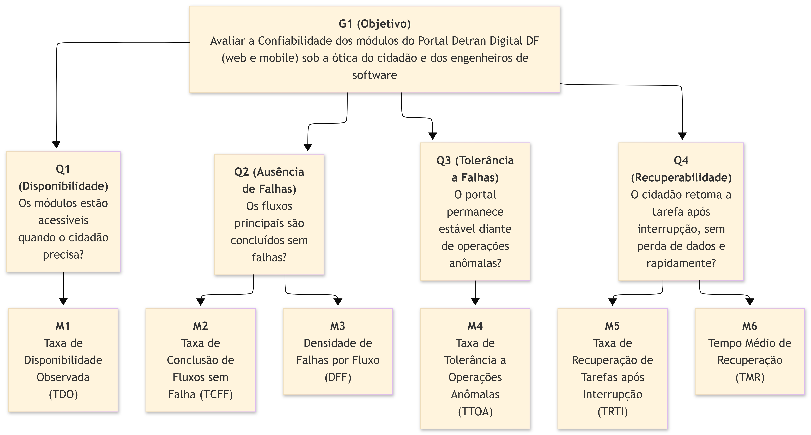

# GQM – Característica: Confiabilidade

**Responsáveis:** João e Davi

A avaliação da característica de **Confiabilidade** fundamenta-se na norma **ISO/IEC 25010:2023**, sendo desdobrada em suas quatro subcaracterísticas:

* **Ausência de Falhas (*Faultlessness*):** Capacidade de o sistema executar suas funções sem falhas em operação normal. Na versão 2023 da norma, esta subcaracterística substitui a antiga *Maturidade*.

* **Disponibilidade (*Availability*):** Capacidade de o sistema estar operacional e acessível quando o cidadão precisa utilizá-lo.

* **Tolerância a Falhas (*Fault Tolerance*):** Capacidade de o sistema manter o nível de desempenho esperado diante de falhas ou de uso fora do fluxo ideal.

* **Recuperabilidade (*Recoverability*):** Capacidade de o sistema retomar o estado desejado e restaurar os dados afetados após uma interrupção ou falha.

A profundidade da avaliação em cada módulo e os limites do escopo estão definidos em [Escopo e Limites da Avaliação](../fase1/escopo-limites.md), seção 4.

---

## 1. Objetivo de Medição (Nível Conceitual)

O objetivo de medição foi estruturado seguindo rigorosamente o template formal da abordagem Goal-Question-Metric (GQM):

| Elemento GQM | Descrição Estruturada |
| :--- | :--- |
| **Analisar** | Os módulos de Infração, Atendimento, Protocolo e Chatbot do Portal Detran Digital DF |
| **Para o propósito de** | Avaliar |
| **Com respeito a** | Confiabilidade (Ausência de Falhas, Disponibilidade, Tolerância a Falhas e Recuperabilidade - ISO/IEC 25010:2023) |
| **Do ponto de vista do** | Cidadão usuário e dos Engenheiros de Software avaliadores |
| **No contexto de** | Acessos em ambiente web e mobile no Distrito Federal, em serviços transacionais com prazos legais (defesa prévia, recursos e vencimento de guias) |

---

## 2. Questões Operacionais e Hipóteses (Nível Operacional)

### Questão Q1 (Disponibilidade)

* **Pergunta:** Os módulos estão acessíveis e respondendo corretamente nos momentos em que o cidadão precisa utilizá-los, inclusive em horários de maior demanda?
* **Hipótese H1:** Espera-se disponibilidade geral acima de 98%, com degradação concentrada em horários comerciais de pico (manhã e início da tarde de dias úteis) e em janelas de manutenção não anunciadas. Espera-se que a dependência do Gov.br seja a principal causa de indisponibilidade parcial.

---

### Questão Q2 (Ausência de Falhas)

* **Pergunta:** Os fluxos principais dos quatro módulos (consulta de débitos, emissão de guia, agendamento, abertura de protocolo e atendimento pelo Chatbot) são concluídos sem falhas, em condições normais de uso?
* **Hipótese H2:** Espera-se taxa de conclusão sem falha superior a 95% no módulo de Infração, por ser majoritariamente consulta. Espera-se taxa inferior e maior densidade de falhas nos módulos de Atendimento e Protocolo, que dependem de integrações externas (Gov.br e SEI-GDF) e de upload de arquivos, com erros HTTP 5xx intermitentes. No Chatbot, espera-se falha intermitente de resposta (*timeout* ou mensagem de erro genérica).

---

### Questão Q3 (Tolerância a Falhas)

* **Pergunta:** O portal permanece estável diante de operações anômalas do cidadão, como dados inválidos, ações repetidas, uso do botão voltar e anexos fora do padrão?
* **Hipótese H3:** Espera-se que entradas inválidas simples sejam bloqueadas, mas que ações repetidas (clique duplo em envio) e anexos fora do padrão gerem erros genéricos ou técnicos (por exemplo, "Erro 500") ou travamento da tela, sobretudo em Protocolo e Atendimento.

---

### Questão Q4 (Recuperabilidade)

* **Pergunta:** Após uma interrupção (queda de conexão, recarregamento da página ou expiração de sessão), o cidadão retoma a tarefa sem perda de dados e rapidamente?
* **Hipótese H4:** Espera-se baixa recuperação nos fluxos longos, com perda dos dados preenchidos no Protocolo ao recarregar a página e reinício completo do agendamento (módulo de Atendimento) após expiração de sessão. Espera-se tempo de recuperação curto em Infração, que tem fluxo curto, e longo nos demais módulos, por exigir novo login e novo preenchimento.

---

## 3. Definição Formal das Métricas (Nível Quantitativo)

As métricas foram estruturadas conectando o GQM com o modelo de informação do **Practical Software Measurement (PSM)**, detalhando medidas básicas, derivadas, procedimentos de coleta e interpretação. As seis métricas respondem às quatro questões: Q1 por M1, Q2 por M2 e M3, Q3 por M4, e Q4 por M5 e M6.

### Fluxos-alvo de medição

Os mesmos fluxos servem de base para as métricas M2 a M6. Os cenários detalhados serão refinados na Fase 3 (Projeto da Avaliação).

| Fluxo | Módulo | Descrição do fluxo |
| :---: | :--- | :--- |
| **F1** | Infração | Consultar débitos e infrações de um veículo |
| **F2** | Infração | Gerar guia de pagamento (DUD / PIX) |
| **F3** | Atendimento | Percorrer o agendamento até a tela de confirmação |
| **F4** | Protocolo | Preencher o formulário e anexar documento até a tela de revisão |
| **F5** | Chatbot | Realizar uma conversa de três perguntas frequentes |

!!! note "Restrições da coleta"
    A coleta ocorre em produção, com as restrições descritas em [Escopo e Limites da Avaliação](../fase1/escopo-limites.md), seção 4.2. Em especial: sem teste de carga, e sem confirmar registros reais.

**Definição de falha (usada em M1, M2 e M3):** considera-se falha qualquer das ocorrências a seguir durante a execução: resposta HTTP 5xx; *timeout* superior a 30 segundos; tela em branco ou mensagem de erro exibida ao usuário; resultado incorreto ou incompleto; ou travamento que exija recarregar a página para prosseguir.

---

### Métrica M1: Taxa de Disponibilidade Observada (TDO) – Associada a Q1
Avalia a proporção de verificações em que o portal e seus módulos estiveram acessíveis e respondendo corretamente durante a janela de observação.

* **Medidas Básicas (PSM):**
  * **V_ok:** Número de verificações em que o endereço monitorado respondeu com status HTTP 2xx ou 3xx, em até 10 segundos, com conteúdo esperado na página (e sem tela de manutenção).
  * **V_tot:** Número total de verificações realizadas na janela de observação.
* **Medida Derivada (Fórmula):**
  > **TDO = (V_ok / V_tot) × 100%**
* **Procedimento de Coleta:** Monitoramento externo de baixa frequência: uma requisição `GET` a cada 15 minutos por endereço público monitorado (página inicial e páginas de entrada de cada um dos 4 módulos que não exijam login) durante 7 dias consecutivos, com *script* automatizado que registra data, horário, status HTTP e tempo de resposta. A frequência é deliberadamente baixa para não caracterizar carga sobre a infraestrutura pública. O resultado é analisado também por faixa de horário.
* **Critério de Interpretação:** Quanto maior a porcentagem, maior a disponibilidade percebida pelo cidadão. Como a medição é externa, quedas de rede do próprio avaliador são descartadas por verificação cruzada (acesso simultâneo a um serviço de referência).

---

### Métrica M2: Taxa de Conclusão de Fluxos sem Falha (TCFF) – Associada a Q2
Avalia a proporção de execuções dos fluxos principais concluídas sem nenhuma falha, em condições normais de uso.

* **Medidas Básicas (PSM):**
  * **E_ok:** Número de execuções dos fluxos F1 a F5 concluídas sem falha.
  * **E_tot:** Número total de execuções realizadas dos fluxos F1 a F5 (mínimo de 10 repetições por fluxo, distribuídas em dias e turnos diferentes: manhã, tarde e noite).
* **Medida Derivada (Fórmula):**
  > **TCFF = (E_ok / E_tot) × 100%**
* **Procedimento de Coleta:** Execução manual dos fluxos em navegador desktop e em smartphone real, registrando em planilha a data, o horário, o fluxo, o resultado e o tipo de falha. Os códigos HTTP e erros de script são verificados no `DevTools` (abas *Network* e *Console*). Cada falha recebe captura de tela como evidência.
* **Critério de Interpretação:** Quanto maior a porcentagem, maior a ausência de falhas em operação normal. O resultado também é calculado por módulo para localizar onde as falhas se concentram.

---

### Métrica M3: Densidade de Falhas por Fluxo (DFF) – Associada a Q2
Complementa a TCFF ao medir a quantidade de falhas por execução, pois uma mesma execução pode apresentar mais de uma falha.

* **Medidas Básicas (PSM):**
  * **F_tot:** Número total de falhas registradas (conforme a definição de falha) nas execuções dos fluxos F1 a F5.
  * **E_tot:** Número total de execuções realizadas (o mesmo valor usado em M2).
* **Medida Derivada (Fórmula):**
  > **DFF = F_tot / E_tot** (falhas por execução)
* **Procedimento de Coleta:** Mesmo registro da M2, contando cada falha distinta observada em cada execução e classificando-a por tipo (erro HTTP 5xx, *timeout*, tela em branco, resultado incorreto ou travamento).
* **Critério de Interpretação:** Quanto **menor** o valor, melhor. Valores próximos de zero indicam fluxos estáveis. O detalhamento por tipo de falha orienta a causa provável.

---

### Métrica M4: Taxa de Tolerância a Operações Anômalas (TTOA) – Associada a Q3
Mede a proporção de operações anômalas do usuário em que o portal permaneceu estável, sem travar, perder dados ou exibir erro técnico.

* **Medidas Básicas (PSM):**
  * **A_ok:** Número de operações anômalas em que o portal permaneceu estável e respondeu com mensagem orientativa ou bloqueio adequado.
  * **A_tot:** Número total de operações anômalas aplicadas.
* **Medida Derivada (Fórmula):**
  > **TTOA = (A_ok / A_tot) × 100%**
* **Procedimento de Coleta:** Aplicação controlada, nos fluxos F2 a F5, de: (a) dados inválidos nos campos (placa, RENAVAM, CPF e datas); (b) ação repetida, como clique duplo em botões de envio (sem confirmar registro real); (c) uso do botão voltar do navegador no meio do fluxo; (d) anexo fora do padrão (formato ou tamanho inválido). Cada operação é classificada como estável ou não estável, com registro da mensagem exibida.
* **Critério de Interpretação:** Quanto maior a porcentagem, maior a tolerância do portal a uso fora do fluxo ideal.

---

### Métrica M5: Taxa de Recuperação de Tarefas após Interrupção (TRTI) – Associada a Q4
Mede a capacidade de o cidadão retomar a tarefa, sem perda de dados, após uma interrupção.

* **Medidas Básicas (PSM):**
  * **C_rec:** Número de cenários de interrupção em que o fluxo foi retomado sem perda de dados e sem necessidade de recomeçar do início.
  * **C_tot:** Número total de cenários de interrupção induzidos.
* **Medida Derivada (Fórmula):**
  > **TRTI = (C_rec / C_tot) × 100%**
* **Procedimento de Coleta:** Indução controlada, no meio dos fluxos F2 a F5, dos cenários: (a) perda de conexão seguida de restabelecimento (modo *offline* do `DevTools`); (b) recarregamento da página (`F5`) com formulário parcialmente preenchido; (c) expiração de sessão (aguardar o limite de inatividade). Cada cenário é classificado como recuperado ou não recuperado.
* **Critério de Interpretação:** Quanto maior a porcentagem, maior a recuperabilidade. Valores baixos indicam perda de dados ou reinício forçado, com risco de o cidadão perder prazos legais.

---

### Métrica M6: Tempo Médio de Recuperação (TMR) – Associada a Q4
Mede o tempo que o cidadão leva para retomar a tarefa após a interrupção.

* **Medidas Básicas (PSM):**
  * **T_i:** Tempo, em segundos, entre o restabelecimento da condição normal e o retorno ao ponto em que a tarefa foi interrompida, em cada cenário recuperado.
  * **N_rec:** Número de cenários recuperados (mesmo valor de C_rec da M5).
* **Medida Derivada (Fórmula):**
  > **TMR = (Σ T_i) / N_rec** (em segundos)
* **Procedimento de Coleta:** Cronometragem dos cenários da M5 com gravação de tela. Os cenários não recuperados não entram no cálculo e ficam registrados pela M5.
* **Critério de Interpretação:** Quanto **menor** o tempo, melhor. Valores altos indicam que o cidadão precisa refazer etapas, o que pesa em serviços com prazo legal.

---

## 4. Níveis de Pontuação e Critérios de Julgamento

A interpretação técnica dos resultados consolidados da característica de Confiabilidade segue a seguinte matriz de decisão:

| Nível de Julgamento | TDO (M1) | TCFF (M2) | DFF (M3) | TTOA (M4) | TRTI (M5) | TMR (M6) | Parecer Técnico e Ação Recomendada |
| :---: | :---: | :---: | :---: | :---: | :---: | :---: | :--- |
| **Excelente** | ≥ 99,5% | ≥ 98% | ≤ 0,02 | ≥ 95% | ≥ 90% | ≤ 30 s | Confiabilidade exemplar. O portal está sempre disponível, não apresenta falhas perceptíveis e permite retomar tarefas rapidamente. Manter boas práticas. |
| **Bom** | 98% a 99,49% | 90% a 97,99% | > 0,02 a 0,05 | 85% a 94,99% | 75% a 89,99% | > 30 a 60 s | Confiabilidade adequada. Falhas raras e pontuais, sem impedimento de conclusão do serviço pelo cidadão. |
| **Satisfatório** | 95% a 97,99% | 80% a 89,99% | > 0,05 a 0,10 | 70% a 84,99% | 60% a 74,99% | > 60 a 120 s | Confiabilidade limítrofe. O cidadão precisa repetir a operação ou recomeçar o fluxo. Priorizar correções nos módulos mais críticos. |
| **Insuficiente** | < 95% | < 80% | > 0,10 | < 70% | < 60% | > 120 s | Confiabilidade crítica e reprovada. Falhas frequentes, indisponibilidade ou perda de dados que podem fazer o cidadão perder prazos legais. Ação de melhoria obrigatória. |

!!! note "Regra de consolidação"
    O nível de cada questão é o **menor nível obtido entre as suas métricas**. O nível final da característica é o **menor nível entre as quatro questões**, pois uma falha grave em qualquer dimensão (por exemplo, indisponibilidade) compromete o serviço independentemente das demais. Os resultados também são apresentados por módulo.

---

## 5. Diagrama Hierárquico GQM
 
O diagrama da Figura 1 mostra o desdobramento do objetivo em questões e métricas, com os três níveis identificados. As questões Q2 e Q4 são respondidas por duas métricas cada.
 

 
*Figura 1 – Hierarquia GQM da característica Confiabilidade. Fonte: elaboração da equipe.*
 
---