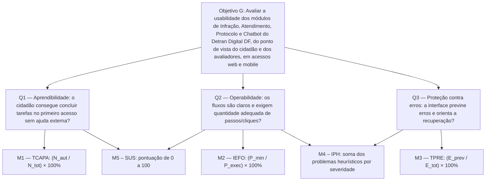

# GQM – Característica: Usabilidade

**Responsáveis:** Natan França e Yan Santos

A avaliação da característica de **Usabilidade** fundamenta-se na ISO/IEC 25010:2023 e considera o uso do Portal Detran Digital DF por cidadãos com diferentes faixas etárias, níveis de letramento digital e pessoas com deficiência. O objetivo é identificar barreiras que dificultem a compreensão, a navegação e a conclusão autônoma dos serviços nos módulos de Infração, Atendimento, Protocolo e Chatbot.

Nesta especificação, o foco quantitativo está nas subcaracterísticas **Aprendibilidade**, **Operabilidade** e **Proteção contra Erros de Usuário**, conforme delimitado para a avaliação. A Estética da Interface do Usuário e a Acessibilidade fazem parte do contexto conceitual de Usabilidade, mas não recebem métricas próprias nesta modelagem. Uma auditoria exaustiva de acessibilidade, incluindo testes completos com leitores de tela e avaliação especializada de contraste, está fora do escopo desta etapa.

---

## 1. Objetivo de Medição (Nível Conceitual)

| Elemento GQM | Descrição Estruturada |
| :--- | :--- |
| **Analisar** | Os módulos de Infração, Atendimento, Protocolo e Chatbot do Portal Detran Digital DF |
| **Para o propósito de** | Avaliar |
| **Com respeito a** | Usabilidade, com foco em Aprendibilidade, Operabilidade e Proteção contra Erros de Usuário (ISO/IEC 25010:2023) |
| **Do ponto de vista do** | Cidadão usuário e dos engenheiros de software avaliadores |
| **No contexto de** | Acessos ao portal em ambiente web e mobile no Distrito Federal |

A avaliação busca verificar se o cidadão consegue compreender os fluxos, realizar as operações necessárias com esforço adequado e prevenir ou recuperar-se de erros sem depender de suporte externo.

---

## 2. Questões Operacionais e Hipóteses (Nível Operacional)

### Questão Q1 – Aprendibilidade

**Pergunta:** O esforço necessário para que um cidadão em seu primeiro acesso compreenda e conclua as tarefas principais dos quatro módulos — consultar infrações, agendar atendimento, abrir um protocolo e interagir com o chatbot — é reduzido a ponto de dispensar suporte técnico, tutoriais ou ajuda externa?

**Hipótese H1:** Espera-se maior facilidade de aprendizado nos módulos de Infração e Chatbot, por envolverem fluxos de consulta e conversação mais diretos. Nos módulos de Protocolo e Atendimento, prevê-se uma curva de aprendizado mais acentuada devido à terminologia técnica, à quantidade de campos dos formulários e à possível ausência de ajuda contextual.

### Questão Q2 – Operabilidade

**Pergunta:** Os quatro módulos oferecem controles de navegação claros, interface consistente, baixo esforço operacional — medido pela quantidade de passos ou cliques — e retorno adequado ao cidadão durante o uso em ambiente web e mobile?

**Hipótese H2:** A operabilidade tende a ser mais satisfatória em computadores desktop. Em dispositivos móveis, podem ocorrer dificuldades como áreas de toque reduzidas na seleção de datas do módulo de Atendimento, demora ou dificuldade de acompanhamento das respostas do Chatbot e excesso de passos ou redirecionamentos no envio de documentos do módulo de Protocolo.

### Questão Q3 – Proteção contra Erros de Usuário

**Pergunta:** O portal previne erros de preenchimento por meio de máscaras, validações e confirmações de ações, e apresenta mensagens claras que permitam ao cidadão compreender o problema e recuperar-se dele?

**Hipótese H3:** A proteção contra erros pode apresentar fragilidades, como validação insuficiente de campos críticos (CPF, placa e RENAVAM) no módulo de Infração, ausência de confirmação resumida antes da conclusão do agendamento e mensagens genéricas ou técnicas no módulo de Protocolo. Essas situações podem dificultar a correção autônoma pelo cidadão. No Chatbot, também deve ser observado se entradas vazias, incoerentes ou não reconhecidas recebem orientação útil e alternativas de recuperação.

---

## 3. Definição Formal das Métricas (Nível Quantitativo)

As métricas abaixo relacionam cada questão operacional a medidas básicas observáveis e a uma medida derivada, seguindo a abordagem GQM e os princípios de medição do Practical Software Measurement (PSM). As métricas M1, M2 e M3 medem o desempenho observado nas tarefas; a M4 registra os problemas identificados por inspeção de especialistas; e a M5 registra a percepção dos participantes.

### Métrica M1 – Taxa de Conclusão Autônoma no Primeiro Acesso (TCAPA)

**Questão associada:** Q1 – Aprendibilidade.

Avalia a proporção de tarefas concluídas com sucesso por cidadãos em seu primeiro contato com os módulos, sem solicitação de auxílio externo.

**Medidas básicas:**

- **N_aut:** número de tarefas concluídas com sucesso e sem solicitação de auxílio externo no primeiro acesso.
- **N_tot:** número total de tarefas de primeiro acesso executadas pelos participantes nos quatro módulos. Considera-se primeiro acesso a primeira execução da tarefa pelo participante, sem demonstração prévia.

**Fórmula:**

\[
TCAPA = \frac{N_{aut}}{N_{tot}} \times 100\%
\]

**Procedimento de coleta:** realizar testes observacionais com participantes em primeiro acesso, utilizando tarefas previamente definidas para os quatro módulos. Registrar a conclusão ou não conclusão de cada tarefa, a solicitação de ajuda e as dificuldades observadas em uma planilha ou registro de teste. Registrar também se o participante já utilizou o portal anteriormente e o dispositivo usado, para que o resultado possa ser interpretado por perfil e por contexto de acesso.

**Critério de interpretação:** quanto maior o percentual, maior a proporção de tarefas que podem ser concluídas autonomamente. O resultado deve ser interpretado junto às observações qualitativas, sem generalizar além da amostra utilizada.

### Métrica M2 – Índice de Eficiência no Fluxo de Operação (IEFO)

**Questão associada:** Q2 – Operabilidade.

Compara a quantidade mínima de passos ou cliques prevista para a tarefa com a quantidade efetivamente realizada pelo participante.

**Medidas básicas:**

- **P_min:** número mínimo de passos ou cliques necessários para concluir a tarefa, conforme o fluxo de referência definido pelos avaliadores. Cada clique ou toque conta como um passo, e o preenchimento de um campo também conta como um passo.
- **P_exec:** número de passos ou cliques efetivamente realizados pelo participante até concluir a tarefa.

**Fórmula:**

\[
IEFO = \frac{P_{min}}{P_{exec}} \times 100\%
\]

**Procedimento de coleta:** definir previamente o fluxo de referência de cada tarefa; observar ou registrar a navegação dos participantes em desktop e mobile; contabilizar os passos efetivamente realizados. O valor de \(P_{exec}\) deve ser maior que zero para que a métrica seja calculada. Se um participante concluir a tarefa com menos passos que \(P_{min}\), o fluxo de referência deve ser revisado e a ocorrência registrada, de modo que o IEFO não ultrapasse 100%. Se a tarefa não for concluída, registrar a não conclusão separadamente e não atribuir artificialmente um valor de eficiência.

**Critério de interpretação:** um valor de 100% representa execução pelo número mínimo de passos definido como referência. Valores menores indicam passos adicionais ou desvios em relação ao fluxo de referência. O indicador não deve ser interpretado isoladamente, pois uma tarefa pode exigir mais passos por razões legítimas de segurança ou confirmação.

### Métrica M3 – Taxa de Prevenção e Recuperação de Erros (TPRE)

**Questão associada:** Q3 – Proteção contra Erros de Usuário.

Mensura a proporção de eventos de erro em que a interface impede o erro ou oferece orientação suficientemente clara para que o usuário consiga corrigi-lo na primeira tentativa após o alerta.

**Medidas básicas:**

- **E_prev:** número de eventos de erro impedidos pela validação da interface ou corrigidos pelo usuário na primeira tentativa após receber uma mensagem clara.
- **E_tot:** número total de eventos de erro ou invalidação observados durante as tarefas nos quatro módulos.

**Fórmula:**

\[
TPRE = \frac{E_{prev}}{E_{tot}} \times 100\%
\]

**Procedimento de coleta:** executar cenários controlados com dados inválidos ou incompletos nos campos de Infração, anexos inválidos no Protocolo e entradas vazias ou incoerentes no Chatbot. No Atendimento, observar a existência e a clareza de confirmações antes de ações finais; essa observação é registrada qualitativamente e só entra no cálculo de \(E_{prev}\) e \(E_{tot}\) se ocorrer um evento de erro durante o agendamento. Registrar a resposta da interface, a mensagem exibida e se o usuário conseguiu corrigir o problema na primeira tentativa.

**Critério de interpretação:** quanto mais próximo de 100%, maior a proporção de eventos prevenidos ou recuperados conforme a definição da métrica. Quando nenhum evento de erro for observado (\(E_{tot}=0\)), a métrica é **não aplicável** para aquela execução, e não deve ser registrada como 100%.

### Métrica M4 – Índice de Problemas Heurísticos (IPH)

**Questões associadas:** Q2 – Operabilidade e Q3 – Proteção contra Erros de Usuário.

Quantifica os problemas de interface identificados por inspeção com as 10 heurísticas de usabilidade de Nielsen, classificados por severidade. Complementa as métricas M2 e M3 ao abranger aspectos que elas não medem diretamente, como consistência da interface, clareza da navegação, retorno ao usuário, mensagens de erro e ajuda contextual.

**Medidas básicas:**

- **N_s:** número de problemas distintos, após a consolidação das listas dos avaliadores, com severidade \(s\) em determinado módulo, sendo \(s\) um valor de 1 a 4.
- **Severidade (\(s\)):** 1 = cosmético; 2 = menor; 3 = maior; 4 = catastrófico. O valor 0 é atribuído quando o avaliador não considera a ocorrência um problema de usabilidade, e ela não é contabilizada.

**Fórmula:**

\[
IPH_{m} = \sum_{s=1}^{4} N_{s}
\]

em que \(IPH_{m}\) é o total de problemas consolidados do módulo \(m\), sempre apresentado junto à distribuição por severidade (\(N_1\), \(N_2\), \(N_3\) e \(N_4\)).

**Procedimento de coleta:** cada avaliador inspeciona de forma independente os quatro módulos, em desktop e mobile, associando cada problema a uma heurística violada, à tela ou ao fluxo em que ocorre e a uma severidade. Em seguida, os avaliadores consolidam as listas, eliminam duplicidades e definem a severidade final de cada problema. A inspeção não envolve o envio de dados reais nem a conclusão de transações no portal. Registrar a evidência de cada problema, como captura de tela e descrição do cenário.

**Critério de interpretação:** quanto menor o número de problemas, e quanto menor a proporção de problemas de severidade 3 e 4, melhor a condição de usabilidade do módulo. O valor total não deve ser interpretado isoladamente, pois um módulo com poucos problemas de severidade 4 pode ser mais crítico que outro com muitos problemas cosméticos. Trata-se de um julgamento de especialistas e não substitui a observação de usuários.

### Métrica M5 – System Usability Scale (SUS)

**Questões associadas:** Q1 – Aprendibilidade e Q2 – Operabilidade.

Mensura a percepção subjetiva dos participantes quanto à usabilidade, por meio do questionário padronizado de 10 itens System Usability Scale. Complementa as métricas M1 e M2 ao registrar a opinião do cidadão sobre a facilidade de aprender e de operar o portal, aspecto que a observação das tarefas não captura.

**Medidas básicas:**

- **R_i:** resposta do participante ao item \(i\) do questionário (\(i = 1, \dots, 10\)), em escala de 1 (discordo totalmente) a 5 (concordo totalmente).

**Fórmula:**

\[
SUS = 2{,}5 \times \left[ \sum_{i \in \{1,3,5,7,9\}} (R_i - 1) + \sum_{i \in \{2,4,6,8,10\}} (5 - R_i) \right]
\]

**Procedimento de coleta:** aplicar o questionário individualmente a cada participante, imediatamente após a execução das tarefas e antes de qualquer discussão sobre o resultado, utilizando a versão em português com os 10 itens originais. Registrar o escopo ao qual o questionário se refere (módulo ou portal como um todo), o dispositivo utilizado e o perfil do participante. Calcular a pontuação de cada participante e apresentar a média junto às pontuações individuais.

**Critério de interpretação:** o resultado varia de 0 a 100 e não representa um percentual. Valores maiores indicam melhor percepção de usabilidade; a literatura costuma citar 68 como média de referência. O SUS indica a percepção geral, mas não identifica a causa das dificuldades, devendo ser interpretado junto às demais métricas e às observações qualitativas.

---

## 4. Níveis de Pontuação e Critérios de Julgamento

Os resultados percentuais das métricas M1, M2 e M3 devem ser classificados conforme as faixas estabelecidas para esta especificação. Os limites são aplicados separadamente a cada métrica. As métricas M4 (IPH) e M5 (SUS) não possuem faixas de julgamento nesta especificação, e seus valores são apresentados diretamente, por módulo sempre que a amostra permitir, e interpretados junto às demais métricas.

| Nível de julgamento | TCAPA (M1) | IEFO (M2) | TPRE (M3) | Interpretação técnica |
| :---: | :---: | :---: | :---: | :--- |
| **Excelente** | ≥ 90% | ≥ 90% | ≥ 95% | Usabilidade exemplar: tarefas realizadas com autonomia, fluxo eficiente e elevada prevenção ou recuperação de erros. |
| **Bom** | 80% a < 90% | 80% a < 90% | 85% a < 95% | Usabilidade adequada: podem ocorrer dúvidas ou desvios pontuais, sem impedir a conclusão da tarefa. |
| **Satisfatório** | 70% a < 80% | 70% a < 80% | 75% a < 85% | Usabilidade limítrofe: o cidadão pode precisar de esforço adicional, repetir ações ou consultar ajuda ocasionalmente. |
| **Insuficiente** | < 70% | < 70% | < 75% | Usabilidade crítica: há indícios de abandono, navegação confusa ou erros sem orientação suficiente para correção. |

**Regras de aplicação e registro:**

1. Definir antes da coleta as tarefas, o fluxo de referência de cada uma e os cenários de erro, aplicando-os da mesma forma a todos os participantes.
2. Registrar numeradores e denominadores junto aos percentuais, permitindo reproduzir os cálculos.
3. Registrar separadamente tarefas não concluídas, eventos não observados e situações em que a métrica não puder ser calculada.
4. Interpretar resultados por módulo e por contexto de acesso sempre que a amostra permitir, sem misturar observações de tarefas diferentes sem identificá-las.
5. Documentar evidências observáveis — por exemplo, capturas de tela, registros de observação e descrição do cenário — para fundamentar o julgamento.
6. As hipóteses H1, H2 e H3 são expectativas a serem verificadas durante a execução; não representam resultados já constatados.

---

## 5. Diagrama Hierárquico GQM

O diagrama abaixo explicita a rastreabilidade entre o objetivo de medição, as questões operacionais e as métricas quantitativas.

---

## 6. Limites da Avaliação de Usabilidade

A avaliação será realizada por inspeção heurística da interface, conduzida por avaliadores independentes, e testes de tarefas guiadas com amostragem técnica reduzida de cidadãos e engenheiros avaliadores, com aplicação do questionário SUS aos participantes. Não contempla testes presenciais em laboratório UX com centenas de participantes, nem intervenção ou alteração direta no portal de produção. Por ocorrer em ambiente real, as tarefas e os cenários de erro não devem gerar efeitos efetivos (protocolos, agendamentos ou pagamentos), e os resultados refletem a versão do portal na data da avaliação.

Embora a inclusão de pessoas com deficiência seja relevante para a avaliação de um serviço público, esta especificação não equivale a uma auditoria completa de acessibilidade. Testes exaustivos com leitores de tela, avaliação especializada de contraste e demais verificações avançadas ficam reservados a um estudo específico. Os resultados deverão explicitar essa limitação.

A análise utiliza somente comportamentos observáveis na interface e nos fluxos acessíveis ao avaliador. Não pressupõe acesso ao código-fonte ou aos sistemas internos do Detran-DF.
