# Piloto dos Instrumentos – Capacidade de Interação

Anexo de [Capacidade de Interação (Fase 3)](usabilidade.md). Registra o piloto de 16/11/2026 e a sua revisão em 20/11/2026. Os dados do piloto **não entram** nos resultados da avaliação.

## 1. Escopo e limites do piloto

O piloto foi feito pela equipe com um **assistente de navegador** (Chrome automatizado), em **desktop** (1366×768) e com o celular **emulado** (viewport de 360×640). Ele serve para validar o **percurso das tarefas**, as telas, as capturas, a regra de contagem de passos e o preenchimento dos registros. Ele **não valida**:

| O que não é validado | Por quê |
| :--- | :--- |
| Solicitação de auxílio externo | Não há moderador nem participante; o campo "pedido de auxílio" **não se aplica** e foi retirado dos resultados |
| Tempo de sessão e de tarefa | O tempo medido (~24 s na T4) é o da automação, não o de uma pessoa; foi **retirado** dos resultados |
| Área de toque e uso em celular (H2) | O mobile foi **emulado**; a emulação reproduz mal a área de toque. Achados de mobile ficam "a confirmar em aparelho real" |
| Roteiro do moderador e regra de auxílio | Dependem de uma sessão com pessoa real (sessão P00, Seção 10 da página principal) |

**Escopo.** O piloto cobre **uma tarefa por módulo** (T1 a T3 em desktop com conta de teste, e T4 em desktop e em mobile emulado). A T1 em mobile não foi feita.

## 2. Resultados

Os passos abaixo seguem a [regra de contagem](usabilidade.md#61-catalogo-de-tarefas-e-fluxos-de-referencia-m1-e-m2) da página principal: cliques sem efeito, voltar e recarregar **contam**; rolagem não conta; o aviso temporário "É GOLPE!" não conta e é registrado à parte. Nas tarefas T1 a T3 a sessão já estava aberta, então **o login não foi executado**.

| Tarefa | Dispositivo | Concluiu | Chegou ao ponto de parada | P_min (catálogo, com login) | P_exec (sem login) | Observações |
| :---: | :--- | :---: | :---: | :---: | :---: | :--- |
| T1 | Desktop | Não | Não | 8 | 2 | A conta de teste não tem veículo; a tela não listou veículos |
| T2 | Desktop | Sim | Sim | 15 | **14** (12 passos + 2 cliques sem efeito, em Unidade e Data) | Comparar com P_min exige o P_min **sem login** (abaixo) |
| T3 | Desktop | Sim | Sim | 10 | 6 | Comparar com P_min sem login |
| T4 | Desktop | Sim | Sim | 3 | **3** | O fechamento do aviso "É GOLPE!" (1 clique) ficou fora e foi registrado à parte |
| T4 | Mobile (emulado) | Sim | Sim | 3 | **3** | Idem |
| T1 | Mobile | **Não foi feita** | – | 8 | – | – |

**Tabela 1 – Resultado do piloto.** Fonte: Elaborado pelos autores. Os valores de T2 e T4 foram **recontados** pela regra da página principal: na versão anterior, T2 aparecia como "12 (14 cliques)", com os 2 cliques sem efeito fora do P_exec, e T4 aparecia com 4 passos, incluindo o fechamento do aviso.

**P_min e login.** O P_min do catálogo **inclui o login**, e o piloto não o executou. Por isso, T2 (14 < 15) e T3 (6 < 10) **não podem ser comparados** com o P_min do catálogo. A comparação válida usa o **P_min sem login** (P_min menos os passos de login). O número de passos de login ainda **não foi medido** e será registrado na sessão P00, em `tarefas-e-fluxos-notas.md`. Até lá, os valores do catálogo **não são considerados alterados nem validados** para T1 a T3.

## 3. Achados do piloto

Os achados abaixo são **observações do percurso**, sem severidade e sem heurística. Eles **não entram na inspeção heurística**, que é feita de forma independente pelos dois avaliadores; publicar classificações antes dela ancoraria as listas.

| Tarefa | Observação | Situação |
| :---: | :--- | :--- |
| T1 | A tela "Histórico de Infrações por Veículo" explica o que será listado ("Serão listados os veículos que estão no seu nome…"), mas, para a conta de teste, não lista veículo algum e **não exibe mensagem de estado vazio** | **A confirmar com uma conta com veículo** |
| T3 | A prévia do documento gerado traz os dados do perfil do titular, o que é esperado em um documento do portal. O ponto a observar é a **ausência de aviso ou de opção de editar** antes da assinatura | A confirmar na inspeção |
| Página inicial | O modal "É GOLPE!" **bloqueia a tela** até o clique em "ENTENDI". É tratado como aviso temporário de campanha: não conta em P_min nem em P_exec, é registrado em `observacoes` e **também como achado de inspeção** (elemento que bloqueia a tarefa) | Registrar a data da coleta; verificar se ainda existe |
| Página inicial (mobile emulado) | Em 360 px, o cartão flutuante "Mulher Não se Cale!" cobre o título "Nossos serviços…" e o avatar do chatbot fica sobre o conteúdo | **A confirmar em aparelho real** |
| T4 | O conteúdo da resposta do assistente variou entre desktop e mobile para a mesma pergunta. A condição de conclusão ("uma resposta sobre o prazo, indicando onde ele consta e como é contado") foi atendida nas duas execuções | Variação esperada; já registrada no piloto dos cenários de erro |

**Tabela 2 – Observações do piloto.** Fonte: Elaborado pelos autores.

**Limitação: conta de teste sem veículo.** A T1 não pôde ser concluída porque a conta usada no piloto não tem veículo vinculado. A equipe vai usar, na coleta, uma conta de terceiro **com veículo e com consentimento do titular** (Seção 6.1 da página principal). Se não for obtida até a data de corte, a T1 sai de N_tot.

## 4. Ajustes nos instrumentos a partir do piloto

- Definida a **regra de contagem de passos** (cliques sem efeito, voltar, recarregar, rolagem, aviso temporário, login), aplicada a todas as sessões.
- T4 passa a ser contada como **3 passos**, com o aviso registrado em `observacoes`.
- Incluída a necessidade do **P_min sem login** para comparar execuções com sessão aberta.
- Retirados dos resultados os campos que a automação não valida (pedido de auxílio, tempo).
- Marcados como "a confirmar em aparelho real" os achados de mobile.

## 5. O que continua pendente

| Instrumento | Verificação a fazer | Situação |
| :--- | :--- | :---: |
| Roteiro do moderador | Sessão completa com pessoa real (P00) e medição da duração (meta de 45 a 60 min) | Pendente |
| Regra de auxílio externo | Conferir se o observador a aplica sem ambiguidade | Pendente |
| Passos de login | Medir os passos de login de T1 a T3 e calcular o P_min sem login | Pendente |
| T1 e T2/T3 com login | Repetir T1 a T3 com a conta com veículo e com o login incluído | Pendente |
| T1 em mobile | Executar em aparelho real | Pendente |
| `registro-tarefas.csv` | Preencher uma linha por tarefa e conferir se N_aut, N_tot, P_min e P_exec saem sem consulta a outra fonte | Pendente |
| `sus-respostas.csv` | Conferir a fórmula **da planilha** com os valores-limite (100, 0 e 50) e o exemplo (85). A conferência do cálculo foi feita em script, não na planilha | Parcial |
| `inspecao-heuristica.csv` | Calibração e consolidação com os dois avaliadores | Pendente |

## 6. Evidências

Capturas em `docs/img/usabilidade/piloto/`, nomeadas `PILOTO-{etapa}_{dispositivo}_{data}.png` (exceção ao padrão de nomes da inspeção, documentada no `README.md` da pasta). A conta usada é de terceiro, com consentimento: o nome do usuário no cabeçalho e os dados da prévia do documento de T3 estão cobertos por tarja gravada na imagem.

### 6.1 Capturas do piloto da T4 (desktop e mobile emulado)

| Etapa | Desktop | Mobile |
| :--- | :---: | :---: |
| Aviso na página inicial | 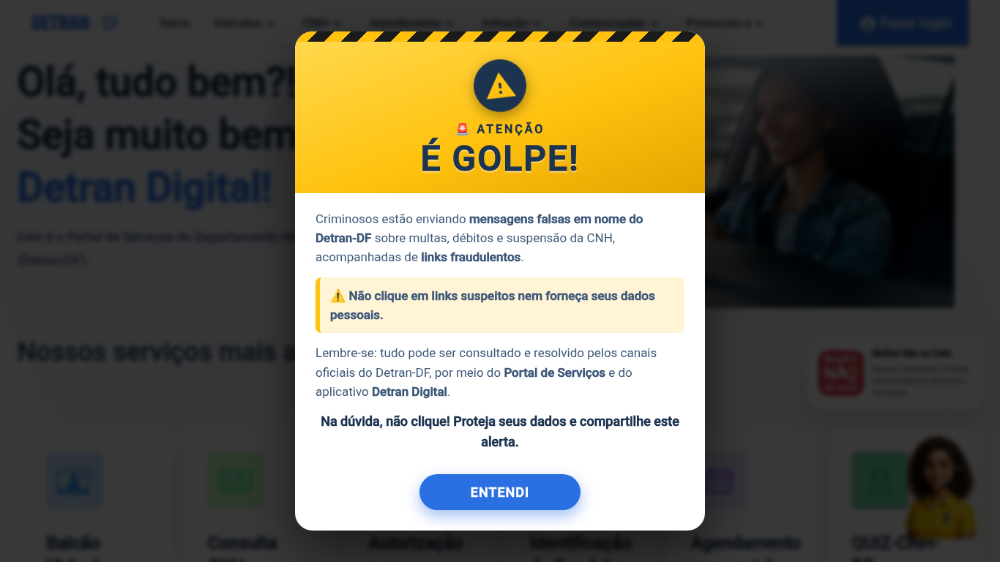{ width="260" } | 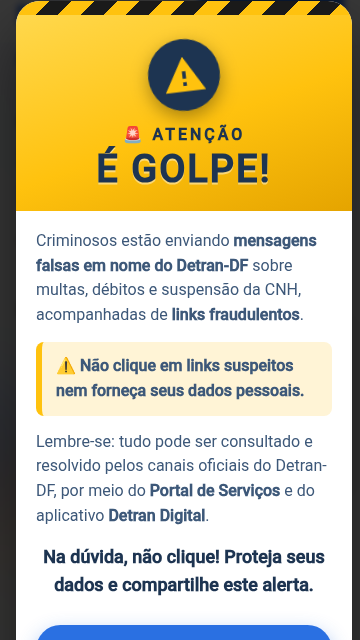{ width="150" } |
| Página inicial após fechar o aviso | { width="260" } | { width="150" } |
| Assistente aberto | { width="260" } | 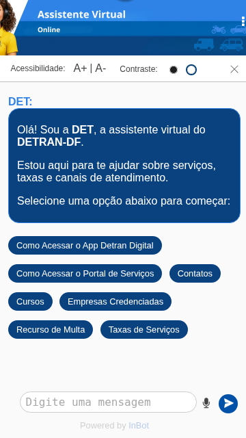{ width="150" } |
| Resposta do assistente | { width="260" } | 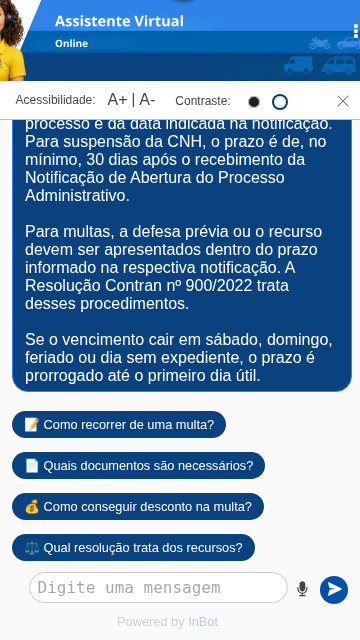{ width="150" } |

**Tabela 3 – Capturas do piloto da T4.** Fonte: Elaborado pelos autores.

### 6.2 Capturas do piloto de T1 a T3 (desktop)

| Tarefa | Etapa | Captura |
| :---: | :--- | :--- |
| T1 | Menu Infração aberto | 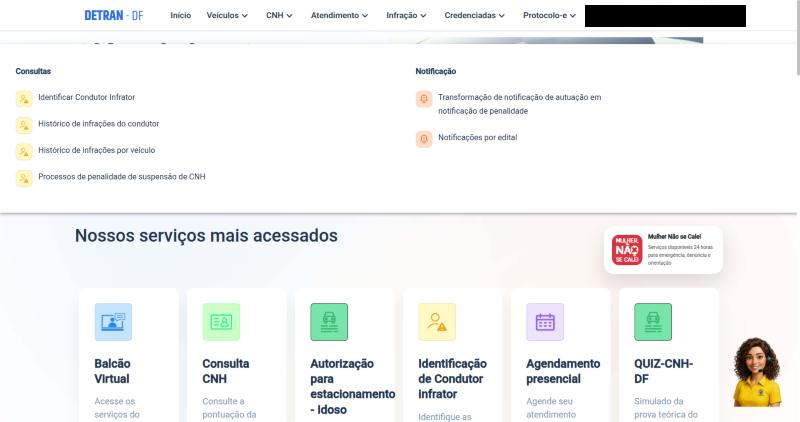{ width="300" } |
| T1 | Histórico de Infrações por Veículo: a tela não lista veículos para a conta de teste | 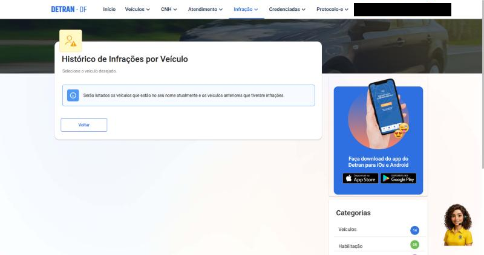{ width="300" } |
| T1 | Mesma tela com janela estreita | 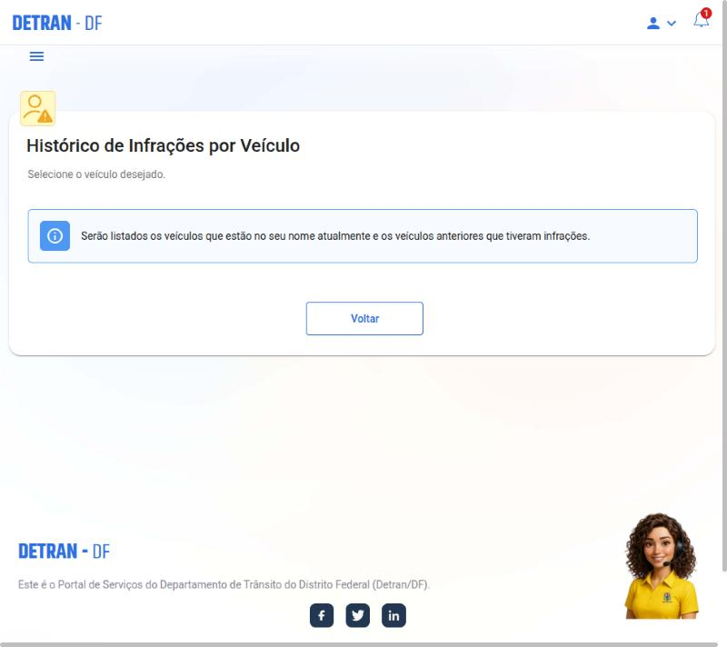{ width="300" } |
| T2 | Entrada do Agendamento (Novo agendamento) | { width="300" } |
| T2 | Formulário vazio | 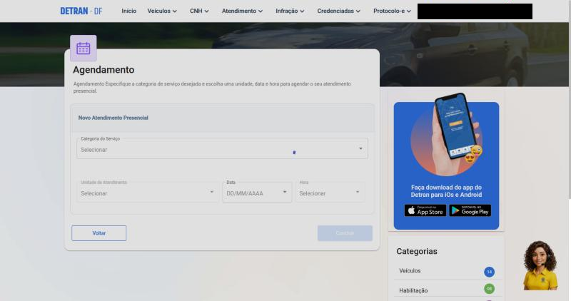{ width="300" } |
| T2 | Lista de categorias, com texto sobreposto | 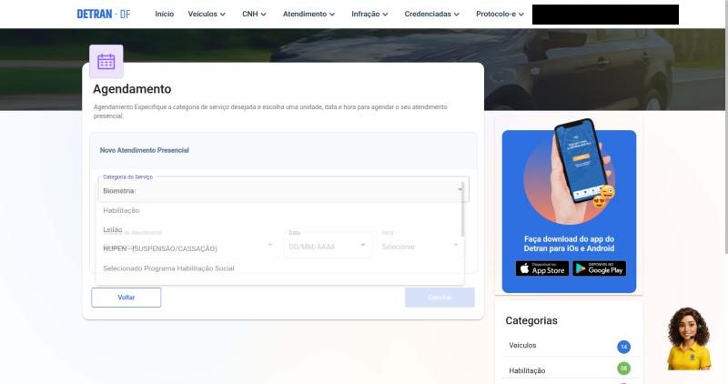{ width="300" } |
| T2 | Categoria Biometria e declaração | 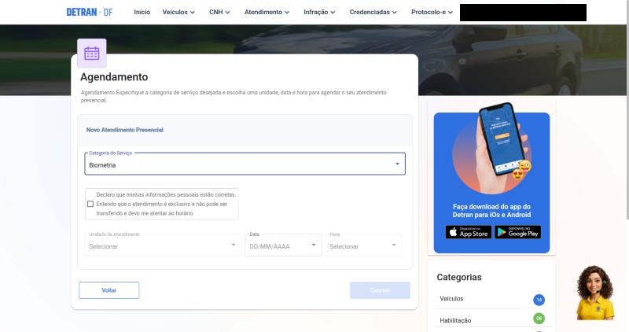{ width="300" } |
| T2 | Lista de unidades | { width="300" } |
| T2 | Lista de datas | 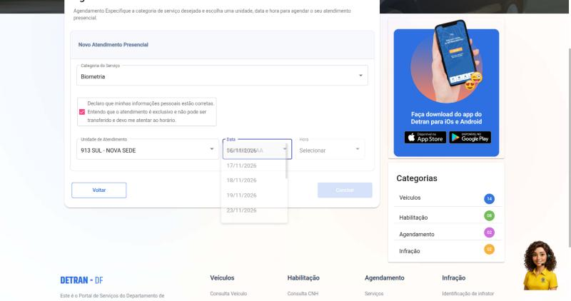{ width="300" } |
| T2 | Lista de horários | { width="300" } |
| T2 | Ponto de parada: formulário preenchido, sem acionar a conclusão | 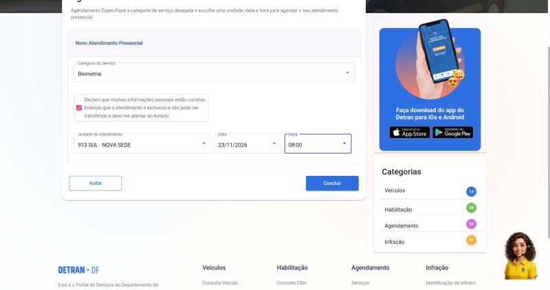{ width="300" } |
| T3 | Menu Protocolo-e | 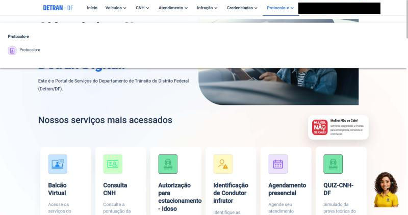{ width="300" } |
| T3 | Home do Protocolo Eletrônico | 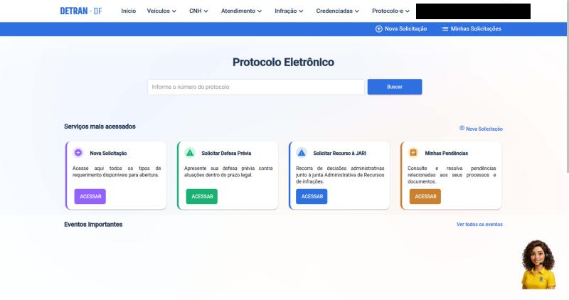{ width="300" } |
| T3 | Nova Solicitação, com as abas de tipo de protocolo | 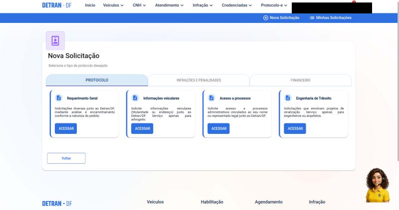{ width="300" } |
| T3 | Requerimento Geral, formulário vazio | 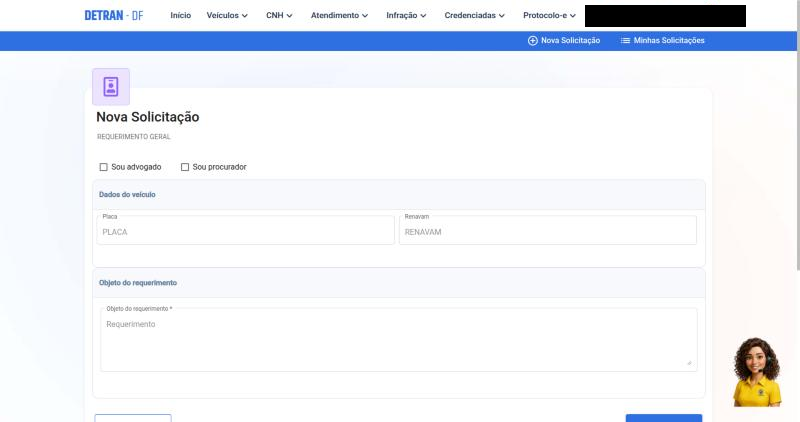{ width="300" } |
| T3 | Formulário preenchido com texto de teste | 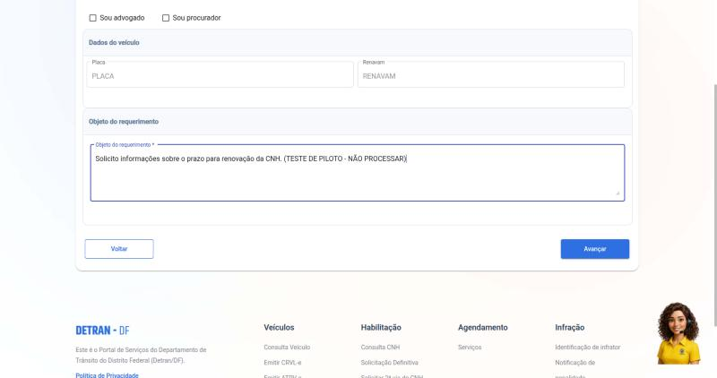{ width="300" } |
| T3 | Prévia do documento (dados cobertos) | 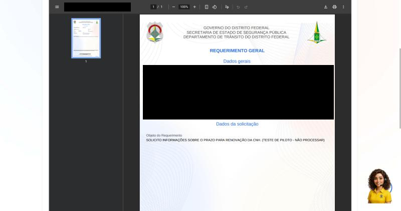{ width="300" } |
| T3 | Ponto de parada: etapa de assinatura, sem assinar | 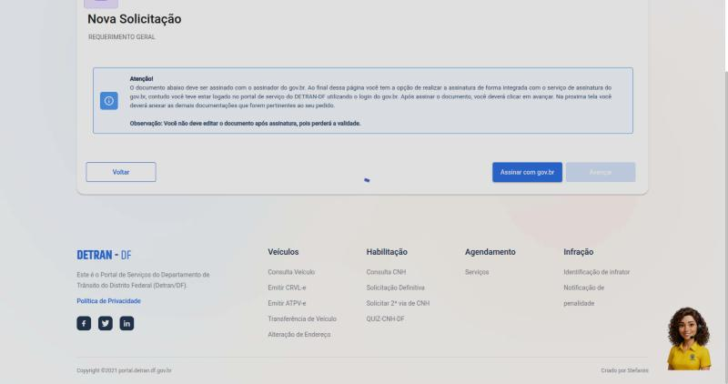{ width="300" } |

**Tabela 4 – Capturas do piloto de T1 a T3.** Fonte: Elaborado pelos autores.
