# Plano de Avaliação – Característica: Capacidade de Interação

**Responsáveis:** Natan França e Yan  
**Característica:** Capacidade de Interação (ISO/IEC 25010:2023)  
**Subcaracterísticas:** Aprendibilidade, Operabilidade e Proteção contra Erros de Usuário  
**Módulos Avaliados:** Infração, Atendimento, Protocolo e Chatbot (Portal Detran Digital DF)  
**Fase Normativa:** Fase 3 (Projeto da Avaliação – ISO/IEC 25040)

!!! note "Status do Documento"
    Página placeholder estruturada pela equipe Kay McNulty para a Fase 3 da ISO/IEC 25040. Os roteiros detalhados de inspeção heurística, tarefas de usuário e formulários do System Usability Scale (SUS) estão em desenvolvimento ativo pela dupla responsável (Natan França e Yan).

!!! info "Atualização do Status (16/11/2026)"
    Os instrumentos da Fase 3 foram definidos e estão integrados nas Seções 6 a 11: catálogo de tarefas e fluxos, cenários de erro, plano do teste com participantes, protocolo de inspeção heurística, matriz de rastreabilidade, responsabilidades e cronograma de coleta. O **piloto dos instrumentos** (Seção 11) foi executado em parte, com T1 a T4 em desktop, e os resultados estão na Seção 11.6. Ficam pendentes o piloto da sessão completa, da regra de auxílio, do SUS e da inspeção heurística (Seção 11.3). A coleta oficial é feita na Fase 4. O texto das Seções 1 a 5 foi mantido como registrado anteriormente.

---

## 1. Método de Avaliação

A avaliação da característica de **Capacidade de Interação** fundamenta-se nas especificações conceituais e métricas operacionais consolidadas na [Fase 2](../fase2/usabilidade.md). A metodologia organiza-se em duas frentes complementares de inspeção diagnóstica caixa-preta:

1. **Inspeção Heurística de Interface:**
   * Aplicação das 10 Heurísticas de Capacidade de Interação de Jacob Nielsen para identificar barreiras cognitivas, falhas de feedback, inconsistências visuais e deficiências no controle do usuário sobre as ações.
2. **Avaliação Empírica de Desempenho e Satisfação:**
   * Condução de ensaios com tarefas operacionais simuladas nos quatro módulos para apuração das métricas **TCAPA** ($Taxa\ de\ Conclusão\ Autônoma\ no\ Primeiro\ Acesso$), **IEFO** ($Índice\ de\ Eficiência\ no\ Fluxo\ Operacional$) e **TPRE** ($Taxa\ de\ Prevenção\ e\ Recuperação\ de\ Erros$).
   * Aplicação do instrumento padronizado **System Usability Scale (SUS)** para quantificação do escore percebido de capacidade de interação.

### 1.1 Visão Geral das Métricas Operacionais

| Métrica | Questão GQM | O que é medido | Instrumento de Coleta | Procedimento de Apuração |
| :--- | :---: | :--- | :--- | :--- |
| **M1 – TCAPA** | Q1 | Taxa de conclusão de tarefas sem solicitação de auxílio externo no primeiro contato | Roteiro de tarefas orientadas | Razão entre tarefas concluídas autonomamente e o total planejado |
| **M2 – IEFO** | Q2 | Relação entre o tempo ideal previsto para a tarefa e o tempo real despendido | Cronometragem sobre gravações de tela | Divisão entre o tempo de referência e a média do tempo cronometrado |
| **M3 – TPRE** | Q3 | Capacidade da interface de prevenir entradas errôneas e auxiliar o usuário na correção imediata | Roteiro de simulação de erros induzidos | Proporção de erros bloqueados ou com mensagens instrutivas claras |
| **M4 – SUS** | Q4 | Escore padronizado de capacidade de interação percebida (escala de 0 a 100) | Questionário SUS de 10 perguntas | Cálculo ponderado conforme fórmula oficial de John Brooke |

**Tabela 1 – Métricas operacionais para Capacidade de Interação.** Fonte: Elaborado pelos autores.

### 1.2 Nota de Consistência com a Fase 2

O conteúdo das Seções 1 a 5 foi mantido como estava. Na especificação formal da [Fase 2](../fase2/usabilidade.md), fonte normativa da avaliação, alguns elementos diferem do que consta nas Tabelas 1 e 2. Para a coleta e o julgamento, **prevalece a Fase 2**:

| Elemento | Nas Tabelas 1 e 2 | Na Fase 2 (especificação formal) |
| :--- | :--- | :--- |
| **M2 – IEFO** | Tempo ideal ÷ tempo real, com cronometragem | Passos: P_min ÷ P_exec × 100%. Cada clique ou toque e cada campo preenchido contam como um passo |
| **M4** | SUS | **IPH** (Índice de Problemas Heurísticos), por módulo e severidade |
| **M5** | Não consta | **SUS** (escore de 0 a 100) |
| **Questões e hipóteses** | Q1 a Q4 e H1 a H4 | Q1 a Q3 e H1 a H3; o SUS se associa a Q1 e Q2 |
| **Faixas de julgamento** | Excelente, Bom, Regular e Insuficiente, com limites distintos por métrica | Excelente, Bom, Satisfatório e Insuficiente, aplicadas só a M1, M2 e M3 (≥ 90% / 80% a < 90% / 70% a < 80% / < 70%; na M3, ≥ 95% / 85% a < 95% / 75% a < 85% / < 75%) |
| **Faixas para M4 e M5** | SUS com faixas | Sem faixas: IPH e SUS são apresentados diretamente |

A matriz atualizada de acordo com a Fase 2 está na Seção 8 (Tabela 6).

---

## 2. Roteiro de Tarefas e Inspeção Heurística por Módulo

Os procedimentos práticos cobrem os quatro módulos prioritários definidos no escopo do projeto:

* **Módulo Infração:** Tarefa de busca de débitos veiculares, interpretação dos campos e visualização dos detalhes de auto de infração sem ambiguidade visual.
* **Módulo Atendimento:** Tarefa de agendamento presencial, compreensão dos fluxos de seleção de unidade, verificação de clareza dos calendários e cancelamento de etapas.
* **Módulo Protocolo:** Tarefa de envio de documentação digital, validação de limites de tamanho/formato de arquivos e transparência no status do protocolo.
* **Módulo Chatbot:** Tarefa de resolução de dúvidas frequentes, clareza das mensagens automáticas e facilidade de alternância para atendimento humano.

---

## 3. Instrumentos de Coleta e Perfil dos Avaliadores

* **Planilha de Severidade Heurística:** Instrumento para classificação dos problemas detectados em escala de 0 a 4 (0 = Não é problema; 1 = Apenas cosmético; 2 = Problema menor; 3 = Problema maior; 4 = Catástrofe de capacidade de interação).
* **Gravação de Telas e Áudio:** Registro visual das sessões de teste para auditoria temporal precisa e identificação exata dos pontos de hesitação ou falha.
* **Avaliadores Técnicos:** Membros da equipe com treinamento no método heurístico e graduandos em Engenharia de Software da UnB.

---

## 4. Matriz de Rastreabilidade (Fase 2 para Fase 3)

| Métrica Formal (Fase 2) | Questão e Hipótese | Medidas Básicas | Roteiro Operacional (Fase 3) | Instrumento de Registro | Níveis de Pontuação (Fase 2) |
| :--- | :---: | :--- | :--- | :--- | :--- |
| **M1 – TCAPA** | Q1, H1 | $T_{aut}$, $T_{tot}$ | Tarefas guiadas nos 4 módulos | Formulário de registro de execução | Excelente: ≥ 90% Bom: 80% a 89% Regular: 65% a 79% Insuficiente: < 65% |
| **M2 – IEFO** | Q2, H2 | $t_{ideal}$, $t_{real}$ | Cronometragem dos fluxos | Tabela de tempos cronometrados | Excelente: ≥ 85% Bom: 70% a 84% Regular: 50% a 69% Insuficiente: < 50% |
| **M3 – TPRE** | Q3, H3 | $E_{prev}$, $E_{tot}$ | Simulação de entradas inválidas | Checklist de prevenção de erros | Excelente: ≥ 90% Bom: 75% a 89% Regular: 60% a 74% Insuficiente: < 60% |
| **M4 – SUS** | Q4, H4 | Respostas Q1 a Q10 | Questionário padronizado | Planilha de consolidação SUS | Excelente: ≥ 80,3 Bom: 68,0 a 80,2 Regular: 51,0 a 67,9 Insuficiente: < 51,0 |

**Tabela 2 – Matriz de rastreabilidade entre Fase 2 e Fase 3 para Capacidade de Interação.** Fonte: Elaborado pelos autores.

---

## 5. Limitações Metodológicas

* **Tamanho Amostral de Participantes:** Por se tratar de auditoria acadêmica diagnóstica, os ensaios laboratoriais com usuários utilizam amostragem de conveniência especializada, complementada pela análise heurística exaustiva dos avaliadores.
* **Simulação de Pagamentos e Envios Oficiais:** Para evitar geração indevida de dados no banco do Detran-DF, as tarefas terminam antes da confirmação final do protocolo ou quitação bancária de guias.

### 5.1 Limitações Adicionais do Plano Operacional

Complementam as limitações acima, a partir dos instrumentos definidos nas Seções 6 a 11.

- **Amostra pequena e de conveniência.** Os resultados valem para os participantes e não se generalizam. Todos os percentuais são acompanhados de numerador e denominador.
- **Ambiente de produção.** As tarefas e os cenários de erro não geram efeitos reais (protocolos, agendamentos ou pagamentos) e param nos pontos de parada seguros.
- **Versão do portal.** Os resultados refletem o portal na data da coleta.
- **Infração.** Não tem campo de entrada, então a proteção contra erros desse módulo não é medida por M3.
- **Protocolo.** Os cenários de anexo inválido não são executados, pela assinatura com gov.br.
- **Acessibilidade.** A avaliação não equivale a uma auditoria de acessibilidade. Leitores de tela e contraste ficam fora do escopo.
- **Caixa-preta.** A análise usa só o que é observável na interface, sem acesso ao código-fonte e sem intervenção no portal.
- **Julgamento de especialistas.** O IPH é um julgamento de especialistas e não substitui a observação de usuários.

---

## 6. Instrumentos Integrados

### 6.1 Catálogo de tarefas e fluxos de referência (M1 e M2)

Há uma tarefa por módulo, executada em desktop e em mobile (8 linhas em `tarefas-e-fluxos.csv`). Os enunciados são neutros e não citam nomes de menus ou botões. Cada clique ou toque conta como um passo, e o preenchimento de um campo também.

| Tarefa | Módulo | P_min (desktop) | P_min (mobile) | Ponto de parada seguro |
| :---: | :--- | :---: | :---: | :--- |
| **T1** | Consultar infrações | 8 | 8 | Lista de infrações, sem pagar, emitir boleto ou recorrer |
| **T2** | Agendar atendimento | 15 | 15 | Formulário preenchido, antes de *Concluir agendamento* |
| **T3** | Abrir protocolo (Requerimento Geral) | 10 | 10 | Etapa de assinatura, sem concluir com gov.br |
| **T4** | Interagir com o chatbot | 3 | 3 | Resposta do assistente exibida |

**Tabela 3 – Tarefas e P_min.** Fonte: Elaborado pelos autores. Valores conciliados entre os dois avaliadores.

- **Login gov.br:** todas as ações, exceto o assistente virtual, exigem login. T1 a T3 começam sem sessão iniciada e **o login conta no P_min**. O teste usa conta de teste, nunca dados de terceiros.
- **T3 usa o Requerimento Geral**, porque "Acesso a processos" exige o número de um processo existente, que não pode ser igual para todos.
- **T4:** a resposta do assistente varia entre execuções. A conclusão é "uma resposta sobre o prazo, indicando onde ele consta e como é contado", e não um valor em dias.

### 6.2 Cenários de erro controlados (M3)

Os cenários usam apenas valores sabidamente inválidos, sem CPF, placa ou RENAVAM de terceiros, e não geram efeitos reais. Cada evento é classificado como `prevenido`, `corrigido_1a_tentativa`, `nao_recuperado` ou `sem_erro`. Os dois primeiros entram em E_prev, e os quatro em E_tot, exceto `N/A`. **Quando E_tot = 0, a métrica é não aplicável, e nunca 100%.**

| Módulo | Cenários | Situação |
| :--- | :--- | :--- |
| Protocolo | Campo obrigatório vazio, placa incompleta e Renavam curto no Requerimento Geral | Executáveis |
| Chatbot | Entrada vazia, só espaços, texto incoerente, pergunta fora do escopo e símbolos ou emojis | Executáveis |
| Atendimento | Roteiro de observação: resumo antes da ação final, voltar, cancelar | Qualitativo; só entra em M3 se ocorrer erro |
| Infração | Cenários definidos para CPF, placa e RENAVAM | **Não aplicáveis**: a consulta usa o veículo da conta logada e não tem campo de entrada |

**Tabela 4 – Cenários de erro por módulo.** Fonte: Elaborado pelos autores.

**Limitação.** O módulo de Infração não atinge o mínimo de dois cenários executáveis por desenho do portal. Os cenários de anexo inválido do Protocolo não foram executados, porque a tela de anexos só vem depois da assinatura com gov.br, que tem validade legal.

### 6.3 Plano do teste com participantes (M1, M2, M3 e M5)

| Item | Definição |
| :--- | :--- |
| Amostra | Mínimo de **6 participantes**: cidadãos com diferentes faixas etárias e níveis de letramento digital (ao menos 2 de baixo letramento) e ao menos 1 engenheiro avaliador |
| Dispositivos | **3 em desktop e 3 em mobile**; cada pessoa usa um só dispositivo |
| Denominador de M1 | N_tot = 24 tarefas (6 participantes × 4 tarefas) |
| Primeiro acesso | O participante nunca executou a tarefa e não recebe demonstração prévia |
| Exclusões | Os avaliadores da inspeção heurística não participam do teste |
| Anonimização | Código sequencial (P01, P02, ...), sem dados pessoais nos arquivos (LGPD); perfil em categorias amplas |
| Ordem das tarefas | Rotação circular entre participantes, para reduzir o efeito de aprendizado |
| SUS | Aplicado uma vez, ao **portal como um todo**, logo após a última tarefa e antes de qualquer discussão |

**Tabela 5 – Plano do teste com participantes.** Fonte: Elaborado pelos autores.

A amostra é de conveniência e tem finalidade diagnóstica. Os resultados valem para ela e não podem ser generalizados. O roteiro do moderador, o termo de consentimento, a regra do que conta como auxílio externo e a fórmula do SUS estão em `roteiro-moderador.md` e `sus-ptbr.md`.

### 6.4 Protocolo de inspeção heurística (M4)

Cada avaliador inspeciona de forma independente os 4 módulos em desktop e em mobile e registra cada problema com heurística (H1 a H10), tela ou fluxo, severidade (0 a 4) e evidência. As listas são consolidadas, as duplicidades eliminadas e a severidade final definida por consenso. O guia de severidade, a rotina de consolidação, o checklist de cobertura (4 módulos × 2 dispositivos) e o padrão de nomes das capturas estão em `guia-severidade.md`. As capturas ficam em `docs/img/usabilidade/`.

---

## 7. Ferramentas e Ambiente

| Item | Uso |
| :--- | :--- |
| Navegador em janela anônima | Início de cada tarefa sem sessão anterior |
| Desktop e celular em modo retrato | Contextos de acesso; registrar resolução, navegador e versão |
| Conta de teste gov.br | Login nas tarefas T1 a T3, sem dados reais |
| Gravação de tela (com consentimento) | Conferência da contagem de passos; não é versionada |
| Planilhas (CSV) | Registro de tarefas, cenários, inspeção e SUS |

Os resultados refletem a versão do portal na data da coleta. Data, horário, navegador, dispositivo e largura de tela são registrados em cada sessão.

---

## 8. Matriz de Rastreabilidade (Fase 2 → Fase 3)

| Questão | Hipótese | Métrica | Medidas básicas | Instrumento | Tarefa ou cenário | Execução | Cálculo e julgamento |
| :---: | :---: | :--- | :--- | :--- | :--- | :---: | :---: |
| **Q1** Aprendibilidade | H1 | **M1 – TCAPA** | N_aut, N_tot | `registro-tarefas.csv` | T1 a T4 | #56 | #57 |
| **Q2** Operabilidade | H2 | **M2 – IEFO** | P_min, P_exec | `registro-tarefas.csv` e `tarefas-e-fluxos.csv` | T1 a T4 | #56 | #57 |
| **Q3** Proteção contra erros | H3 | **M3 – TPRE** | E_prev, E_tot | `cenarios-de-erro.csv` | E-PRO, E-BOT e E-ATE | #56 | #57 |
| **Q2 e Q3** | H2, H3 | **M4 – IPH** | N₁ a N₄ por módulo | `inspecao-heuristica.csv` | Inspeção dos 4 módulos × 2 dispositivos | #55 | #57 |
| **Q1 e Q2** | H1, H2 | **M5 – SUS** | R₁ a R₁₀ | `sus-respostas.csv` | Aplicado após as tarefas | #56 | #57 |

**Tabela 6 – Matriz de rastreabilidade para Capacidade de Interação.** Fonte: Elaborado pelos autores.

**Níveis de pontuação (Fase 2).** Aplicam-se a M1, M2 e M3, separadamente a cada métrica:

| Nível | TCAPA (M1) | IEFO (M2) | TPRE (M3) |
| :---: | :---: | :---: | :---: |
| Excelente | ≥ 90% | ≥ 90% | ≥ 95% |
| Bom | 80% a < 90% | 80% a < 90% | 85% a < 95% |
| Satisfatório | 70% a < 80% | 70% a < 80% | 75% a < 85% |
| Insuficiente | < 70% | < 70% | < 75% |

**Hipóteses a verificar.** H1: facilidade de aprendizado maior em Infração e Chatbot do que em Protocolo e Atendimento. H2: operabilidade melhor em desktop do que em mobile. H3: fragilidades na proteção contra erros. São expectativas e não resultados constatados. Cada uma será confirmada, refutada ou considerada inconclusiva na Fase 4.

---

## 9. Responsabilidades

| Atividade | Issue | Responsável |
| :--- | :---: | :--- |
| Catálogo de tarefas e fluxos | #50 | Natan |
| Cenários de erro | #51 | Natan |
| Plano do teste e instrumentos | #52 | Natan |
| Protocolo heurístico | #53 | Yan |
| Consolidação da Fase 3 e piloto | #54 | Natan |
| Inspeção heurística (execução) | #55 | Yan e Natan, de forma independente |
| Sessões com participantes (execução) | #56 | Natan, com Yan como observador ou moderador |
| Cálculo, julgamento e GQM | #57 | Yan |

**Tabela 7 – Responsabilidades da dupla.** Fonte: Elaborado pelos autores, a partir das issues. A divisão das sessões da #56 é uma proposta para confirmação pela dupla.

Nas sessões, quem modera não conta passos, e quem observa não interfere. Os dois alternam os papéis entre participantes.

---

## 10. Cronograma da Coleta

As datas abaixo são uma **proposta** para confirmação pela dupla. A coleta termina antes de 22/11/2026, data de encerramento da Fase 4.

| Rodada | Período | Atividade | Métricas | Issue |
| :---: | :---: | :--- | :---: | :---: |
| **R0** | 16/11 | Piloto dos instrumentos e ajustes | M1 a M5 | #54 |
| **R1** | 17/11 | Recrutamento e agendamento dos participantes; início da inspeção heurística | M4 | #55 |
| **R2** | 17/11 a 19/11 | Inspeção heurística independente dos 4 módulos, em desktop e em mobile | M4 | #55 |
| **R3** | 18/11 a 20/11 | Sessões com os 6 participantes e aplicação do SUS | M1, M2, M3, M5 | #56 |
| **R4** | 20/11 | Consolidação das listas heurísticas e conferência dos registros | M4 | #55 |
| **R5** | 20/11 a 21/11 | Cálculo das métricas, julgamento e respostas GQM | M1 a M5 | #57 |
| **R6** | 21/11 a 22/11 | Oportunidades, protótipo e validação (Fase 4) | – | #58, #59 e #60 |

**Tabela 8 – Cronograma de coleta.** Fonte: Elaborado pelos autores.

- R2 e R3 podem ocorrer em paralelo, pois a inspeção depende só dos avaliadores.
- O recrutamento é o ponto de maior risco do cronograma. Se o número de participantes ficar abaixo de 6, o denominador de M1 diminui e a limitação deve ser registrada.
- Os participantes da validação do protótipo (#60) devem ser, preferencialmente, outros, porque quem fez o teste deixa de estar em primeiro acesso.

---

## 11. Piloto dos Instrumentos

### 11.1 Escopo

Piloto curto, com um avaliador e **uma tarefa por módulo**, para validar o roteiro, o tempo de sessão e as planilhas antes da coleta oficial. Os dados do piloto **não entram** nos resultados.

### 11.2 O que já foi validado

| Instrumento | Verificação feita | Resultado |
| :--- | :--- | :--- |
| Catálogo de tarefas (T1 a T4) | Os dois avaliadores percorreram os fluxos de forma independente e conciliaram o P_min | Consenso nos 8 casos; divergência da T1 mobile resolvida e registrada |
| Cenários de erro (M3) | Execução-piloto dos avaliadores nos módulos Protocolo e Chatbot | Cenários executáveis; Infração não aplicável; anexos do Protocolo não executados |

### 11.3 Pendente

| Instrumento | Verificação a fazer | Situação |
| :--- | :--- | :---: |
| Roteiro do moderador | Executar uma sessão completa e medir a duração (meta de 30 a 40 minutos) | Pendente |
| Regra de auxílio externo | Conferir se o observador consegue aplicá-la sem ambiguidade | Pendente |
| `registro-tarefas.csv` | Preencher uma linha por tarefa e verificar se N_aut, N_tot, P_min e P_exec saem sem consulta a outra fonte | Parcial: T1 a T3 registradas fora da planilha (Seção 11.6); falta preencher o arquivo |
| `sus-respostas.csv` | Conferir a fórmula com os valores-limite (100, 0 e 50) | Pendente |
| `inspecao-heuristica.csv` | Registrar um problema por módulo e verificar se a rotina de consolidação funciona | Pendente |

**Ajustes nos instrumentos a partir do piloto:** nenhum registrado até o momento.

### 11.4 Piloto da T4 (Chatbot) em 16/11/2026

Execução da T4 nas partes **públicas** do portal, em Chrome automatizado, com 1366×768 (desktop) e 360×640 (mobile). É um piloto de instrumentos: os valores **não** entram nos resultados da avaliação e não substituem a inspeção dos avaliadores nem o teste com participantes. As tarefas T1 a T3 exigem login gov.br e não foram executadas neste piloto.

| Contexto | Passos executados | Tempo | Resultado |
| :--- | :---: | :---: | :--- |
| Desktop (1366×768) | 4 | ~24 s | Resposta do assistente exibida, com sugestões de perguntas |
| Mobile (360×640) | 4 | ~24 s | Resposta do assistente exibida, com sugestões de perguntas |

**Passos observados:** fechar o aviso da página inicial, abrir o assistente, digitar a mensagem e enviar.

**Achado 1: aviso temporário na página inicial.** Ao abrir o portal, aparece o modal "É GOLPE!", um aviso de segurança sobre mensagens e links falsos em nome do Detran-DF. O modal bloqueia a tela até o clique em "ENTENDI". A equipe o trata como **aviso temporário**, de campanha de alerta, e não como parte do fluxo permanente do portal. Por isso, o catálogo de tarefas **não o conta** no P_min (T4 = 3 passos). Nas execuções oficiais, o fechamento do aviso deve ser registrado em `observacoes`, sem entrar em `passos_executados`, para que o IEFO não seja penalizado por um elemento passageiro. Se o aviso tiver sido removido na data da coleta, registre essa informação.

**Achado 2: sobreposição em mobile.** Em 360 px, o cartão flutuante "Mulher Não se Cale!" cobre o título "Nossos serviços…", e o avatar do chatbot fica sobre o conteúdo. A compatibilidade registrou ocorrência semelhante nos pontos de responsividade.

**Achado 3: resposta do assistente.** O conteúdo variou entre desktop e mobile para a mesma pergunta, como já observado no piloto dos cenários de erro. A condição de conclusão da T4 ("uma resposta sobre o prazo, indicando onde ele consta e como é contado") foi atendida nas duas execuções.

**Evidências:** capturas em `docs/img/usabilidade/piloto/`, nomeadas `PILOTO-{etapa}_{dispositivo}_{data}.png`. Sem dado pessoal.

| Etapa | Desktop | Mobile |
| :--- | :---: | :---: |
| Aviso na página inicial | { width="260" } | 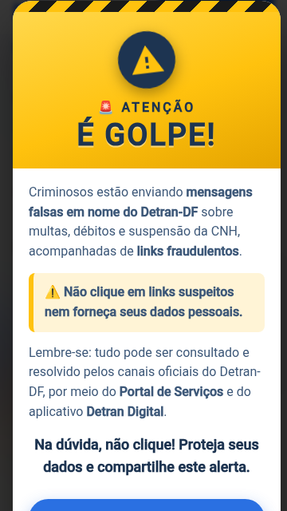{ width="150" } |
| Página inicial após fechar o aviso | { width="260" } | { width="150" } |
| Assistente aberto | { width="260" } | 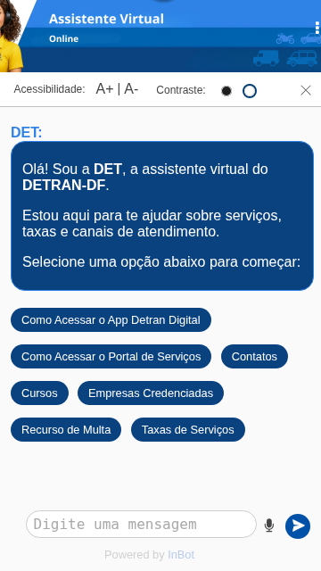{ width="150" } |
| Resposta do assistente | { width="260" } | 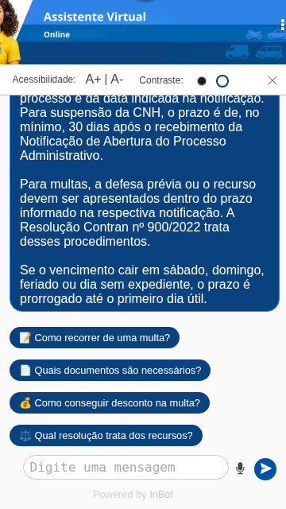{ width="150" } |

**Tabela 9 – Capturas do piloto da T4.** Fonte: Elaborado pelos autores.

### 11.5 Capturas do piloto de T1 a T3 (desktop)

Capturas das telas percorridas no piloto de T1 (Infração), T2 (Atendimento) e T3 (Protocolo), em desktop, com conta de teste. O nome do usuário no cabeçalho e os dados da prévia do documento de T3 estão cobertos. As capturas mostram o estado das telas e **não substituem** o registro de passos, tempo e erros, que será preenchido no piloto com o `registro-tarefas.csv`. Os mesmos limites da Seção 11.4 se aplicam: os dados do piloto não entram nos resultados.

| Tarefa | Etapa | Captura |
| :---: | :--- | :--- |
| T1 | Menu Infração aberto | 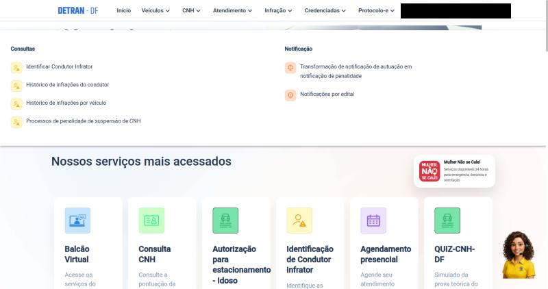{ width="300" } |
| T1 | Histórico de Infrações por Veículo: a tela não lista veículos para a conta de teste | 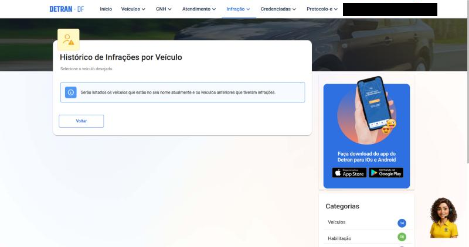{ width="300" } |
| T1 | Mesma tela com janela estreita | 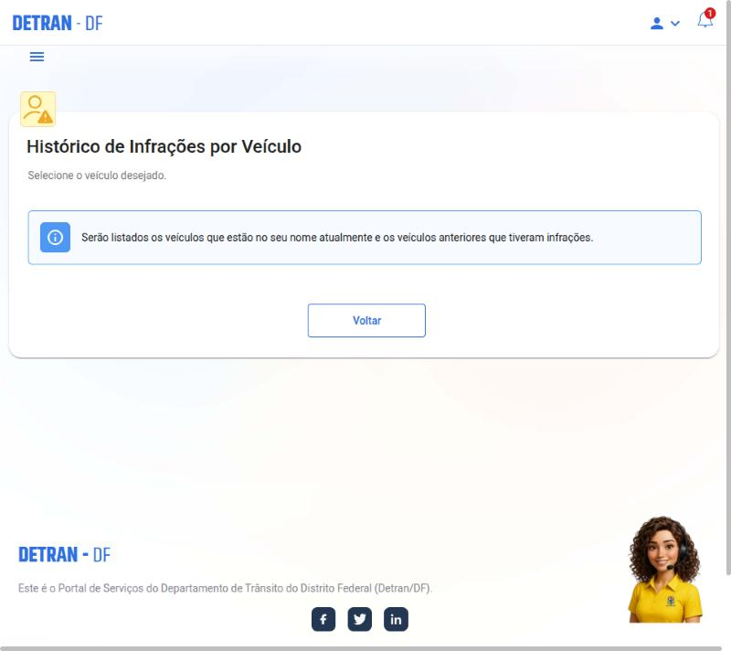{ width="300" } |
| T2 | Entrada do Agendamento (Novo agendamento) | { width="300" } |
| T2 | Formulário vazio | 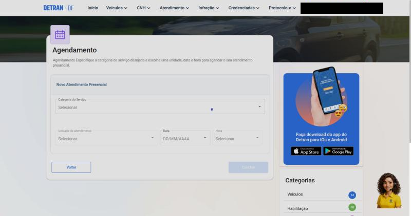{ width="300" } |
| T2 | Lista de categorias, com texto sobreposto | 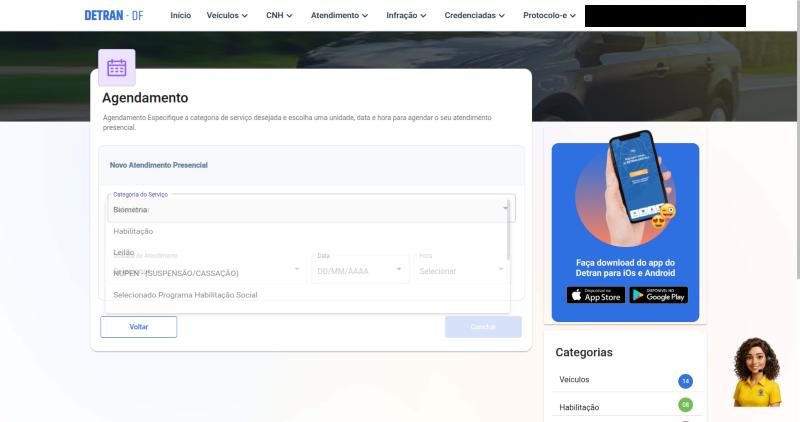{ width="300" } |
| T2 | Categoria Biometria e declaração | 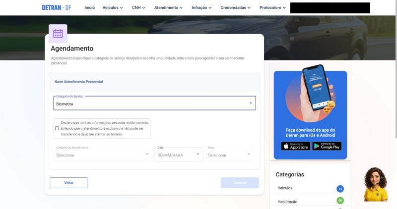{ width="300" } |
| T2 | Lista de unidades | { width="300" } |
| T2 | Lista de datas | 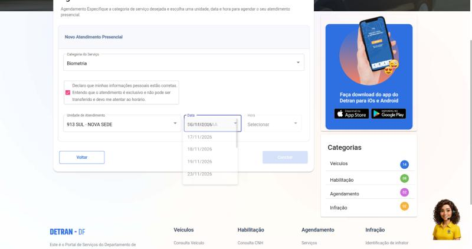{ width="300" } |
| T2 | Lista de horários | { width="300" } |
| T2 | Ponto de parada: formulário preenchido, sem acionar a conclusão | 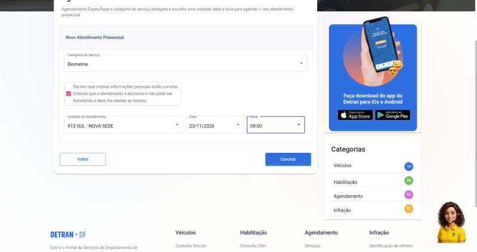{ width="300" } |
| T3 | Menu Protocolo-e | 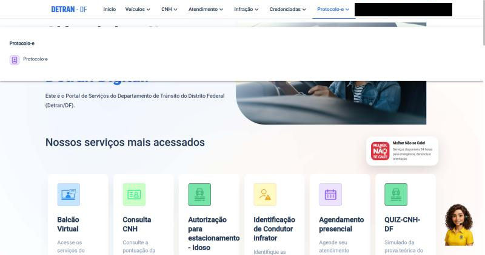{ width="300" } |
| T3 | Home do Protocolo Eletrônico | 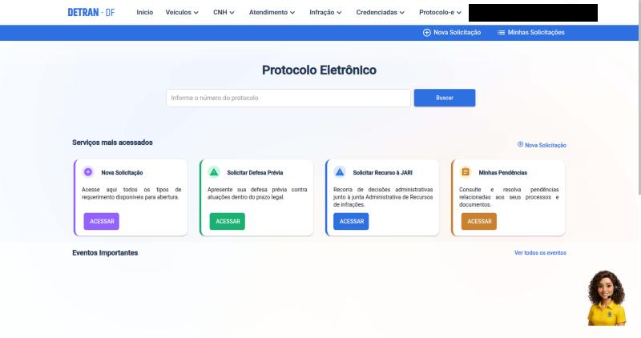{ width="300" } |
| T3 | Nova Solicitação, com as abas de tipo de protocolo | 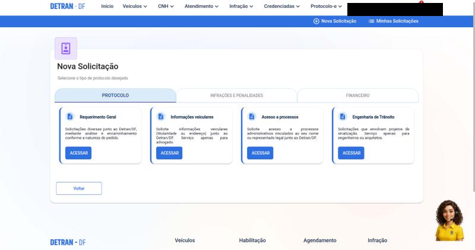{ width="300" } |
| T3 | Requerimento Geral, formulário vazio | 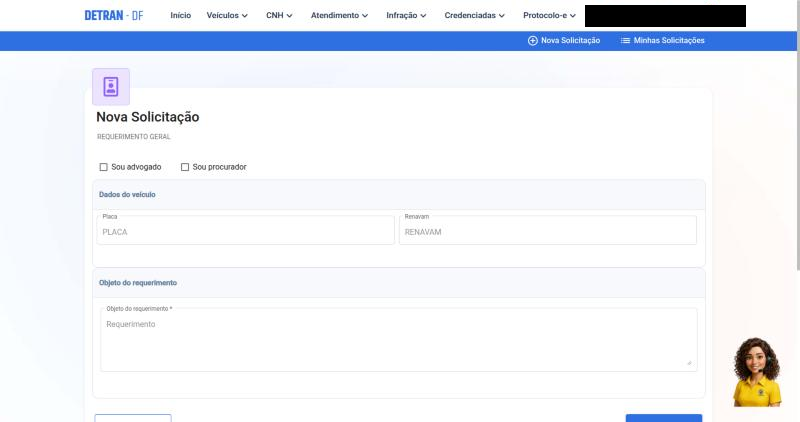{ width="300" } |
| T3 | Formulário preenchido com texto de teste | 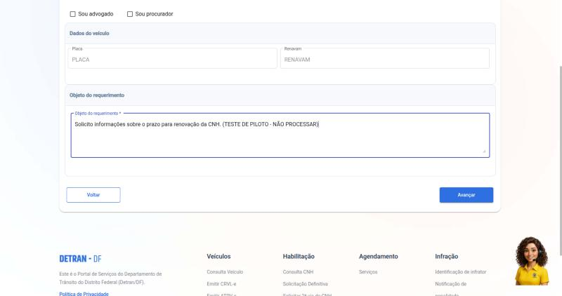{ width="300" } |
| T3 | Prévia do documento (dados cobertos) | 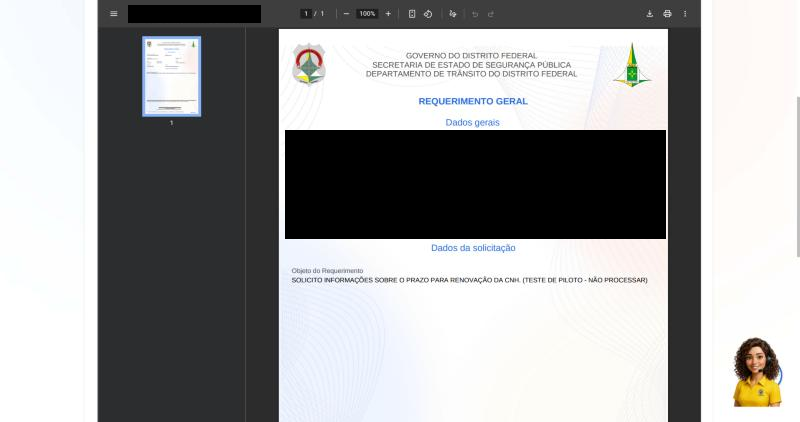{ width="300" } |
| T3 | Ponto de parada: etapa de assinatura, sem assinar | 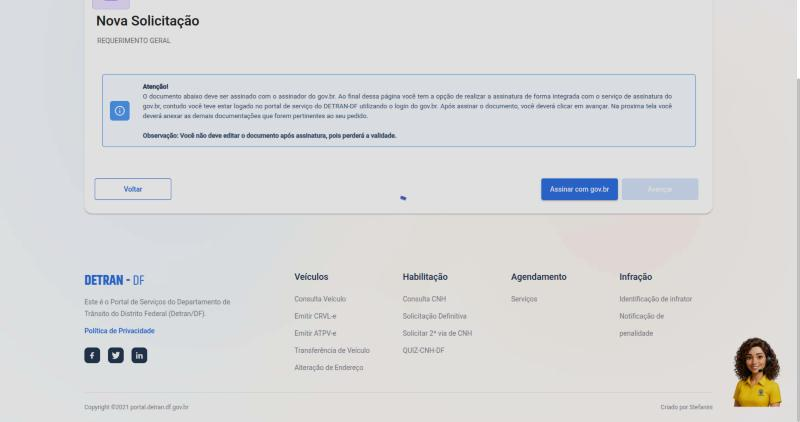{ width="300" } |

**Tabela 10 – Capturas do piloto de T1 a T3.** Fonte: Elaborado pelos autores.

### 11.6 Resultados do piloto de T1 a T3 (desktop)

Execução de 16/11/2026, feita pela equipe com apoio de um assistente de navegador, em conta de teste do gov.br com o login feito antes do início. O aviso "É GOLPE!" da página inicial não foi contado como passo. Os valores servem para validar os instrumentos e **não são resultados da avaliação**.

| Tarefa | Dispositivo | Concluiu | Chegou ao ponto de parada | P_min | Passos executados | Erros espontâneos |
| :---: | :--- | :---: | :---: | :---: | :---: | :--- |
| T1 | Desktop | Não | Não | 8 | 2 | Nenhum de caminho; a tela não listou veículos nem exibiu mensagem de vazio |
| T2 | Desktop | Sim | Sim | 15 | 12 (14 cliques) | 2 cliques sem efeito (Unidade e Data) |
| T3 | Desktop | Sim | Sim | 10 | 6 | Nenhum |
| T1 | Mobile | **Não foi feita** | – | 8 | – | – |

**Tabela 11 – Resultado do piloto de T1 a T3.** Fonte: Elaborado pelos autores. Pedido de auxílio: não, em todas as tarefas. **O tempo das tarefas ainda não foi medido.**

**Passos contra P_min.** Em T2 e T3, os passos ficaram abaixo do P_min (12 contra 15 e 6 contra 10). A diferença é de 3 e de 4 passos. Isso é compatível com o fato de o login contar no P_min (decisão do catálogo) e não ter sido contado no piloto, porque a sessão já estava aberta. O número de passos do login não foi observado, e a diferença não é igual nas duas tarefas, então a explicação precisa ser conferida com os avaliadores que conciliaram o P_min. Nas sessões oficiais, as tarefas T1 a T3 começam sem sessão iniciada e o login conta dos dois lados.

**Achados do piloto** (severidades são sugestões de 0 a 4, não finais; a definição final é feita na inspeção heurística):

| Tarefa | Achado | Heurística | Sugestão |
| :---: | :--- | :---: | :---: |
| T1 | A tela "Histórico de Infrações por Veículo" não lista veículos nem explica o vazio | H1 e H9 | 3 |
| T3 | A prévia do documento exibe dados pessoais do perfil, sem aviso e sem edição (dados cobertos nas capturas) | H3 e H5 | 3 |

**Limitação: conta de teste sem veículo vinculado.** A T1 não pôde ser concluída porque a conta de teste não tem veículo vinculado, e a equipe **não tem como dispor de uma conta com veículo**. A tela não oferece o que a tarefa exige, então, neste ambiente, a lista de infrações e o valor da mais recente não podem ser alcançados. O achado da T1 acima, portanto, não pode ser confirmado com uma conta que tenha veículo. Essa limitação afeta o módulo de Infração na coleta oficial e deve ser registrada nos resultados.

**Limites do piloto.**
- A T1 em mobile **não foi feita**.
- O tempo das tarefas **ainda não foi medido**.
- Não foram pilotados: a sessão completa com o roteiro (e sua duração), a regra de auxílio externo, o SUS e a inspeção heurística com consolidação.

---
