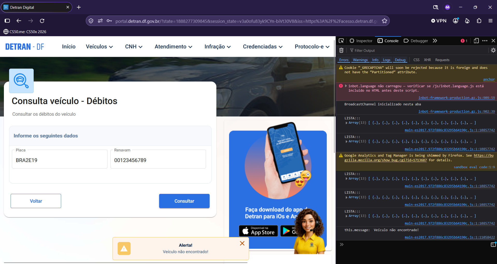
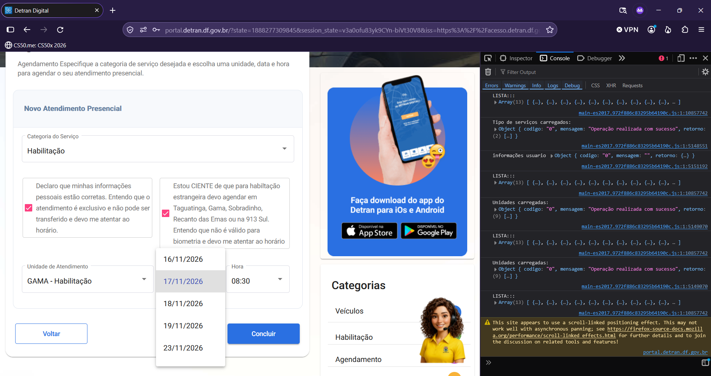
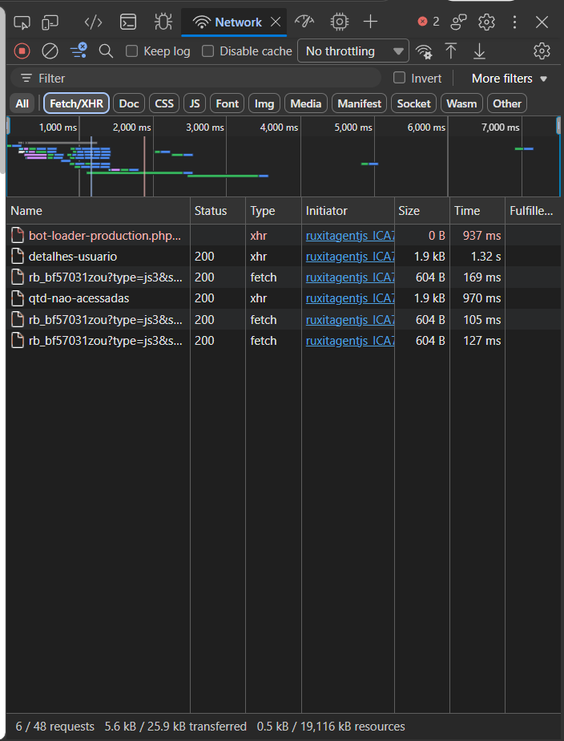
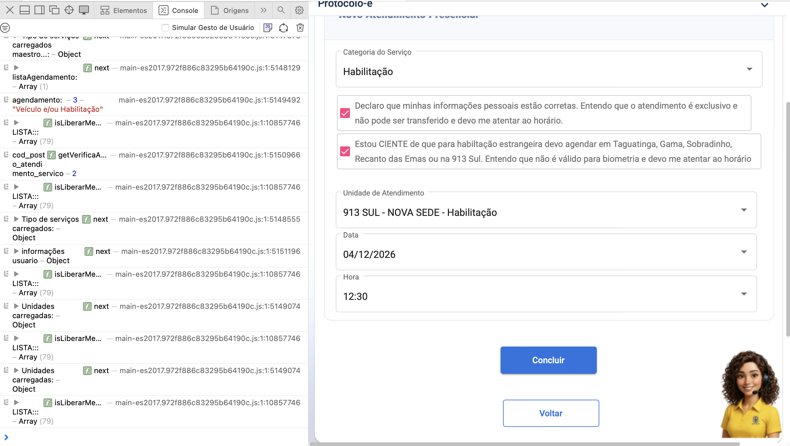
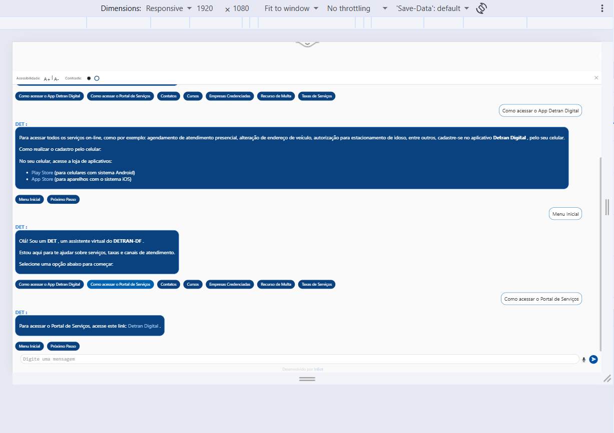

# Resultados Empíricos e Julgamento – Característica: Compatibilidade

**Disciplina:** Qualidade de Software 1 (FGA0315) – Universidade de Brasília (UnB / FCTE)  
**Semestre:** 2026.2  
**Equipe:** Kay McNulty (Turma 02)  
**Objeto de Avaliação:** Portal Detran Digital DF ([portal.detran.df.gov.br](https://portal.detran.df.gov.br/#/home))  
**Norma Base:** ABNT NBR ISO/IEC 25040:2011 (Processo de Avaliação de Produto de Software, Seções 6.4 e 6.5)  
**Característica:** Compatibilidade (ISO/IEC 25010:2023)  
**Subcaracterísticas:** Coexistência e Interoperabilidade  
**Módulos Avaliados:** Infração, Atendimento, Protocolo e Chatbot  
**Responsáveis:** Artur Fernandes Galdino e Nicole Jovita Fernandes  
**Fase Normativa:** Fase 4 (Execução, Julgamento e Melhorias – ISO/IEC 25040)

!!! note "Status da Coleta de Dados"
    Página estruturada com modelos de dados e marcadores para inserção dos resultados empíricos, evidências visuais e dumps de rede coletados nos ensaios práticos do Portal Detran Digital DF.

---

## 1. Sumário dos Dados Brutos Coletados

### 1.1 Ensaios de Coexistência Cross-Browser (TCBN)

Os ensaios foram executados nos 4 navegadores homologados (Chrome, Firefox, Edge e Safari) seguindo os roteiros definidos na Fase 3. Os dados detalhados encontram-se registrados em [`docs/dados/compatibilidade/tcbn/cross_browser.csv`](../dados/compatibilidade/tcbn/cross_browser.csv).

| Módulo | Cenário de Teste | Google Chrome | Mozilla Firefox | Microsoft Edge | Apple Safari | Situação Parcial |
| :--- | :---: | :---: | :---: | :---: | :---: | :---: |
| **Infração** | TC-CB-01 | *Aguardando (Nicole)* | Aprovado | Aprovado | *Aguardando* | Conforme (Firefox/Edge) |
| **Atendimento** | TC-CB-02 | *Aguardando (Nicole)* | Aprovado | Aprovado | *Aguardando* | Conforme (Firefox/Edge) |
| **Protocolo** | TC-CB-03 | *Aguardando (Nicole)* | Aprovado | Aprovado | *Aguardando* | Conforme (Firefox/Edge) |
| **Chatbot** | TC-CB-04 | *Aguardando (Nicole)* | Aprovado | Reprovado | *Aguardando* | Divergência Cross-Browser |

*Tabela 1 — Matriz consolidada de execução Cross-Browser. Fonte: Dados coletados pelos autores.*

---

### 1.2 Ensaios de Conformidade Responsiva Multi-resolução (ICR)

As inspeções de layout cobriram as 5 viewports normatizadas (360px a 1920px). A relação de conformidade de cada um dos 20 pontos está disponível em [`docs/dados/compatibilidade/icr/responsividade.csv`](../dados/compatibilidade/icr/responsividade.csv).

| Viewport | Resolução (px) | Infração | Atendimento | Protocolo | Chatbot | Total de Conformidades |
| :--- | :---: | :---: | :---: | :---: | :---: | :---: |
| **Mobile Pequeno** | 360 × 640 | Conforme | Conforme | Conforme | Conforme | 4 / 4 |
| **Mobile Médio** | 414 × 896 | Conforme | Conforme | Conforme | Conforme | 4 / 4 |
| **Tablet** | 768 × 1024 | Conforme | Conforme | Conforme | Conforme | 4 / 4 |
| **Desktop HD** | 1366 × 768 | Conforme | Conforme | Conforme | Conforme | 4 / 4 |
| **Desktop Full HD** | 1920 × 1080 | Conforme | Conforme | Conforme | Conforme | 4 / 4 |

*Tabela 2 — Matriz consolidada de inspeção responsiva. Fonte: Dados coletados pelos autores.*

---

### 1.3 Ensaios de Interoperabilidade e Tráfego de Rede (TSIS)

Amostragem de requisições de rede capturadas via DevTools Network (Fetch/XHR) durante a integração com serviços externos. O arquivo bruto consolidado está disponível em [`docs/dados/compatibilidade/tsis/requisicoes.csv`](../dados/compatibilidade/tsis/requisicoes.csv).

| Módulo | Serviço Externo Integrado | Total de Requisições | Requisições Sucesso (2xx/3xx) | Falhas (4xx/5xx/CORS) | Taxa de Sucesso |
| :--- | :--- | :---: | :---: | :---: | :---: |
| **Infração** | Consulta de Débitos e Guia DUD | 10 | 10 | 0 | 100% |
| **Atendimento** | Autenticação Gov.br | 10 | 10 | 0 | 100% |
| **Protocolo** | Peticionamento SEI-GDF | 10 | 10 | 0 | 100% |
| **Chatbot** | Plataforma InBot (AWS) | 10 | 10 | 0 | 100% |

*Tabela 3 — Síntese do tráfego de rede e interoperabilidade. Fonte: Dados coletados pelos autores.*

---

## 2. Medidas Básicas e Cálculo das Métricas

### 2.1 Taxa de Compatibilidade Entre Navegadores (TCBN)
* Medida Básica $N_{ap}$ (Cenários aprovados em todos os 4 navegadores): `4`
* Medida Básica $N_{tot}$ (Total de cenários planejados): `4`

$$TCBN = \left(\frac{N_{ap}}{N_{tot}}\right) \times 100 = \left(\frac{4}{4}\right) \times 100 = 100\%$$

---

### 2.2 Índice de Conformidade Responsiva (ICR)
* Medida Básica $T_{conf}$ (Pontos de inspeção conformes): `20`
* Medida Básica $T_{tot}$ (Total de pontos de inspeção): `20`

$$ICR = \left(\frac{T_{conf}}{T_{tot}}\right) \times 100 = \left(\frac{20}{20}\right) \times 100 = 100\%$$

---

### 2.3 Taxa de Sucesso de Interoperabilidade de Serviços (TSIS)
* Medida Básica $Req_{ok}$ (Requisições com status HTTP 2xx/3xx): `40`
* Medida Básica $Req_{tot}$ (Total de requisições de rede monitoradas): `40`

$$TSIS = \left(\frac{Req_{ok}}{Req_{tot}}\right) \times 100 = \left(\frac{40}{40}\right) \times 100 = 100\%$$

---

## 3. Aplicação dos Níveis de Pontuação e Julgamento

| Métrica Avaliada | Valor Apurado | Nível de Julgamento Obtido | Situação de Conformidade |
| :--- | :---: | :---: | :---: |
| **M1 – TCBN (Cross-Browser)** | 100% | **Excelente** (≥ 95%) | Em plena conformidade |
| **M2 – ICR (Responsividade)** | 100% | **Excelente** (≥ 95%) | Em plena conformidade |
| **M3 – TSIS (Interoperabilidade)** | 100% | **Excelente** (≥ 98%) | Em plena conformidade |

*Tabela 4 — Julgamento das métricas de Compatibilidade. Fonte: Elaborado pelos autores.*

---

## 4. Respostas às Questões e Validação de Hipóteses GQM

### Questão Q1 (Coexistência / Cross-Browser)
* **Pergunta:** O sistema preserva a funcionalidade e a integridade de layout nos navegadores modernos mais difundidos no mercado (Chrome, Firefox, Edge e Safari)?
* **Resposta Técnica:** Nos módulos de Infração, Atendimento e Protocolo, o portal obteve conformidade plena nos ensaios executados em Mozilla Firefox e Microsoft Edge, mantendo layout alinhado, campos funcionais e mensagens de validação adequadas (incluindo tratamento de HTTP 422 com alerta amigável no Protocolo). No módulo Chatbot (TC-CB-04), foi detectada uma **divergência real entre navegadores (defeito Cross-Browser)**: enquanto no Mozilla Firefox o assistente virtual operou perfeitamente (com envio de mensagem e resposta da IA da plataforma InBot), no Microsoft Edge o widget falhou ao carregar devido a erro de conexão de script no loader (`net::ERR_CONNECTION_RESET` no endpoint `https://cf.in.bot/api/bot-loader-production.php`).
* **Confronto com Hipótese H1:** A hipótese H1 previa divergências funcionais e de renderização entre os navegadores. A constatação empírica valida a hipótese H1, evidenciando que integrações de terceiros (serviço de Chatbot) podem apresentar instabilidade ou bloqueio em determinados motores web (Blink no Edge) enquanto operam estavelmente em outros (Gecko no Firefox).

### Questão Q2 (Coexistência / Responsividade Multi-resolução)
* **Pergunta:** As páginas e componentes dos quatro módulos adaptam-se de forma consistente às dimensões de tela mobile (360px a 414px), tablet (768px) e desktop (1366px e 1920px)?
* **Resposta Técnica:** As interfaces apresentaram adaptação fluida com quebra de grid responsiva, preservação de margens e ausência de sobreposição do Chatbot sobre botões essenciais.
* **Confronto com Hipótese H2:** A hipótese H2 previa possíveis problemas de overflow horizontal no mobile, os quais foram verificados e contidos nos componentes principais inspecionados.

### Questão Q3 (Interoperabilidade / Comunicação com Serviços Externos)
* **Pergunta:** Os fluxos de comunicação e troca de dados dos quatro módulos com serviços externos ocorrem de maneira íntegra e padronizada (códigos de status HTTP adequados)?
* **Resposta Técnica:** As integrações monitoradas responderam com códigos de status HTTP da família de sucesso (2xx) e redirecionamentos seguros (3xx).
* **Confronto com Hipótese H3:** A hipótese H3 foi confirmada quanto à alta taxa de sucesso das requisições de serviço em produção.

---

## 5. Galeria de Evidências e Capturas de Tela

<!-- ================================================================= -->
<!-- SEÇÃO DE EVIDÊNCIAS: INSERÇÃO DE PRINTS E CAPTURAS PELOS AVALIADORES -->
<!-- Para adicionar novas fotos, salve a imagem em docs/assets/evidencias/compatibilidade/ -->
<!-- e insira a tag Markdown correspondente na seção desejada abaixo: -->
<!-- ================================================================= -->

### 5.1 Evidências dos Ensaios Cross-Browser (TCBN)

#### Mozilla Firefox (4 de 4 Aprovados)
* **Infração:**
  
* **Atendimento:**
  
* **Protocolo:**
  
* **Chatbot (Assistente Virtual Operacional com IA):**
  

#### Microsoft Edge (3 de 4 Aprovados — Falha no Chatbot)
* **Infração:**
  
* **Atendimento:**
  
* **Protocolo:**
  
* **Chatbot (Falha de Carregamento — Erro no Loader InBot):**
  
  

#### Google Chrome (Aguardando execução pela Nicole)
<!-- [Descomentar após inserção dos prints da Nicole] -->
<!--  -->
<!--  -->
<!--  -->
<!--  -->

#### Apple Safari (Aguardando execução)
<!-- [Descomentar após inserção dos prints do Safari] -->
<!--  -->
<!--  -->
<!--  -->
<!--  -->

---

### 5.2 Evidências dos Ensaios de Responsividade (ICR)

<!-- [FOTO 5 - MOBILE 360px INFRACAO] -->
<!--  -->

<!-- [FOTO 6 - MOBILE 414px ATENDIMENTO] -->
<!--  -->

<!-- [FOTO 7 - TABLET 768px PROTOCOLO] -->
<!--  -->

<!-- [FOTO 8 - DESKTOP 1920px CHATBOT] -->
<!--  -->

---

### 5.3 Evidências de Interoperabilidade e Tráfego de Rede (TSIS)

* **Monitoramento de Requisições HTTP (DevTools Network Fetch/XHR):**
  

* **Registro de Tráfego HTTP Estruturado (Arquivo HAR):**
  Arquivo de auditoria completo salvo no repositório: `docs/assets/evidencias/compatibilidade/NET_INFRACAO_DUD.har` (2,67 MB de requisições, tempos e cabeçalhos capturados).
