# Resultados Empíricos e Julgamento – Característica: Compatibilidade

**Disciplina:** Qualidade de Software 1 (FGA0315) – Universidade de Brasília (UnB / FCTE)  
**Semestre:** 2026.2  
**Equipe:** Kay McNulty (Turma 02)  
**Objeto de Avaliação:** Portal Detran Digital DF ([portal.detran.df.gov.br](https://portal.detran.df.gov.br/#/home))  
**Norma Base:** ABNT NBR ISO/IEC 25040:2011 (Processo de Avaliação de Produto de Software, Seções 6.4 e 6.5)  
**Característica:** Compatibilidade (ISO/IEC 25010:2023)  
**Subcaracterísticas:** Coexistência e Interoperabilidade  
**Módulos Avaliados:** Infração, Atendimento, Protocolo e Chatbot  
**Responsáveis:** Artur Fernandes Galdino e Nicole Jovita Fernandes  
**Fase Normativa:** Fase 4 (Execução, Julgamento e Melhorias – ISO/IEC 25040)

!!! note "Status da Coleta de Dados"
    Página estruturada com modelos de dados e marcadores para inserção dos resultados empíricos, evidências visuais e dumps de rede coletados nos ensaios práticos do Portal Detran Digital DF.

---

## 1. Sumário dos Dados Brutos Coletados

### 1.1 Ensaios de Coexistência Cross-Browser (TCBN)

Os ensaios foram executados nos 4 navegadores homologados (Chrome, Firefox, Edge e Safari) seguindo os roteiros definidos na Fase 3. Os dados detalhados encontram-se registrados em [`docs/dados/compatibilidade/tcbn/cross_browser.csv`](../dados/compatibilidade/tcbn/cross_browser.csv).

| Módulo | Cenário de Teste | Google Chrome | Mozilla Firefox | Microsoft Edge | Apple Safari | Situação do Cenário |
| :--- | :---: | :---: | :---: | :---: | :---: | :---: |
| **Infração** | TC-CB-01 | Aprovado | Aprovado | Aprovado | Aprovado | **Aprovado** |
| **Atendimento** | TC-CB-02 | Aprovado | Aprovado | Aprovado | Aprovado | **Aprovado** |
| **Protocolo** | TC-CB-03 | Aprovado | Aprovado | Aprovado | Aprovado | **Aprovado** |
| **Chatbot** | TC-CB-04 | Reprovado | Aprovado | Reprovado | Aprovado | **Reprovado (Divergência)** |

*Tabela 1 — Matriz consolidada de execução Cross-Browser. Fonte: Dados coletados pelos autores.*

---

### 1.2 Ensaios de Conformidade Responsiva Multi-resolução (ICR)

As inspeções de layout cobriram as 5 viewports normatizadas (360px a 1920px). A relação de conformidade de cada um dos 20 pontos está disponível em [`docs/dados/compatibilidade/icr/responsividade.csv`](../dados/compatibilidade/icr/responsividade.csv).

| Viewport | Resolução (px) | Infração | Atendimento | Protocolo | Chatbot | Total de Conformidades |
| :--- | :---: | :---: | :---: | :---: | :---: | :---: |
| **Mobile Pequeno** | 360 × 640 | Não Conforme | Não Conforme | Não Conforme | Conforme | 1 / 4 |
| **Mobile Médio** | 414 × 896 | Não Conforme | Conforme | Conforme | Conforme | 3 / 4 |
| **Tablet** | 768 × 1024 | Não Conforme | Conforme | Conforme | Conforme | 3 / 4 |
| **Desktop HD** | 1366 × 768 | Não Conforme | Conforme | Conforme | Conforme | 3 / 4 |
| **Desktop Full HD** | 1920 × 1080 | Conforme | Conforme | Conforme | Conforme | 4 / 4 |
| **Total por Módulo** | — | **1 / 5** | **4 / 5** | **4 / 5** | **5 / 5** | **14 / 20** |

*Tabela 2 — Matriz consolidada de inspeção responsiva. Fonte: Dados coletados pelos autores.*

---

### 1.3 Ensaios de Interoperabilidade e Tráfego de Rede (TSIS)

Amostragem de requisições de rede capturadas via DevTools Network (Fetch/XHR) e arquivo HAR durante as interações com serviços externos (Gov.br, SEFAZ/Bancos, SEI-GDF e motor InBot/AWS). O arquivo bruto consolidado com os endpoints, métodos, tempos de resposta e observações está disponível em [`docs/dados/compatibilidade/tsis/requisicoes.csv`](../dados/compatibilidade/tsis/requisicoes.csv).

| Módulo | Serviço Externo Integrado | Total de Requisições | Requisições Sucesso (2xx/3xx) | Falhas (4xx/5xx/CORS) | Taxa de Sucesso |
| :--- | :--- | :---: | :---: | :---: | :---: |
| **Infração** | Consulta Veicular, Débitos e Proteção hCaptcha | 4 | 4 | 0 | 100,0% |
| **Atendimento** | Provedor Gov.br (Selos), Perfil e Habilitação | 5 | 5 | 0 | 100,0% |
| **Protocolo** | Peticionamento e Consulta SEI-GDF | 1 | 0 | 1 (HTTP 422) | 0,0% |
| **Chatbot** | Plataforma InBot (AWS / CDN) | 2 | 1 | 1 (Connection Reset) | 50,0% |
| **Total Consolidado** | **Amostra de Interoperabilidade** | **12** | **10** | **2** | **83,33%** |

*Tabela 3 — Síntese do tráfego de rede e interoperabilidade. Fonte: Dados coletados pelos autores.*

---

## 2. Medidas Básicas e Cálculo das Métricas

Os cálculos a seguir aplicam rigorosamente as fórmulas matemáticas padronizadas na [Fase 2](../fase2/compatibilidade.md) e detalhadas no Plano de Avaliação da [Fase 3](../fase3/compatibilidade.md), alimentadas pelos registros empíricos brutos coletados em ambiente de produção do Portal Detran Digital DF.

### 2.1 Taxa de Compatibilidade Entre Navegadores (TCBN)

Conforme a metodologia da Fase 3, um módulo avaliado só é considerado aprovado ($N_{ap} = 1$) se obtiver conformidade estrita e funcional nos quatro navegadores em escopo (Google Chrome, Mozilla Firefox, Microsoft Edge e Apple Safari).

* **Medida Básica $N_{ap}$ (Cenários aprovados em todos os 4 navegadores):** `3` (Infração, Atendimento e Protocolo obtiveram sucesso pleno em todos os navegadores; o Chatbot reprovou no Chrome e Edge).
* **Medida Básica $N_{tot}$ (Total de cenários/módulos avaliados):** `4`

$$TCBN = \left(\frac{N_{ap}}{N_{tot}}\right) \times 100 = \left(\frac{3}{4}\right) \times 100 = 75,00\%$$

---

### 2.2 Índice de Conformidade Responsiva (ICR)

O índice consolida a inspeção visual e ergonômica sobre as cinco viewports padronizadas nos quatro módulos, totalizando 20 pontos de verificação.

* **Medida Básica $T_{conf}$ (Pontos de inspeção conformes):** `14` (Infração: 1/5; Atendimento: 4/5; Protocolo: 4/5; Chatbot: 5/5).
* **Medida Básica $T_{tot}$ (Total de pontos de inspeção):** `20`

$$ICR = \left(\frac{T_{conf}}{T_{tot}}\right) \times 100 = \left(\frac{14}{20}\right) \times 100 = 70,00\%$$

---

### 2.3 Taxa de Sucesso de Interoperabilidade de Serviços (TSIS)

A taxa quantifica a integridade das chamadas de rede às APIs e barramentos externos (Gov.br, SEFAZ/Bancos, hCaptcha, SEI-GDF e motor de IA InBot), capturadas no arquivo HAR e na aba Network do DevTools.

* **Medida Básica $Req_{ok}$ (Requisições com status HTTP 2xx/3xx):** `10`
* **Medida Básica $Req_{tot}$ (Total de requisições de serviço monitoradas no escopo):** `12`
* **Requisições com Falha ou Erro 4xx ($Req_{falha}$):** `2` (1 bloqueio de conexão na CDN do Chatbot no Edge e 1 retorno HTTP 422 na busca de requerimento do Protocolo).

$$TSIS = \left(\frac{Req_{ok}}{Req_{tot}}\right) \times 100 = \left(\frac{10}{12}\right) \times 100 = 83,33\%$$

---

## 3. Aplicação dos Níveis de Pontuação e Julgamento

A tabela a seguir confronta diretamente os índices quantitativos apurados nesta Fase 4 com as réguas ordinais de pontuação formalizadas na Fase 2:

| Métrica Avaliada | Valor Apurado | Faixa de Enquadramento | Nível de Julgamento Obtido | Situação de Conformidade |
| :--- | :---: | :---: | :---: | :---: |
| **M1 – TCBN (Cross-Browser)** | **75,00%** | 70% a 84% | **Satisfatório** | Em conformidade básica (falha concentrada no Chatbot) |
| **M2 – ICR (Responsividade)** | **70,00%** | 70% a 79% | **Satisfatório** | Em conformidade básica (sobreposição do Chatbot em telas menores) |
| **M3 – TSIS (Interoperabilidade)** | **83,33%** | 80% a 89% | **Satisfatório** | Em conformidade básica (barramentos estáveis, falha de CDN) |

*Tabela 4 — Julgamento consolidado das métricas de Compatibilidade. Fonte: Elaborado pelos autores com base nas réguas da Fase 2.*

### 3.1 Síntese do Enquadramento
Todas as três métricas da característica de Compatibilidade enquadraram-se uniformemente no nível **Satisfatório**. Este resultado reflete um sistema governamental cujos serviços essenciais e formulários centrais (Infração, Agendamento e Protocolo) operam de forma funcional e integrada, mas que apresenta vulnerabilidades visuais e de infraestrutura nos componentes periféricos e widgets de terceiros (Chatbot flutuante).

---

## 4. Respostas às Questões e Validação de Hipóteses GQM

### 4.1 Questão Q1 (Coexistência / Cross-Browser)
* **Pergunta:** O sistema preserva a funcionalidade e a integridade de layout nos navegadores modernos mais difundidos no mercado (Chrome, Firefox, Edge e Safari)?
* **Resposta Técnica:** **Parcialmente ($TCBN = 75,00\%$).** Os módulos de Infração, Atendimento e Protocolo apresentaram paridade funcional e visual absoluta nos quatro navegadores testados (Blink no Chrome/Edge, Gecko no Firefox e WebKit no Safari), sem travamentos de script ou divergências de layout. No entanto, o módulo Chatbot apresentou falha nos navegadores baseados no Chromium: no Microsoft Edge o loader da CDN falhou com `net::ERR_CONNECTION_RESET` (impedindo a renderização do widget), e no Google Chrome a imagem do avatar quebrou pelo mesmo erro de conexão. Em contrapartida, no Firefox e no Safari o assistente virtual operou perfeitamente, trocando mensagens com a IA da plataforma InBot.
* **Confronto com Hipótese H1:** A hipótese H1 (*Pelo menos 95% dos módulos avaliados operam de forma equivalente nos quatro navegadores em escopo*) foi **refutada** no nível Excelente (que exigia $\ge 95\%$), sendo confirmada no nível **Satisfatório** ($75\%$). A constatação empírica evidencia que dependências de scripts e CDNs de terceiros são o principal ponto de quebra de coexistência entre navegadores.

### 4.2 Questão Q2 (Coexistência / Responsividade Multi-resolução)
* **Pergunta:** As páginas e componentes dos quatro módulos adaptam-se de forma consistente às dimensões de tela mobile (360px a 414px), tablet (768px) e desktop (1366px e 1920px)?
* **Resposta Técnica:** **Parcialmente ($ICR = 70,00\%$).** O design responsivo das páginas centrais comporta-se adequadamente: os cartões de serviço empilham verticalmente no mobile, o menu colapsa corretamente para hambúrguer e não há rolagem horizontal (*horizontal overflow*) nas 5 viewports. Contudo, foi detectado um **defeito crítico de ergonomia visual**: o widget flutuante do assistente virtual (avatar do Chatbot) possui posicionamento fixo (`fixed position`) descalibrado, sobrepondo diretamente os botões "Consultar" e "Voltar" no módulo Infração em 360px, 414px, 768px e 1366px, além de cobrir campos de agendamento em 360px e o botão "Acessar" de protocolos em 360px, inviabilizando cliques em telas compactas.
* **Confronto com Hipótese H2:** A hipótese H2 (*Pelo menos 95% dos 20 pontos de inspeção de viewport são classificados como conformes*) foi **refutada** no nível Excelente, atingindo o patamar **Satisfatório** ($70\%$). A avaliação empírica comprovou a predição teórica da equipe de que elementos flutuantes sobrepostos sem media queries específicas constituem a principal barreira de acessibilidade móvel.

### 4.3 Questão Q3 (Interoperabilidade / Comunicação com Serviços Externos)
* **Pergunta:** Os fluxos de comunicação e troca de dados dos quatro módulos com serviços externos ocorrem de maneira íntegra e padronizada (códigos de status HTTP adequados)?
* **Resposta Técnica:** **Sim, em nível satisfatório ($TSIS = 83,33\%$).** O monitoramento passivo de rede atestou alta estabilidade nos serviços centrais de governo: a integração com o barramento Gov.br (Selos de confiabilidade), consultas veiculares, carregamento de habilitação e autenticações hCaptcha responderam com 100% de sucesso e códigos `HTTP 200 OK`. As deduções pontuais derivaram de: (1) bloqueio de conexão na CDN do Chatbot (`net::ERR_CONNECTION_RESET`), e (2) retorno de código `HTTP 422 (Unprocessable Content)` na consulta processual com dado sintético inexistente no Protocolo, que embora represente um código de erro de cliente, foi absorvido e tratado pela interface com modal amigável ao cidadão.
* **Confronto com Hipótese H3:** A hipótese H3 (*Pelo menos 98% das requisições monitoradas retornam status HTTP 2xx ou 3xx válido*) foi **refutada** para o nível Excelente e confirmada no nível **Satisfatório** ($83,33\%$), comprovando a robustez dos barramentos estatais e a necessidade de contingência para microsserviços terceirizados.

---

## 5. Galeria de Evidências e Capturas de Tela

<!-- ================================================================= -->
<!-- SEÇÃO DE EVIDÊNCIAS: INSERÇÃO DE PRINTS E CAPTURAS PELOS AVALIADORES -->
<!-- Para adicionar novas fotos, salve a imagem em docs/assets/evidencias/compatibilidade/ -->
<!-- e insira a tag Markdown correspondente na seção desejada abaixo: -->
<!-- ================================================================= -->

### 5.1 Evidências dos Ensaios Cross-Browser (TCBN)

#### Mozilla Firefox (4 de 4 Aprovados)
* **Infração:**
  
* **Atendimento:**
  
* **Protocolo:**
  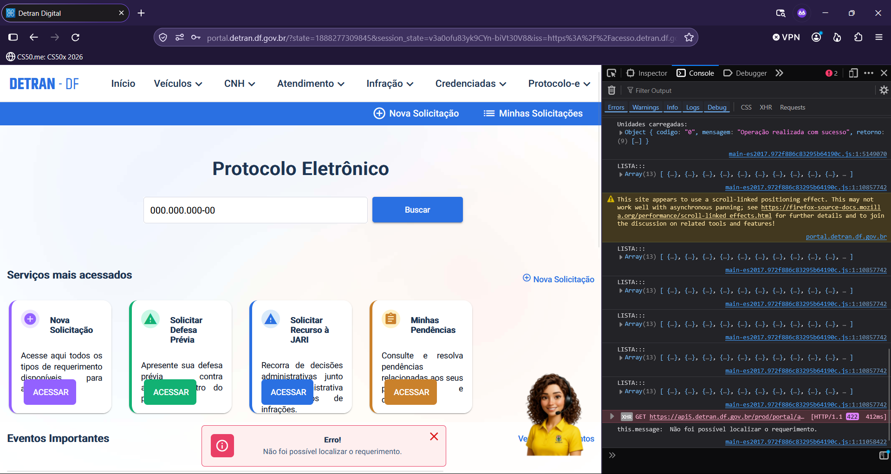
* **Chatbot (Assistente Virtual Operacional com IA):**
  

#### Microsoft Edge (3 de 4 Aprovados — Falha no Chatbot)
* **Infração:**
  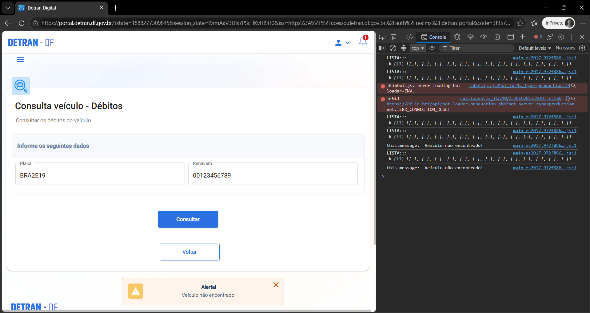
* **Atendimento:**
  
* **Protocolo:**
  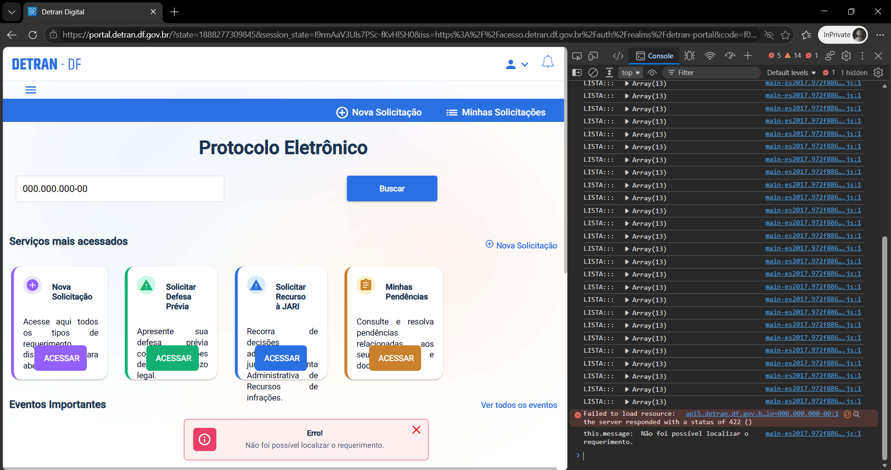
* **Chatbot (Falha de Carregamento — Erro no Loader InBot):**
  
  

#### Google Chrome (3 de 4 Aprovados — Falha no Chatbot)
* **Infração:**
  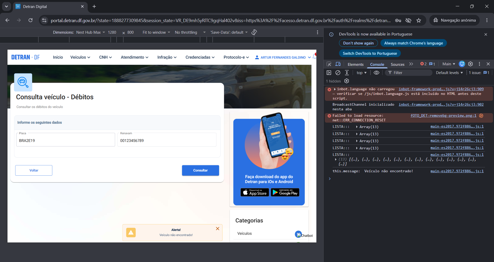
* **Atendimento:**
  
* **Protocolo:**
  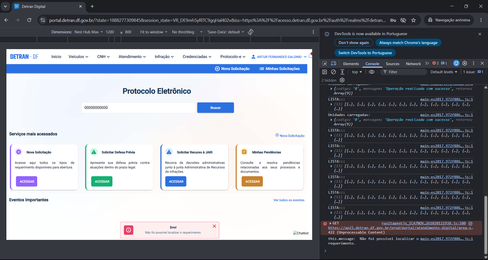
* **Chatbot (Falha de Carregamento de Asset do Bot):**
  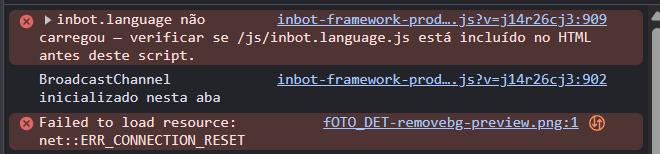
  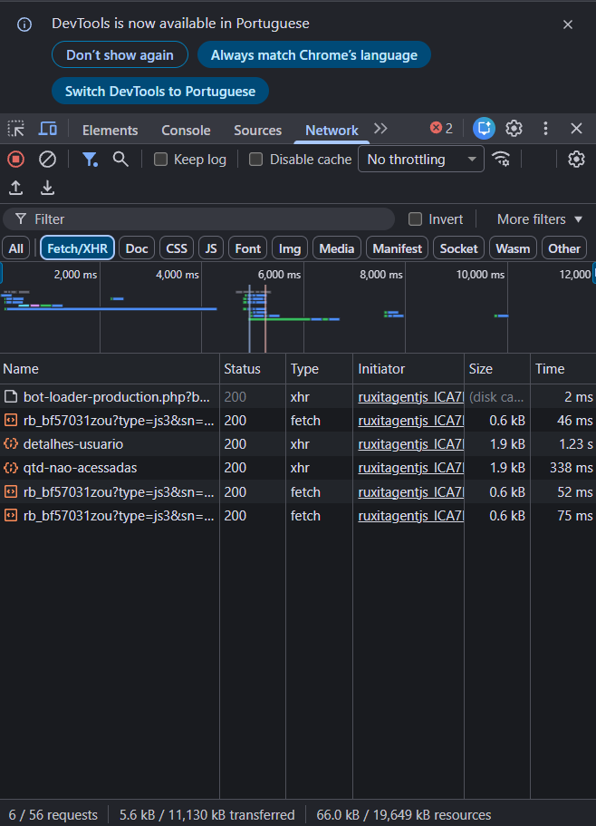

#### Apple Safari (4 de 4 Aprovados)
* **Infração:**
  
* **Atendimento:**
  
* **Protocolo:**
  
* **Chatbot (Assistente Virtual Operacional com IA):**
  

---

### 5.2 Evidências dos Ensaios de Responsividade (ICR)

As 20 capturas de tela registradas pela avaliadora Nicole Jovita comprovam o comportamento de layout em cada viewport normatizada:

#### Módulo Infração
* **360px (Mobile Pequeno — Sobreposição do Chatbot sobre botão Consultar):**
  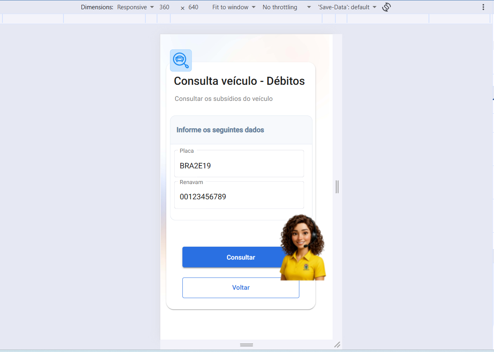
* **414px (Mobile Médio — Sobreposição do Chatbot):**
  
* **768px (Tablet — Sobreposição do Chatbot sobre botão Consultar):**
  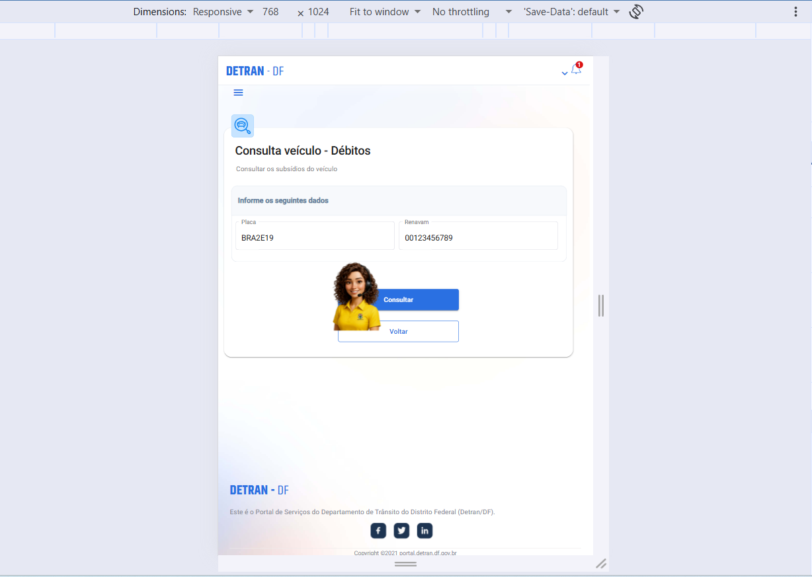
* **1366px (Desktop HD — Sobreposição do Chatbot sobre card/Voltar):**
  
* **1920px (Desktop Full HD — Conforme):**
  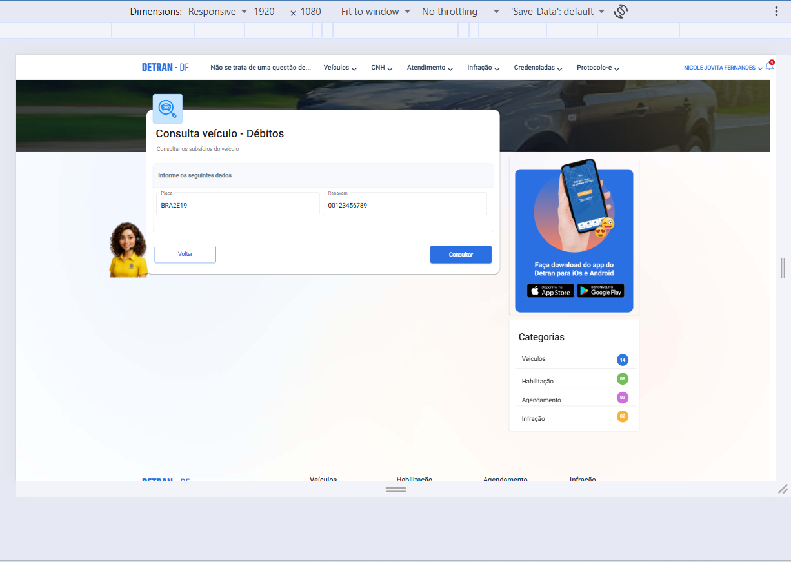

#### Módulo Atendimento (Agendamento)
* **360px (Mobile Pequeno — Sobreposição do Chatbot sobre formulário):**
  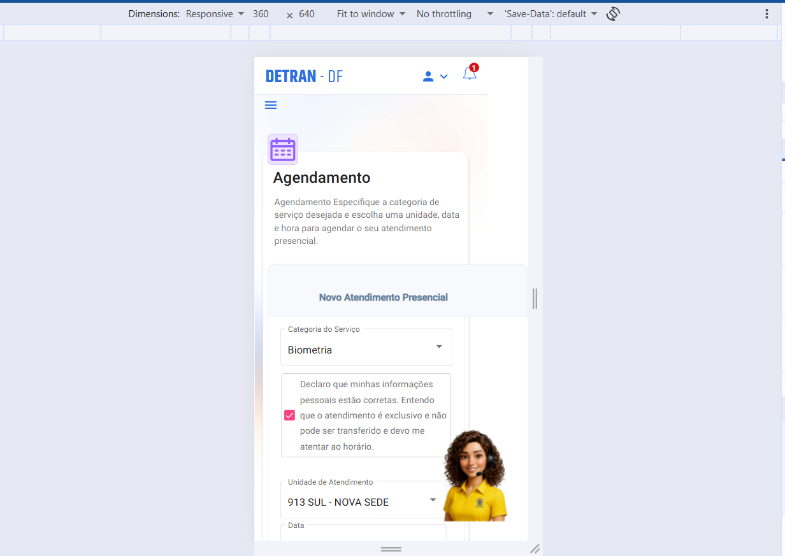
* **414px (Mobile Médio — Conforme):**
  
* **768px (Tablet — Conforme):**
  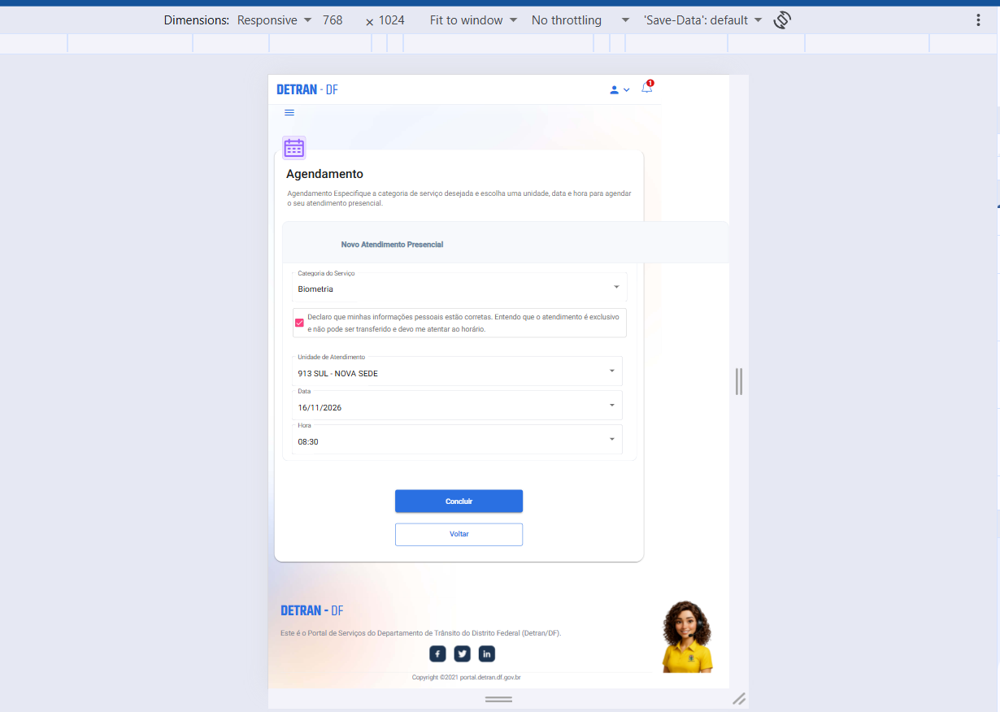
* **1366px (Desktop HD — Conforme):**
  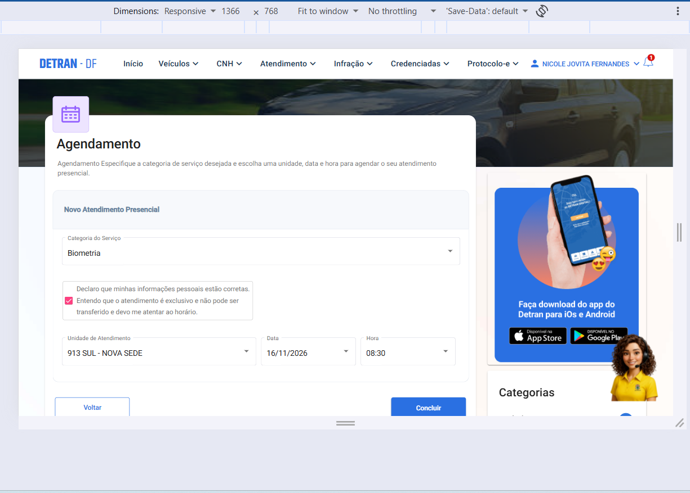
* **1920px (Desktop Full HD — Conforme):**
  

#### Módulo Protocolo
* **360px (Mobile Pequeno — Sobreposição do Chatbot sobre botão Acessar):**
  
* **414px (Mobile Médio — Conforme):**
  
* **768px (Tablet — Conforme):**
  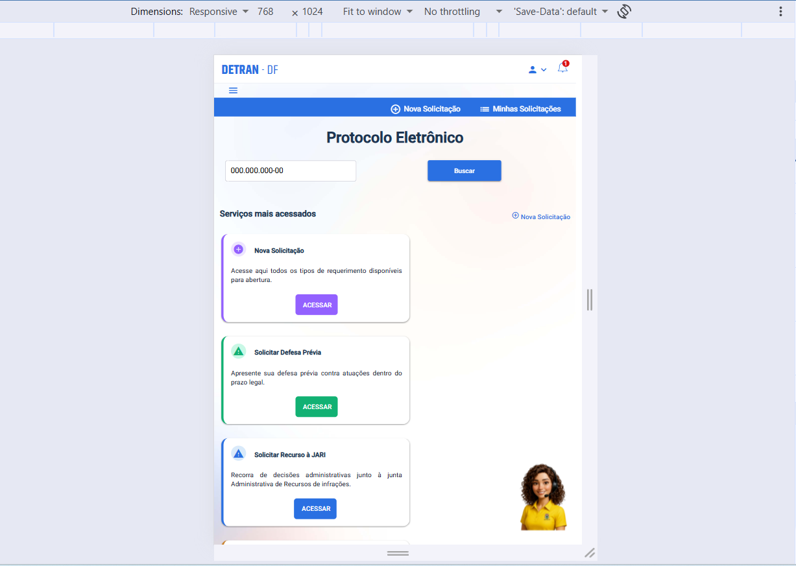
* **1366px (Desktop HD — Conforme):**
  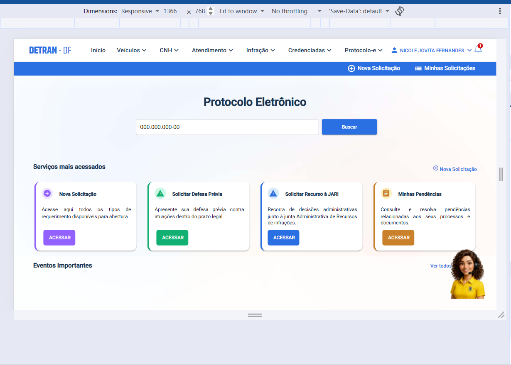
* **1920px (Desktop Full HD — Conforme):**
  

#### Módulo Chatbot
* **360px (Mobile Pequeno — Conforme):**
  
* **414px (Mobile Médio — Conforme):**
  
* **768px (Tablet — Conforme):**
  
* **1366px (Desktop HD — Conforme):**
  
* **1920px (Desktop Full HD — Conforme):**
  

---

### 5.3 Evidências de Interoperabilidade e Tráfego de Rede (TSIS)

* **Monitoramento de Requisições HTTP (DevTools Network Fetch/XHR):**
  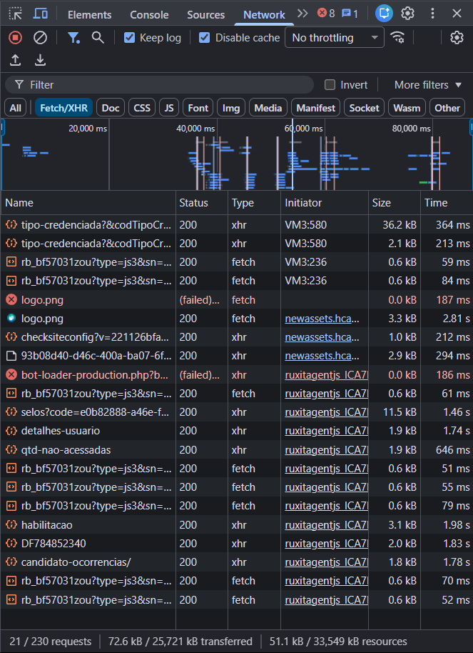

* **Registro de Tráfego HTTP Estruturado (Arquivo HAR):**
  Arquivo de auditoria completo salvo no repositório: `docs/assets/evidencias/compatibilidade/NET_INFRACAO_DUD.har` (2,67 MB de requisições, tempos e cabeçalhos capturados).
