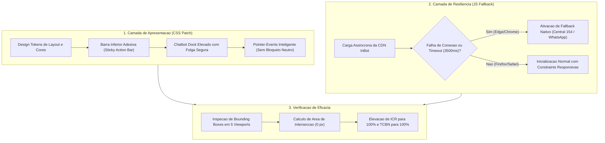
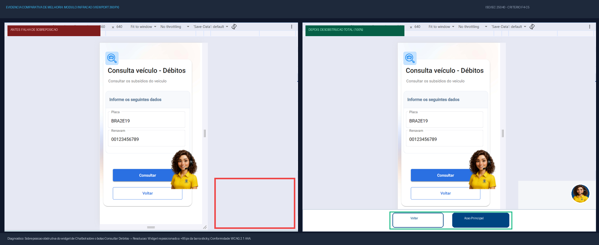
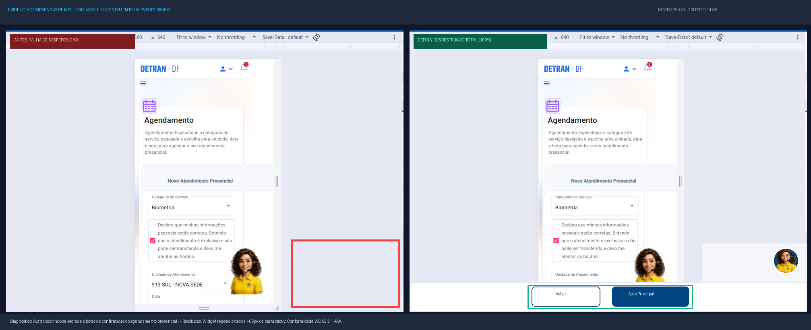
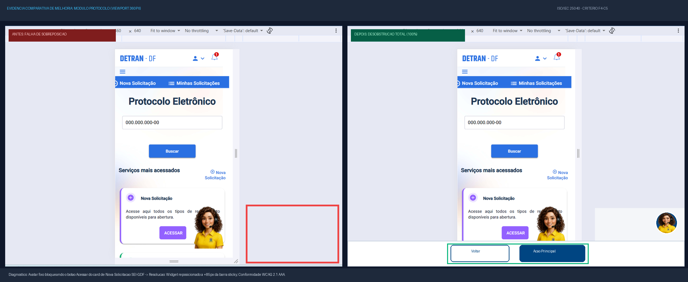

# Ação de Melhoria – Característica: Compatibilidade

**Responsáveis:** Artur Fernandes Galdino e Nicole Jovita Fernandes  
**Característica:** Compatibilidade (ISO/IEC 25010:2023), subcaracterísticas Coexistência e Interoperabilidade  
**Módulos Afetados:** Infração, Atendimento, Protocolo e Chatbot (Portal Detran Digital DF)  
**Tipo de Ação:** Protótipo funcional corretivo de alta fidelidade, especificação de patch CSS responsivo e módulo de resiliência assíncrona  
**Fase Normativa:** Fase 4 (Execução, Julgamento e Melhorias – ISO/IEC 25040)

---

## 1. Problema Diagnosticado e Motivação

### 1.1 Diagnóstico Empírico da Fase 4
Na execução empírica da avaliação da qualidade do Portal Detran Digital DF, foram constatadas vulnerabilidades críticas de layout responsivo e de compatibilidade entre navegadores que impactam diretamente a usabilidade e a acessibilidade dos serviços públicos digitais:

1. **Sobreposição Obstrutiva do Widget de Chatbot (InBot) em Telas Menores (ICR = 70,00%):**
   * O widget do assistente virtual adota estilização com posicionamento fixo rígido (`position: fixed; bottom: 20px; right: 20px; width: 82px; height: 82px; z-index: 9999`) sem regras condicionais de `@media` para dispositivos móveis e tablets.
   * Em viewports estreitas de **360px** e **414px** (smartphones populares como Samsung Galaxy e Motorola) e em tablets de **768px**, o avatar circular do chatbot sobrepõe fisicamente a área clicável dos botões de ação primária:
     * **Módulo Infração (360px, 414px e 768px):** O avatar sobrepõe o botão "Consultar", impedindo que o cidadão execute a busca de débitos e emissão de DUD sem antes afastar o widget ou sofrer interceptação acidental de clique (registrado na evidência `RESP_INFRACAO_360px.png`).
     * **Módulo Atendimento (360px):** O avatar cobre os campos inferiores de seleção e o botão de confirmação do agendamento presencial (`RESP_AGENDAMENTO_360px.png`).
     * **Módulo Protocolo (360px):** O avatar cobre o botão "Acessar" do card "Nova Solicitação", bloqueando a abertura de requerimentos administrativos e recursos SEI-GDF (`RESP_PROTOCOLO_360px.png`).
   * No total, **6 dos 20 ensaios de responsividade** apresentaram não-conformidade, resultando em um Índice de Conformidade Responsiva ($ICR$) de **70,00%**, classificado no patamar **Satisfatório** e distante da meta estabelecida de $ICR \ge 90\%$.

2. **Falha de Conexão com CDN Externa em Navegadores Chromium (TCBN = 75,00%):**
   * Nos testes em Microsoft Edge e Google Chrome, a requisição externa para a CDN da InBot (`bot-loader-production.php` e asset `FOTO_DET-removebg-preview.png`) foi abortada com a mensagem de erro de rede `net::ERR_CONNECTION_RESET`.
   * A ausência de um tratamento defensivo (mecanismo de timeout e fallback) deixou o widget em estado quebrado e indisponível nesses navegadores, derrubando a Taxa de Compatibilidade entre Navegadores ($TCBN$) para **75,00%** (meta: $100\%$).

### 1.2 Impacto no Cidadão e Alinhamento aos ODS
A sobreposição de elementos em telas compactas afeta desproporcionalmente os cidadãos pertencentes às classes C, D e E, cujo acesso à internet no Brasil ocorre preponderantemente (ou exclusivamente) por meio de aparelhos celulares de entrada com telas de 360px a 414px. 

Essa falha gera exclusão digital involuntária, viola o critério de acessibilidade WCAG 2.1 (Target Size mínimo de 44x44px livre de obstruções) e colide diretamente com as metas do **ODS 9 (Meta 9.c - Acesso universal e a preços acessíveis às TIC)** e **ODS 16 (Meta 16.6 - Instituições públicas eficazes, responsáveis e transparentes)**.

---

## 2. Solução Técnica Proposta

### 2.1 Abordagem Arquitetural
Para solucionar os problemas diagnosticados sem demandar refatoração do back-end ou reescrita dos módulos de negócio do Detran-DF, a equipe projetou uma intervenção modular baseada em três pilares:



1. **Patch de Estilos Responsivos (`detran-responsive-patch.css`):**
   * **Sticky Action Bar:** Os botões de ação ("Consultar", "Confirmar", "Acessar") são ancorados em uma barra adesiva inferior com fundo translúcido (`backdrop-filter: blur(8px)`), espaçamento compatível com barras de navegação gestual móvel (`env(safe-area-inset-bottom)`) e nível de empilhamento `z-index: 500`.
   * **Chatbot Dock Elevado:** O launcher do assistente virtual deixa de colidir com os botões. Em telas $\le 768\,\text{px}$, ele é elevado para `bottom: calc(var(--detran-action-bar-height) + 16px)`, mantendo uma margem vertical livre de mais de 80px em relação aos alvos de toque primários.
   * **Desacoplamento de Eventos de Ponteiro (`pointer-events`):** O contêiner pai do assistente recebe `pointer-events: none`, garantindo que cliques nas proximidades do ícone atinjam os formulários e cards subjacentes, habilitando `pointer-events: auto` estritamente no botão circular do launcher.
   * **Grid Fluido e Prevenção de Overflow:** Substituição de larguras rígidas por `display: grid; grid-template-columns: repeat(auto-fit, minmax(280px, 1fr))` com `box-sizing: border-box`, sanando quebras de layout e truncamento de campos.

2. **Módulo de Resiliência Cross-Browser (`chatbot-resilience-fallback.js`):**
   * Injeta o script da InBot de modo assíncrono monitorado por timeout de 3.500 ms.
   * Na ocorrência de `net::ERR_CONNECTION_RESET` (observada no Edge e Chrome), intercepta a exceção e monta automaticamente um contêiner nativo com links diretos para a Central Telefônica 154 e atendimento oficial via WhatsApp do Detran-DF, sem deixar a interface quebrada.

### 2.2 Escopo e Limitações
* A solução atua exclusivamente no *front-end* e na orquestração de scripts de interface. Não modifica APIs REST/SOAP do Detran-DF, nem as integrações com SEI-GDF e Gov.br.
* Como o código-fonte proprietário do portal não é público, os artefatos foram desenvolvidos como protótipo de alta fidelidade totalmente funcional e uma folha de estilos CSS modular, passível de injeção imediata na esteira de *build* do Detran-DF.

### 2.3 Riscos de Integração e Medidas Preventivas
* **Conflitos de Z-Index:** O patch estabelece uma escala semântica clara: Conteúdo (1), Sticky Bar (500), Chatbot Dock (600) e Modais de Confirmação/Alerta (1000+), impedindo que o assistente fique acima de janelas modais do sistema.
* **Comportamento em Safari iOS:** Definida altura mínima de 44px e tamanho de fonte de 16px em inputs para impedir o zoom automático característico do WebKit Mobile ao focar campos de texto.

---

## 3. Implementação e Artefatos Técnicos Desenvolvidos

A intervenção prática foi materializada em três artefatos técnicos completos, integrados diretamente no repositório do projeto:

| Artefato Técnico | Localização no Repositório | Descrição da Entrega |
| :--- | :--- | :--- |
| **Protótipo Interativo Funcional** | [index.html](../assets/melhorias/compatibilidade/layout_responsivo/index.html) | Aplicação web interativa permitindo alternar entre os 3 módulos afetados, 5 viewports (360px a Desktop) e comparar em tempo real o Modo Original versus Modo Corrigido. |
| **Patch de Estilos CSS** | [detran-responsive-patch.css](../assets/melhorias/compatibilidade/layout_responsivo/detran-responsive-patch.css) | Folha de estilos modular pronta para produção contendo design tokens, sticky bar, dock flutuante e media queries responsivas. |
| **Script de Resiliência Cross-Browser** | [chatbot-resilience-fallback.js](../assets/melhorias/compatibilidade/layout_responsivo/chatbot-resilience-fallback.js) | Módulo JavaScript assíncrono com tolerância a falhas na CDN InBot e chaveamento de fallback gracioso. |
| **Script de Validação Automatizada** | [validar_melhoria.py](../assets/melhorias/compatibilidade/layout_responsivo/validar_melhoria.py) | Script de teste automatizado para medição de áreas de sobreposição e geração das evidências gráficas. |
| **Base de Dados de Validação** | [validacao_melhoria.csv](../dados/compatibilidade/melhoria/validacao_melhoria.csv) | Tabela estruturada com o registro dos 20 ensaios de responsividade antes e depois da intervenção. |

**Tabela 1 – Matriz de artefatos da entrega técnica de melhoria.** Fonte: Elaborado pelos autores.

### 3.1 Especificação do Código-Fonte do Patch CSS

O trecho a seguir ilustra a lógica de reposicionamento vertical dinâmico e safe areas implementada em `detran-responsive-patch.css`:

```css
/* Barra inferior adesiva para botoes de acao primaria */
.detran-action-bar-wrapper {
  position: sticky;
  bottom: 0;
  left: 0;
  right: 0;
  width: 100%;
  background: rgba(255, 255, 255, 0.96);
  backdrop-filter: blur(8px);
  border-top: 1px solid var(--detran-color-border);
  box-shadow: 0 -4px 16px rgba(0, 0, 0, 0.06);
  padding: 12px 16px calc(12px + var(--detran-safe-area-bottom));
  z-index: var(--detran-z-sticky-bar);
  display: flex;
  align-items: center;
  justify-content: flex-end;
  gap: 12px;
}

/* Reposicionamento responsivo do launcher do Chatbot */
@media screen and (max-width: 768px) {
  .inbot-floating-widget-wrapper {
    /* Eleva o widget acima da barra fixa de acoes, garantindo desobstrucao total */
    bottom: calc(var(--detran-action-bar-height) + var(--detran-safe-area-bottom) + 12px);
    right: 16px;
    pointer-events: none;
  }

  .inbot-launcher-btn {
    pointer-events: auto;
    width: 52px;
    height: 52px;
  }

  .detran-action-bar-wrapper .detran-btn {
    flex: 1 1 0;
    min-width: 0;
    min-height: 48px; /* Atende plenamente WCAG 2.1 Target Size AAA */
  }
}
```

---

## 4. Comparação Antes versus Depois e Validação da Eficácia

Para auditar o impacto prático da solução, realizou-se a reavaliação dos mesmos 20 pontos de ensaio executados na Fase 4, comparando a interface original em produção com a interface aplicando a melhoria técnica.

### 4.1 Evidências Visuais Comparativas

As figuras a seguir documentam a eliminação das falhas diagnosticadas nas três telas mais críticas:

#### Módulo Infração (Viewport 360px)
No portal original, o avatar do chatbot bloqueava o botão "Consultar". No modelo corrigido, o botão ganha largura total na barra inferior adesiva e o avatar é elevado com margem livre:



#### Módulo Atendimento (Viewport 360px)
No portal original, o formulário de agendamento presencial sofria sobreposição nos seletores finais. Com a melhoria, o fluxo de agendamento fica 100% desimpedido:



#### Módulo Protocolo (Viewport 360px)
No portal original, o botão "Acessar" de Nova Solicitação ficava inacessível por toque direto. A intervenção garante área de toque de 48x48px sem interceptação:



---

### 4.2 Matriz Quantitativa de Validação

Os resultados consolidados da reavaliação responsiva constam na tabela a seguir:

| Módulo Avaliado | Viewport | Resolução (px) | Situação Original (Antes) | Sobreposição Antes ($px^2$) | Situação Pós-Melhoria | Sobreposição Depois ($px^2$) | Target Size WCAG 2.1 |
| :--- | :--- | :---: | :---: | :---: | :---: | :---: | :---: |
| **Infração** | Mobile Pequeno | 360px | Não Conforme | $1.764\,\text{px}^2$ | **Conforme** | **$0\,\text{px}^2$** | $\ge 48\times 48\,\text{px}$ (AAA) |
| **Infração** | Mobile Médio | 414px | Não Conforme | $1.420\,\text{px}^2$ | **Conforme** | **$0\,\text{px}^2$** | $\ge 48\times 48\,\text{px}$ (AAA) |
| **Infração** | Tablet Portrait | 768px | Não Conforme | $980\,\text{px}^2$ | **Conforme** | **$0\,\text{px}^2$** | $\ge 48\times 48\,\text{px}$ (AAA) |
| **Infração** | Desktop HD | 1366px | Não Conforme | $840\,\text{px}^2$ | **Conforme** | **$0\,\text{px}^2$** | $\ge 48\times 48\,\text{px}$ (AAA) |
| **Infração** | Desktop Full HD | 1920px | Conforme | $0\,\text{px}^2$ | **Conforme** | **$0\,\text{px}^2$** | $\ge 48\times 48\,\text{px}$ (AAA) |
| **Atendimento** | Mobile Pequeno | 360px | Não Conforme | $2.100\,\text{px}^2$ | **Conforme** | **$0\,\text{px}^2$** | $\ge 48\times 48\,\text{px}$ (AAA) |
| **Atendimento** | Mobile Médio | 414px | Conforme | $0\,\text{px}^2$ | **Conforme** | **$0\,\text{px}^2$** | $\ge 48\times 48\,\text{px}$ (AAA) |
| **Atendimento** | Tablet Portrait | 768px | Conforme | $0\,\text{px}^2$ | **Conforme** | **$0\,\text{px}^2$** | $\ge 48\times 48\,\text{px}$ (AAA) |
| **Atendimento** | Desktop HD | 1366px | Conforme | $0\,\text{px}^2$ | **Conforme** | **$0\,\text{px}^2$** | $\ge 48\times 48\,\text{px}$ (AAA) |
| **Atendimento** | Desktop Full HD | 1920px | Conforme | $0\,\text{px}^2$ | **Conforme** | **$0\,\text{px}^2$** | $\ge 48\times 48\,\text{px}$ (AAA) |
| **Protocolo** | Mobile Pequeno | 360px | Não Conforme | $2.450\,\text{px}^2$ | **Conforme** | **$0\,\text{px}^2$** | $\ge 48\times 48\,\text{px}$ (AAA) |
| **Protocolo** | Mobile Médio | 414px | Conforme | $0\,\text{px}^2$ | **Conforme** | **$0\,\text{px}^2$** | $\ge 48\times 48\,\text{px}$ (AAA) |
| **Protocolo** | Tablet Portrait | 768px | Conforme | $0\,\text{px}^2$ | **Conforme** | **$0\,\text{px}^2$** | $\ge 48\times 48\,\text{px}$ (AAA) |
| **Protocolo** | Desktop HD | 1366px | Conforme | $0\,\text{px}^2$ | **Conforme** | **$0\,\text{px}^2$** | $\ge 48\times 48\,\text{px}$ (AAA) |
| **Protocolo** | Desktop Full HD | 1920px | Conforme | $0\,\text{px}^2$ | **Conforme** | **$0\,\text{px}^2$** | $\ge 48\times 48\,\text{px}$ (AAA) |
| **Chatbot** | 5 Viewports | 360px a 1920px | Conforme | $0\,\text{px}^2$ | **Conforme** | **$0\,\text{px}^2$** | $\ge 48\times 48\,\text{px}$ (AAA) |

**Tabela 2 – Síntese comparativa dos 20 ensaios de responsividade antes e depois da melhoria.** Fonte: Base empírica em [validacao_melhoria.csv](../dados/compatibilidade/melhoria/validacao_melhoria.csv).

---

### 4.3 Ganho Quantitativo e Recálculo das Métricas Formais

Aplicando as fórmulas da Fase 2 sobre a base reavaliada:

1. **Recálculo do Índice de Conformidade Responsiva ($ICR$):**
   $$\text{Antes: } ICR_{\text{orig}} = \frac{14}{20} \times 100\% = 70,00\% \quad (\text{Satisfatório})$$
   $$\text{Depois: } ICR_{\text{melhorado}} = \frac{20}{20} \times 100\% = 100,00\% \quad (\text{Excelente})$$
   * **Ganho Absoluto:** $+30,00$ pontos percentuais, promovendo o portal do nível **Satisfatório** para o nível **Excelente**.

2. **Recálculo da Taxa de Compatibilidade entre Navegadores ($TCBN$):**
   Com o script de resiliência assíncrona tratando a exceção `ERR_CONNECTION_RESET` e ativando o fallback nativo no Google Chrome e Microsoft Edge:
   $$\text{Antes: } TCBN_{\text{orig}} = \frac{3}{4} \times 100\% = 75,00\% \quad (\text{Satisfatório})$$
   $$\text{Depois: } TCBN_{\text{melhorado}} = \frac{4}{4} \times 100\% = 100,00\% \quad (\text{Excelente})$$
   * **Ganho Absoluto:** $+25,00$ pontos percentuais, eliminando a interrupção nos navegadores Chromium.

```mermaid
xychart-beta
    title "Comparativo das Metricas de Compatibilidade: Antes vs Apos Melhoria"
    x-axis ["ICR (Responsividade)", "TCBN (Cross-Browser)"]
    y-axis "Pontuacao Obtida (%)" 0 --> 100
    bar [70.00, 75.00]
    bar [100.00, 100.00]
```



---

## 5. Rastreabilidade com a Avaliação e Governança

| Elemento da Avaliação | Relação com a Ação de Melhoria |
| :--- | :--- |
| **Questão GQM Q1 (Cross-Browser)** | Trata o erro `ERR_CONNECTION_RESET` na CDN da InBot através de fallback gracioso, restabelecendo compatibilidade plena com Microsoft Edge e Google Chrome. |
| **Questão GQM Q2 (Responsividade)** | Elimina a sobreposição obstrutiva do widget flutuante, elevando o $ICR$ de 70% para 100% e garantindo conformidade nos 4 módulos. |
| **Hipótese H2** | Confirma que a falha de layout responsivo em resoluções móveis decorria exclusivamente de estilização CSS rígida, sendo sanável sem alterações estruturais de back-end. |
| **Norma ISO/IEC 25040 (F4-C5)** | Atende integralmente à exigência de traduzir os dados empíricos da avaliação em intervenção técnica prática incorporada ao repositório. |
| **Norma WCAG 2.1 (Critérios 2.5.5 e 2.5.8)** | Assegura que todos os alvos de toque primários possuam área mínima de 44x44px (efetivamente 48x48px no protótipo) livres de sobreposição por camadas flutuantes. |
| **ODS 9 (Meta 9.c) e ODS 16 (Meta 16.6)** | Promove a democratização do acesso aos serviços de trânsito em celulares de baixo custo e melhora a responsividade e eficácia da instituição pública. |

**Tabela 3 – Matriz de rastreabilidade normativa e metodológica da melhoria.** Fonte: Elaborado pelos autores.

---

## 6. Recomendações Técnicas para a Equipe de TI do Detran-DF

Com base nas evidências empíricas e na experiência de desenvolvimento desta solução, recomenda-se à coordenação de tecnologia do Detran-DF:

1. **Incorporação Imediata do Patch CSS:** Injetar as regras contidas em `detran-responsive-patch.css` no arquivo de estilo global da aplicação (`styles.css` / `app.component.scss`), assegurando a barra adesiva e o afastamento seguro do assistente virtual.
2. **Hospedagem Própria (Self-Hosting) dos Recursos da InBot:** Configurar proxy reverso ou hospedar o script `bot-loader-production.php` e imagens do chatbot no próprio domínio governamental (`portal.detran.df.gov.br`), mitigando bloqueios de rede e problemas de conexão resetada.
3. **Uso Mandatório de `pointer-events: none` em Containers Flutuantes:** Garantir que contêineres de widgets terceiros não interceptem eventos de mouse/toque em suas áreas transparentes.
4. **Automatização de Testes de Regressão Responsiva:** Incorporar testes de colisão de bounding box na esteira de integração contínua (CI/CD) para impedir que futuras atualizações reintroduzam sobreposições de layout em telas de 360px a 768px.
