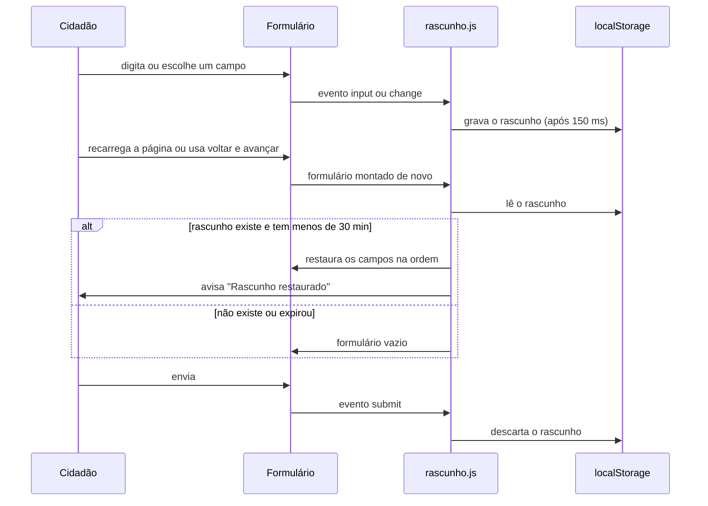

# Ação de Melhoria – Característica: Confiabilidade

**Responsáveis:** Davi Ursulino de Oliveira e João Eduardo Pereira Rabelo  
**Característica:** Confiabilidade (ISO/IEC 25010:2023), subcaracterística Recuperabilidade  
**Módulos Afetados:** Atendimento e Protocolo (Portal Detran Digital DF)  
**Tipo de Ação:** Protótipo funcional corretivo e proposição técnica  
**Fase Normativa:** Fase 4 (Execução e Julgamento da Avaliação – ISO/IEC 25040)

---

## 1. Problema Diagnosticado e Motivação

* **Componentes afetados:** o formulário de **agendamento presencial** (Atendimento) e o formulário do **Requerimento Geral** (Protocolo).
* **Evidência:** nos cenários B3, B4 e B5 e na operação anômala A6, o portal perdeu tudo o que o cidadão tinha preenchido.
  * **B4:** com o agendamento preenchido, a recarga da página (F5) devolveu o formulário vazio, e refazer o preenchimento levou 33 s.
  * **B5:** com o Requerimento Geral preenchido, a recarga levou o cidadão à tela inicial do Protocolo, sem o texto digitado.
  * **A6:** o botão voltar e avançar do navegador devolveu o formulário de agendamento vazio.
  * **B3:** com a sessão limpa, o portal levou à página inicial deslogada, e foi preciso entrar de novo e refazer o formulário (48 s).
* **Métricas vinculadas:** M5 (TRTI), com 20,00% e nível Insuficiente, e M4 (TTOA), com o cenário A6 não tolerado. A perda de estado está registrada como C-07 no catálogo de falhas da [página de resultados](confiabilidade.md).
* **Impacto no cidadão:** o cidadão perde o preenchimento por um gesto comum (atualizar a página, voltar ou avançar no navegador) e precisa refazer a tarefa. Nos serviços com prazo legal, como defesa prévia, recurso e agendamento, isso consome tempo e pode fazer o cidadão desistir.

---

## 2. Solução Técnica Proposta

### 2.1 Abordagem

Guardar o preenchimento do formulário no navegador enquanto o cidadão digita e restaurá-lo quando a página ou a rota for montada de novo. A solução é um módulo pequeno, `rascunho.js`, que:

1. grava os campos do formulário em `localStorage`, com um pequeno atraso depois de cada digitação;
2. restaura os campos na ordem do formulário, para que campos dependentes (categoria, unidade, data e hora) sejam recriados antes do próximo;
3. avisa o cidadão com a mensagem "Rascunho restaurado (salvo às HH:MM)", para ele revisar antes de continuar;
4. descarta o rascunho ao enviar ou limpar o formulário, e depois de 30 minutos;
5. nunca guarda senha, arquivo nem campos marcados com `data-sem-rascunho`.

### 2.2 Escopo e Limitações

* O protótipo cobre as recargas e o uso do botão voltar. **Não cobre a sessão limpa (B3)**, porque limpar os dados do site também apaga o `localStorage`. Para esse caso, a recomendação ao Detran-DF é guardar o rascunho no servidor, associado ao cidadão autenticado (seção 6).
* Em computador compartilhado, o rascunho fica no navegador. Por isso ele expira em 30 minutos, é descartado ao enviar, e não guarda dados de autenticação. Campos com dados mais sensíveis devem usar `data-sem-rascunho`.
* A proposta altera só o comportamento do formulário, sem tocar nas integrações com o Gov.br e o SEI-GDF.
* A equipe não tem acesso ao código-fonte do portal, então a solução foi validada em um protótipo que reproduz os campos dos dois formulários. Os resultados não são medidas feitas no portal em produção.

---

## 3. Implementação e Artefatos Técnicos

Os arquivos ficam em [`docs/assets/melhorias/confiabilidade/rascunho/`](../assets/melhorias/confiabilidade/rascunho/index.html):

| Arquivo | Função |
| :--- | :--- |
| [`rascunho.js`](../assets/melhorias/confiabilidade/rascunho/rascunho.js) | Módulo que grava, restaura e descarta o rascunho |
| [`index.html`](../assets/melhorias/confiabilidade/rascunho/index.html) | Protótipo com o Requerimento Geral e o agendamento presencial, montados como em uma aplicação de página única |
| [`validar.py`](../assets/melhorias/confiabilidade/rascunho/validar.py) | Script que reproduz os cenários B3, B4, B5 e A6 com e sem o rascunho |
| [`validacao.csv`](../dados/confiabilidade/melhoria/validacao.csv) | Resultado de cada repetição |

### 3.1 Fluxo de Controle



### 3.2 Trecho Principal

```javascript
var registro = lerRascunho(loja, form);
if (registro) {
  /* Restaura na ordem do formulário, para que campos dependentes sejam recriados antes do próximo. */
  camposDe(form).forEach(function (campo) {
    if (Object.prototype.hasOwnProperty.call(registro.dados, campo.name)) {
      aplicar(campo, registro.dados[campo.name]);
    }
  });
}

form.addEventListener('input', agendarGravacao);
form.addEventListener('change', agendarGravacao);
form.addEventListener('submit', descartar);
```

### 3.3 Como Aplicar e Reproduzir

Para usar em um formulário, basta incluir o módulo e chamá-lo depois de montar o formulário:

```html
<script src="rascunho.js"></script>
<script>
  Rascunho.iniciar(document.getElementById('meu-formulario'), {
    aviso: document.getElementById('aviso')
  });
</script>
```

Para reproduzir a validação:

```bash
pip install playwright
playwright install chromium
python docs/assets/melhorias/confiabilidade/rascunho/validar.py
```

O protótipo também pode ser aberto no navegador (veja [o protótipo](../assets/melhorias/confiabilidade/rascunho/index.html)). Com `?rascunho=off` no endereço, o rascunho é desativado e o formulário se comporta como o portal atual.

---

## 4. Verificação da Eficácia da Melhoria

O script repetiu cada cenário 5 vezes com o rascunho desativado (comportamento atual do portal) e 5 vezes com ele ativado.

| Cenário | Portal atual (medido em produção) | Protótipo sem rascunho | Protótipo com rascunho |
| :--- | :---: | :---: | :---: |
| **B4** – Recarga com o agendamento preenchido | Não recuperado, 33 s | 0 de 5 | **5 de 5**, em média 9 ms |
| **B5** – Recarga com o Requerimento Geral preenchido | Não recuperado, 3 s | 0 de 5 | **5 de 5**, em média 10 ms |
| **A6** – Voltar e avançar do navegador | Não tolerado | 0 de 5 | **5 de 5**, em média 4 ms |
| **B3** – Sessão limpa | Não recuperado, 48 s | 0 de 5 | 0 de 5 |

*Tabela 1 – Comparação antes e depois. Fonte: elaboração dos autores. A primeira coluna vem das medições da [página de resultados](confiabilidade.md), e as demais, de [`validacao.csv`](../dados/confiabilidade/melhoria/validacao.csv).*

O comportamento do protótipo sem rascunho reproduz o do portal nos quatro cenários (nenhuma recuperação), o que mostra que o teste detecta a perda de dados. Com o rascunho, os três cenários de recarga e navegação deixam de perder dados. O tempo de restauração é de milissegundos, enquanto no portal o cidadão levou de 3 s a 33 s para refazer o preenchimento.

### 4.1 Efeito Projetado nas Métricas

Se o portal recuperasse o B4 e o B5 como o protótipo, e o A6 fosse tolerado, as métricas seriam as seguintes. É uma **projeção**, calculada sobre os dados já coletados, e não uma medição no portal.

| Métrica | Valor medido | Valor projetado | Nível medido | Nível projetado |
| :--- | :---: | :---: | :---: | :---: |
| **M5 – TRTI** | 1 de 5 (20,00%) | 3 de 5 (60,00%) | Insuficiente | Satisfatório |
| **M4 – TTOA** | 7 de 9 (77,78%) | 8 de 9 (88,89%) | Satisfatório | Bom |

*Tabela 2 – Projeção do efeito da melhoria. Fonte: elaboração dos autores.*

---

## 5. Rastreabilidade com a Avaliação

| Elemento | Referência |
| :--- | :--- |
| Questão GQM | Q4 (Recuperabilidade) e Q3 (Tolerância a Falhas) |
| Hipótese | H4 (perda de dados no Protocolo ao recarregar) e H3 (botão voltar no Atendimento) |
| Falha do catálogo | C-07 (perda do preenchimento ao recarregar, voltar ou limpar a sessão) |
| Oportunidade de melhoria | Seção 5.1 da [página de resultados](confiabilidade.md), item 1 |
| Rubrica | F4-C5 |

---

## 6. Recomendações ao Detran-DF

1. **Guardar o rascunho no servidor** para o cidadão autenticado, o que cobre também a sessão expirada ou limpa (B3). O portal já cria um protocolo em rascunho antes da assinatura do Requerimento Geral, então a estrutura existe para esse formulário.
2. **Aplicar o mesmo mecanismo ao agendamento**, ao Recurso à JARI e à Defesa Prévia, que têm formulários longos e prazo legal.
3. **Manter o aviso de rascunho restaurado**, para o cidadão revisar antes de continuar.
4. **Tratar o erro da consulta de débitos** (C-01 e C-02) com mensagem clara e nova tentativa, que foi a outra oportunidade levantada na avaliação.
