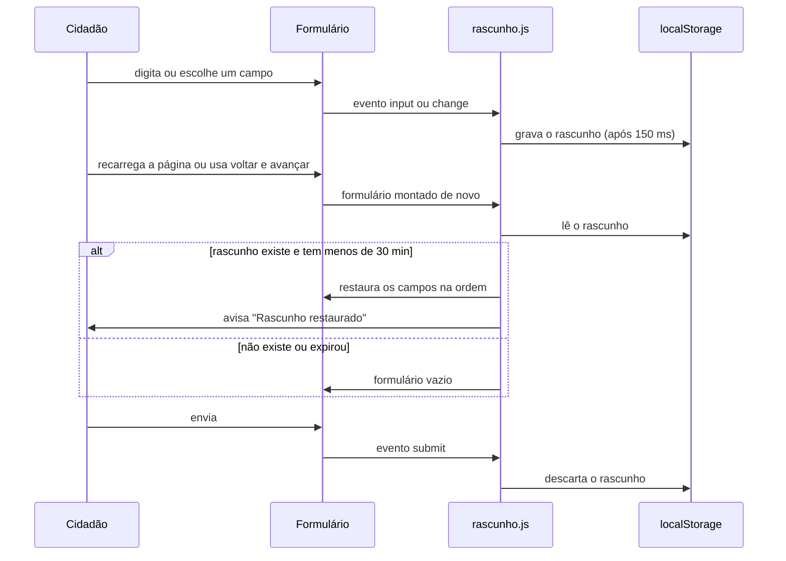
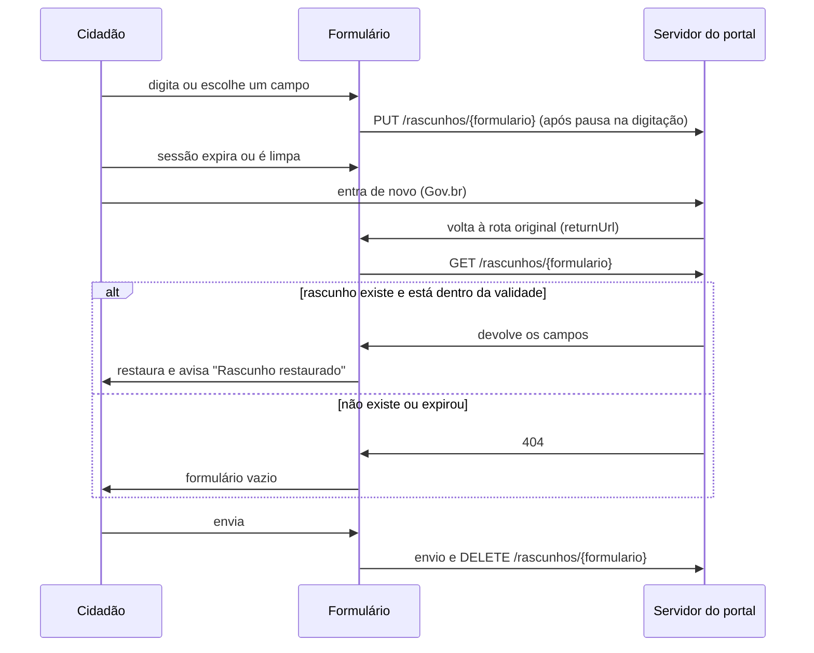

# Ação de Melhoria – Característica: Confiabilidade

**Responsáveis:** Davi Ursulino de Oliveira e João Eduardo Pereira Rabelo  
**Característica:** Confiabilidade (ISO/IEC 25010:2023), subcaracterística Recuperabilidade  
**Módulos Afetados:** Atendimento e Protocolo (Portal Detran Digital DF)  
**Tipo de Ação:** Protótipo funcional corretivo e proposição técnica  
**Fase Normativa:** Fase 4 (Execução e Julgamento da Avaliação – ISO/IEC 25040)

---

## 1. Problema Diagnosticado e Motivação

* **Componentes afetados:** o formulário de **agendamento presencial** (Atendimento) e o formulário do **Requerimento Geral** (Protocolo).
* **Evidência:** nos cenários B3, B4 e B5 e na operação anômala A6, o portal perdeu tudo o que o cidadão tinha preenchido.
  * **B4:** com o agendamento preenchido, a recarga da página (F5) devolveu o formulário vazio, e refazer o preenchimento levou 33 s.
  * **B5:** com o Requerimento Geral preenchido, a recarga levou o cidadão à tela inicial do Protocolo, sem o texto digitado.
  * **A6:** o botão voltar e avançar do navegador devolveu o formulário de agendamento vazio.
  * **B3:** com a sessão limpa, o portal levou à página inicial deslogada, e foi preciso entrar de novo e refazer o formulário (48 s).
* **Métricas vinculadas:** M5 (TRTI), com 20,00% e nível Insuficiente, e M4 (TTOA), com o cenário A6 não tolerado. A perda de estado está registrada como C-07 no catálogo de falhas da [página de resultados](confiabilidade.md).
* **Impacto no cidadão:** o cidadão perde o preenchimento por um gesto comum (atualizar a página, voltar ou avançar no navegador) e precisa refazer a tarefa. Nos serviços com prazo legal, como defesa prévia, recurso e agendamento, isso consome tempo e pode fazer o cidadão desistir.

---

## 2. Solução Técnica Proposta

### 2.1 Abordagem

Guardar o preenchimento do formulário no navegador enquanto o cidadão digita e restaurá-lo quando a página ou a rota for montada de novo. A solução é um módulo pequeno, `rascunho.js`, que:

1. grava os campos do formulário em `localStorage`, com um pequeno atraso depois de cada digitação;
2. restaura os campos na ordem do formulário, para que campos dependentes (categoria, unidade, data e hora) sejam recriados antes do próximo;
3. avisa o cidadão com a mensagem "Rascunho restaurado (salvo às HH:MM)", para ele revisar antes de continuar;
4. descarta o rascunho ao enviar ou limpar o formulário, e depois de 30 minutos;
5. nunca guarda senha, arquivo nem campos marcados com `data-sem-rascunho`.

### 2.2 Escopo e Limitações

* O protótipo cobre as recargas e o uso do botão voltar. **Não cobre a sessão limpa (B3)**, porque limpar os dados do site também apaga o `localStorage`. Para esse caso, a recomendação ao Detran-DF é guardar o rascunho no servidor, associado ao cidadão autenticado (seção 6).
* **Não cobre a conversa do chatbot (B7).** O C-07 inclui a perda da conversa após a recarga, mas o protótipo reproduz apenas os formulários de Atendimento e Protocolo, e o widget do chatbot (InBot) é um componente à parte. A recomendação para esse caso está na seção 6.
* Em computador compartilhado, o rascunho fica no navegador. Por isso ele expira em 30 minutos, é descartado ao enviar, e não guarda dados de autenticação. Campos com dados mais sensíveis devem usar `data-sem-rascunho`.
* A proposta altera só o comportamento do formulário, sem tocar nas integrações com o Gov.br e o SEI-GDF.
* A equipe não tem acesso ao código-fonte do portal, então a solução foi validada em um protótipo que reproduz os campos dos dois formulários. Os resultados não são medidas feitas no portal em produção.

### 2.3 Riscos de Integração

Como o código do portal não está disponível, os pontos abaixo não foram verificados e devem ser testados antes de levar o módulo à produção:

* **Frameworks reativos (React, Angular, Vue).** Atribuir `campo.value = x` altera o campo na tela, mas não o estado interno do framework, e o valor restaurado pode ser apagado na próxima renderização ou ignorado no envio. A restauração deve usar o setter nativo do elemento (`Object.getOwnPropertyDescriptor(HTMLInputElement.prototype, 'value').set`) e disparar os eventos `input` e `change` com `bubbles: true`.
* **Máscaras de entrada (CPF, telefone, CEP).** A máscara costuma ser aplicada no evento `input`. O valor gravado deve ser o que está no campo e a restauração deve disparar o mesmo evento, para a máscara não ser aplicada duas vezes nem ser ignorada.
* **Opções carregadas de forma assíncrona.** No portal, categoria, unidade, data e hora provavelmente dependem de requisições. Restaurar na ordem do formulário não basta se a opção ainda não existe no momento da restauração. A restauração deve tentar de novo (por exemplo, com `MutationObserver` e tempo limite) até a opção aparecer.

### 2.4 Privacidade e Dados Pessoais

* **`localStorage` ou `sessionStorage`.** O `sessionStorage` sobrevive à recarga e ao voltar/avançar e é apagado ao fechar a aba, o que combina melhor com computador compartilhado. O `localStorage` também recupera o caso em que a aba é fechada sem querer ou descartada pelo navegador do celular. A escolha é um compromisso entre segurança e conveniência, e a decisão deve ser registrada ou deixada como opção do módulo.
* **Expiração.** Se a expiração for verificada apenas na leitura, um rascunho com CPF e endereço de quem não voltou ao formulário permanece no navegador indefinidamente. O módulo deve varrer e apagar os rascunhos expirados ao ser iniciado em qualquer página.
* **Logout e troca de usuário.** Os rascunhos devem ser apagados ao sair da conta, e a chave deve identificar o formulário (e o usuário, quando houver), para que outro cidadão no mesmo computador não veja o rascunho do anterior.
* **LGPD.** O rascunho guarda dados pessoais no dispositivo do cidadão. Convém guardar só os campos necessários (minimização), manter o prazo curto de retenção e informar que o rascunho é local.

### 2.5 Usabilidade e Acessibilidade do Aviso

* O aviso "Rascunho restaurado" deve usar `role="status"` ou `aria-live="polite"`, para que leitores de tela o anunciem.
* Deve haver um botão explícito **"Descartar rascunho"**. Hoje o descarte é só implícito (envio, limpeza ou expiração), e o cidadão que não quer o conteúdo restaurado precisa apagar campo a campo.
* Como medida complementar, um aviso do navegador (`beforeunload`) pode ser mostrado ao sair com campos preenchidos e não enviados.

---

## 3. Implementação e Artefatos Técnicos

Os arquivos ficam em [`docs/assets/melhorias/confiabilidade/rascunho/`](../assets/melhorias/confiabilidade/rascunho/index.html):

| Arquivo | Função |
| :--- | :--- |
| [`rascunho.js`](../assets/melhorias/confiabilidade/rascunho/rascunho.js) | Módulo que grava, restaura e descarta o rascunho |
| [`index.html`](../assets/melhorias/confiabilidade/rascunho/index.html) | Protótipo com o Requerimento Geral e o agendamento presencial, montados como em uma aplicação de página única |
| [`validar.py`](../assets/melhorias/confiabilidade/rascunho/validar.py) | Script que reproduz os cenários B3, B4, B5 e A6 com e sem o rascunho |
| [`validacao.csv`](../dados/confiabilidade/melhoria/validacao.csv) | Resultado de cada repetição |

### 3.1 Fluxo de Controle



### 3.2 Trecho Principal

```javascript
var registro = lerRascunho(loja, form);
if (registro) {
  /* Restaura na ordem do formulário, para que campos dependentes sejam recriados antes do próximo. */
  camposDe(form).forEach(function (campo) {
    if (Object.prototype.hasOwnProperty.call(registro.dados, campo.name)) {
      aplicar(campo, registro.dados[campo.name]);
    }
  });
}

form.addEventListener('input', agendarGravacao);
form.addEventListener('change', agendarGravacao);
form.addEventListener('submit', descartar);
```

### 3.3 Como Aplicar e Reproduzir

Para usar em um formulário, basta incluir o módulo e chamá-lo depois de montar o formulário:

```html
<script src="rascunho.js"></script>
<script>
  Rascunho.iniciar(document.getElementById('meu-formulario'), {
    aviso: document.getElementById('aviso')
  });
</script>
```

Para reproduzir a validação:

```bash
pip install playwright
playwright install chromium
python docs/assets/melhorias/confiabilidade/rascunho/validar.py
```

O protótipo também pode ser aberto no navegador (veja [o protótipo](../assets/melhorias/confiabilidade/rascunho/index.html)). Com `?rascunho=off` no endereço, o rascunho é desativado e o formulário se comporta como o portal atual.

---

## 4. Verificação da Eficácia da Melhoria

O script repetiu cada cenário 5 vezes com o rascunho desativado (comportamento atual do portal) e 5 vezes com ele ativado.

| Cenário | Portal atual (medido em produção) | Protótipo sem rascunho | Protótipo com rascunho |
| :--- | :---: | :---: | :---: |
| **B4** – Recarga com o agendamento preenchido | Não recuperado, 33 s | 0 de 5 | **5 de 5**, em média 9 ms |
| **B5** – Recarga com o Requerimento Geral preenchido | Não recuperado, 3 s | 0 de 5 | **5 de 5**, em média 10 ms |
| **A6** – Voltar e avançar do navegador | Não tolerado | 0 de 5 | **5 de 5**, em média 4 ms |
| **B3** – Sessão limpa | Não recuperado, 48 s | 0 de 5 | 0 de 5 |

*Tabela 1 – Comparação antes e depois. Fonte: elaboração dos autores. A primeira coluna vem das medições da [página de resultados](confiabilidade.md), e as demais, de [`validacao.csv`](../dados/confiabilidade/melhoria/validacao.csv).*

O comportamento do protótipo sem rascunho reproduz o do portal nos quatro cenários (nenhuma recuperação), o que mostra que o teste detecta a perda de dados. Com o rascunho, os três cenários de recarga e navegação deixam de perder dados. O tempo de restauração é de milissegundos, enquanto no portal o cidadão levou de 3 s a 33 s para refazer o preenchimento.

A coluna "Protótipo sem rascunho" foi construída para se comportar como o portal, então o 0 de 5 confirma que o teste detecta a perda, mas não é uma medida do portal. A evidência do "antes" é a primeira coluna da Tabela 1, medida em produção. Como o protótipo é determinístico, as 5 repetições mostram a estabilidade do script, e não a variabilidade do comportamento real. Os limites da validação e os testes que ainda a ampliariam estão na seção 4.3.

### 4.1 Efeito Projetado nas Métricas

Se o portal recuperasse o B4 e o B5 como o protótipo, e o A6 fosse tolerado, as métricas seriam as seguintes. É uma **projeção**, calculada sobre os dados já coletados, e não uma medição no portal.

| Métrica | Valor medido | Valor projetado | Nível medido | Nível projetado |
| :--- | :---: | :---: | :---: | :---: |
| **M5 – TRTI** | 1 de 5 (20,00%) | 3 de 5 (60,00%) | Insuficiente | Satisfatório |
| **M4 – TTOA** | 7 de 9 (77,78%) | 8 de 9 (88,89%) | Satisfatório | Bom |
| **M6 – TMR** | 19,0 s | 11,8 s | Excelente | Excelente |

*Tabela 2 – Projeção do efeito da melhoria nas métricas. Fonte: elaboração dos autores.*

Na M6, a projeção usa Tᵢ de 0 s para o B4 e o B5, já que a restauração leva milissegundos: TMR = (48 + 0 + 0 + 1 + 10) / 5 = 59 / 5 = 11,8 s. Os cenários B3 e B7 continuam sem recuperação.

### 4.2 Efeito Projetado nas Questões e no Objetivo

Aplicando a regra de agregação da Fase 2 às notas projetadas (M5 = 2, M4 = 3, M6 = 4, M1 = 1, M2 = 3 e M3 = 3):

| Questão ou objetivo | Cálculo projetado | Nota medida | Nota projetada | Nível medido | Nível projetado |
| :--- | :--- | :---: | :---: | :---: | :---: |
| **Q3** – Tolerância a Falhas | M4 | 2,0 | 3,0 | Satisfatório | Bom |
| **Q4** – Recuperabilidade | (2 + 4) / 2 | 2,5 | 3,0 | Bom | Bom |
| **G1** – Confiabilidade | (1 + 3 + 3 + 3) / 4 | 2,1 | 2,5 | Satisfatório, com ressalva | Bom, com ressalva |

*Tabela 3 – Projeção do efeito da melhoria nas questões e no objetivo. Fonte: elaboração dos autores.*

Os níveis projetados de Q4 e G1 seguem o enquadramento já usado na página de resultados (2,5 como Bom), e devem ser conferidos nas faixas da régua da Fase 2. A ressalva de G1 permanece, porque a Q1 continua com nota 1 e a ação não atua na disponibilidade.

Pontos que limitam a projeção:

* O M5 projetado (60,00%) está exatamente no limite inferior do nível Satisfatório. Com os 8 cenários do plano no denominador, o valor seria 3 de 8 (37,50%), ainda Insuficiente.
* Os dados da avaliação são parciais, então a projeção deve ser recalculada se os valores de M4 ou M5 mudarem com novas coletas.
* A projeção supõe que o portal teria o mesmo comportamento do protótipo, o que depende dos riscos da seção 2.3.

### 4.3 Limites da Validação e Próximos Testes

A validação atual cobre os quatro cenários da avaliação, em um navegador, com campos de preenchimento síncrono. Ela ainda não cobre os itens abaixo, que são os testes recomendados para ampliá-la:

* **Casos de borda do módulo:**
  * expiração aos 30 minutos (o Playwright permite simular o tempo com `page.clock`);
  * descarte do rascunho ao enviar o formulário;
  * campos com `data-sem-rascunho`, `type="password"` e `type="file"` não são gravados;
  * JSON corrompido ou `localStorage` indisponível (aba anônima, cota cheia) não quebra o formulário;
  * dois separadores abertos com o mesmo formulário.
* **Mais de um navegador.** Repetir os cenários em Chromium, Firefox e WebKit, porque o comportamento de voltar e avançar (cache de página) varia entre eles.
* **Opções assíncronas.** Repetir a restauração com atraso simulado nas opções de categoria, unidade, data e hora (interceptando a requisição no Playwright), para verificar a restauração em ordem.

---

## 5. Rastreabilidade com a Avaliação

| Elemento | Referência |
| :--- | :--- |
| Questão GQM | Q4 (Recuperabilidade) e Q3 (Tolerância a Falhas) |
| Hipótese | H4 (perda de dados no Protocolo ao recarregar) e H3 (botão voltar no Atendimento) |
| Falha do catálogo | C-07 (perda do preenchimento ao recarregar, voltar ou limpar a sessão) |
| Oportunidade de melhoria | Seção 5.1 da [página de resultados](confiabilidade.md), item 1 |
| Rubrica | F4-C5 |

---

## 6. Recomendações ao Detran-DF

1. **Guardar o rascunho no servidor** para o cidadão autenticado, o que cobre também a sessão expirada ou limpa (B3). O portal já cria um protocolo em rascunho antes da assinatura do Requerimento Geral, então a estrutura existe para esse formulário. Uma especificação sugerida está na seção 6.1.
2. **Aplicar o mesmo mecanismo ao agendamento**, ao Recurso à JARI e à Defesa Prévia, que têm formulários longos e prazo legal.
3. **Manter o aviso de rascunho restaurado**, para o cidadão revisar antes de continuar.
4. **Tratar o erro da consulta de débitos** (C-01 e C-02) com mensagem clara e nova tentativa, que foi a outra oportunidade levantada na avaliação.
5. **Voltar à rota original depois de um novo login** (por exemplo, com um parâmetro `returnUrl`). No B3, o cidadão foi levado à página inicial deslogada, e retornar à tela em que estava reduz o retrabalho mesmo antes de existir o rascunho no servidor.
6. **Preservar a conversa do chatbot** (B7). Guardar o identificador da conversa (por exemplo, em `sessionStorage`) e restaurar o histórico ao recarregar é uma solução a ser avaliada com o fornecedor do InBot, já que o widget não faz parte do código do portal.
7. **Proteger a consulta contra duplo clique e dar retorno em entradas vazias** (oportunidades 3 e 4 da seção 5.1 da [página de resultados](confiabilidade.md)): desabilitar o botão enquanto a requisição está pendente (A4) e mostrar mensagem de campo obrigatório (A3) e aviso de mensagem vazia (A9). São mudanças de baixo custo que também melhoram a M4.

### 6.1 Especificação Sugerida do Rascunho no Servidor

| Item | Sugestão |
| :--- | :--- |
| Interface | `PUT /rascunhos/{formulario}` para gravar, `GET` para ler e `DELETE` para descartar |
| Autenticação | Sessão do cidadão autenticado (Gov.br); o rascunho é acessível apenas ao seu dono |
| Validade (TTL) | Prazo curto e definido pelo Detran-DF (o protótipo usa 30 minutos), com remoção automática |
| Proteção dos dados | Criptografia em repouso e em trânsito; guardar só os campos necessários |
| Reaproveitamento | No Requerimento Geral, usar o protocolo em rascunho que o portal já cria (resposta 201) como registro do rascunho |
| Descarte | Ao enviar o formulário, ao clicar em "Descartar rascunho" e ao expirar o prazo |

*Tabela 4 – Especificação sugerida do rascunho no servidor. Fonte: elaboração dos autores.*

