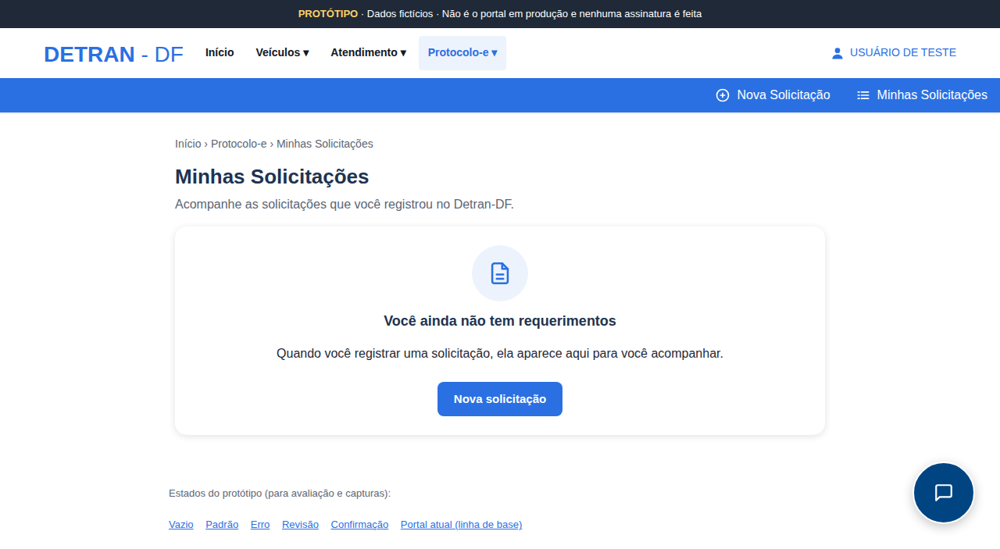
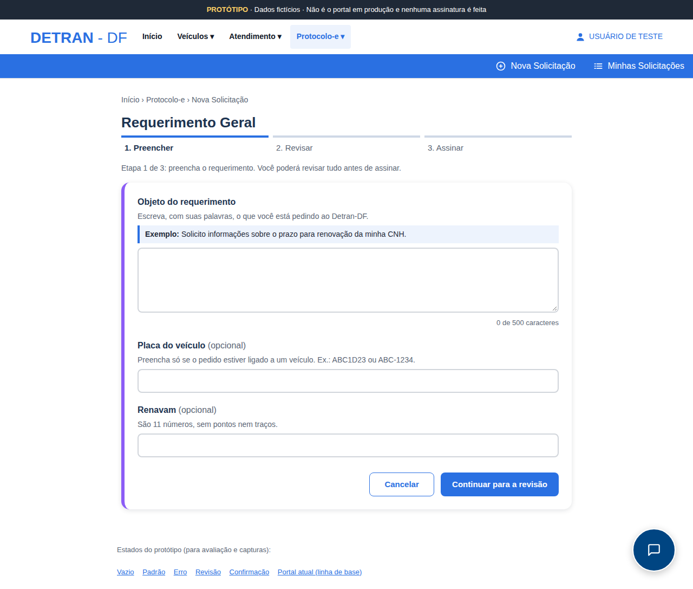
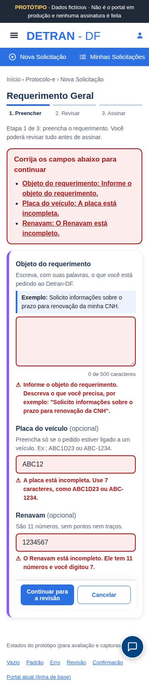
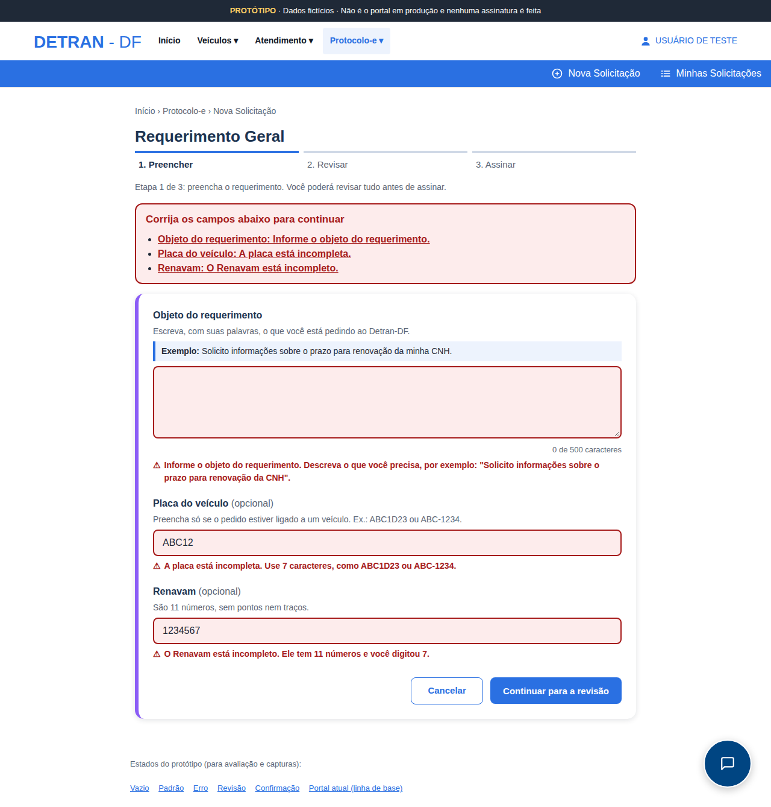
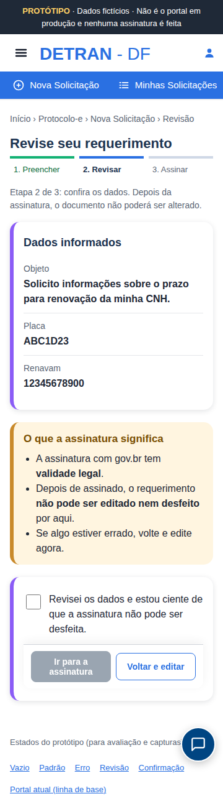
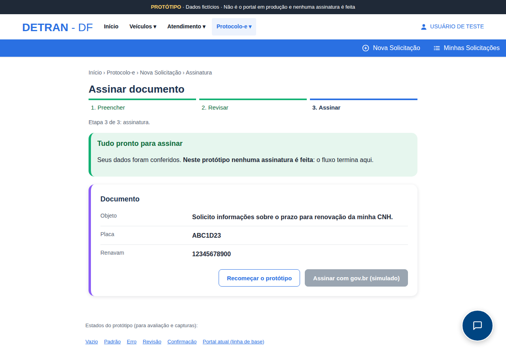
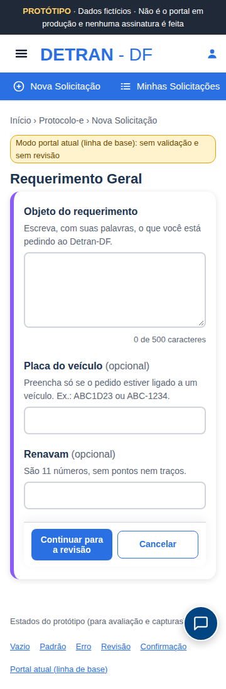

# Ação de Melhoria – Capacidade de Interação: Protótipo do Requerimento Geral

**[Acesse o protótipo aqui](../assets/melhorias/compatibilidade/layout_responsivo/requerimento-geral.html)**

**Responsável:** Yan  
**Característica:** Capacidade de Interação (ISO/IEC 25010:2023), subcaracterísticas Operabilidade e Proteção contra Erros de Usuário  
**Módulo Afetado:** Protocolo (Requerimento Geral, tarefa T3)  
**Tipo de Ação:** Protótipo de alta fidelidade (HTML, CSS e JavaScript, sem dependências), integrado ao protótipo da melhoria de compatibilidade  
**Fase Normativa:** Fase 4 (Execução, Julgamento e Melhorias – ISO/IEC 25040)

!!! warning "O que este protótipo é e o que não é"
    É uma **proposta de projeto** do fluxo do Requerimento Geral. Não é o portal em produção, usa **somente dados fictícios** e **não faz assinatura**. Os testes desta página medem o comportamento do protótipo, e não o do portal. O efeito sobre as métricas M1, M2 e M3 só pode ser afirmado depois da validação com participantes (issue de validação do protótipo).

---

## 1. Problema e motivação

Na avaliação do módulo Protocolo, a T3 (abrir um requerimento) foi a tarefa com pior desempenho. Na inspeção do portal (Seção 8), uma placa e um Renavam inválidos avançaram até a etapa de assinatura sem nenhum alerta, e o Objeto vazio gerou só uma faixa de erro longe do campo. A página de oportunidades de melhoria priorizou duas falhas do mesmo fluxo:

| ID | Problema | Evidência |
| :---: | :--- | :---: |
| **O1** | O formulário aceita placa e Renavam inválidos e avança sem alerta, e o erro do Objeto vazio aparece longe do campo | EV-07, IPH-PRO-D-001 e 002 |
| **O3** | A etapa de assinatura, que tem validade legal, não mostra o documento nem os dados para conferência | EV-11, IPH-PRO-D-007 |
| **O2** | A T3 teve baixa autonomia, e a causa ainda não está documentada | EV-02 |

**Tabela 1 – Problemas atacados.** Fonte: Elaborado pelos autores, a partir da página de oportunidades de melhoria. Os IDs da inspeção heurística consolidada serão acrescentados quando a inspeção real estiver registrada.

---

## 2. O protótipo

O protótipo é uma página navegável com o teclado e com o toque, que cobre o caminho **Minhas Solicitações → Requerimento Geral → Revisão → Assinatura (simulada)**. Ele fica na mesma pasta do protótipo de compatibilidade e usa o mesmo visual das telas do portal.

* **Abrir:** [requerimento-geral.html](../assets/melhorias/compatibilidade/layout_responsivo/requerimento-geral.html)
* **Linha de base (portal atual):** [requerimento-geral.html?modo=atual](../assets/melhorias/compatibilidade/layout_responsivo/requerimento-geral.html?modo=atual), que reproduz o comportamento observado: sem validação e sem revisão.
* **Ponto de entrada:** na tela [protocolo.html](../assets/melhorias/compatibilidade/layout_responsivo/protocolo.html), o botão "Acessar" do card "Nova Solicitação" e o botão "Nova Solicitação" da barra azul levam ao Requerimento Geral. O "Cancelar" volta para o `protocolo.html`.

Os estados podem ser abertos direto por parâmetro (`?estado=vazio`, `padrao`, `erro`, `revisao` e `confirmacao`) e também pelos links no rodapé do protótipo.

### 2.1 Integração com a melhoria de compatibilidade

As duas ações compartilham os mesmos arquivos de base, para que o fluxo novo já nasça compatível com telas estreitas e com os navegadores Chromium:

| Parte da melhoria de compatibilidade | Como o Requerimento Geral usa |
| :--- | :--- |
| `detran-responsive-patch.css` | Barra de ações fixa na parte de baixo (`.detran-action-bar-wrapper`), botões (`.detran-btn`), campos (`.detran-input-control`) e posicionamento do avatar do assistente acima da barra |
| `chatbot-resilience-fallback.js` | Carregado na página. Se a CDN do assistente falhar, o avatar vira o atalho para a Central 154 e o WhatsApp |
| Telas do portal (`index`, `infracao`, `atendimento` e `protocolo`) | Mesmo cabeçalho, mesmo menu e mesma barra azul de ações. Em telas estreitas, o menu vira um botão, para não sobrepor o logotipo |
| `protocolo.html` | Dois botões passaram a abrir o Requerimento Geral (única alteração nesse arquivo) |

**Tabela 2 – Pontos de integração.** Fonte: Elaborado pelos autores.

### 2.2 Elementos do protótipo

| Elemento | Responde a | Heurística principal | Situação |
| :--- | :---: | :---: | :--- |
| Validação por campo (Objeto, placa e Renavam), com mensagem junto do campo e sem avançar com valor inválido | O1 | NH5 e NH9 | Decidido |
| Resumo de erros no topo, com links para cada campo | O1 | NH9 | Decidido |
| Tela de revisão com os dados informados e botão "Voltar e editar" | O3 | NH3 | Decidido |
| Aviso de que a assinatura tem validade legal e não pode ser desfeita, com ciência obrigatória antes de seguir | O3 | NH5 | Decidido |
| Indicação da etapa atual e do total ("Etapa 2 de 3") | O2 | NH1 | **Hipótese a testar** |
| Exemplo no campo Objeto | O2 | NH10 | **Hipótese a testar** |

**Tabela 3 – Elementos do protótipo.** Fonte: Elaborado pelos autores. As duas hipóteses não têm dado real que as sustente, e o resultado não deve ser atribuído a elas sem teste separado.

### 2.3 Regras de validação

| Campo | Obrigatório | Regra | Mensagem |
| :--- | :---: | :--- | :--- |
| Objeto | Sim | Mínimo de 10 caracteres | Diz o que fazer e dá um exemplo |
| Placa | Não | 7 caracteres, no formato antigo (ABC-1234) ou Mercosul (ABC1D23) | Mostra o formato esperado |
| Renavam | Não | 11 números e dígito verificador correto | Mostra quantos números foram digitados |

**Tabela 4 – Regras de validação.** Fonte: Elaborado pelos autores. Placa e Renavam são opcionais porque o requerimento da T3 não está ligado a um veículo.

### 2.4 Estados modelados

Os quatro estados pedidos pela issue estão em 360 px (mobile) e em 1280 px (desktop):

| Estado | Tela | Mobile | Desktop |
| :--- | :--- | :---: | :---: |
| Vazio | Minhas Solicitações, sem nenhum registro |  |  |
| Padrão | Formulário em branco |  |  |
| Erro | Formulário com os três campos inválidos |  |  |
| Revisão | Dados conferidos e aviso da assinatura |  |  |
| Confirmação | Pronto para assinar (simulado) |  |  |

**Tabela 5 – Estados do protótipo.** Fonte: Elaborado pelos autores, a partir de capturas do próprio protótipo.

---

## 3. Antes e depois

| Aspecto | Antes (portal atual, conforme as evidências) | Depois (protótipo) |
| :--- | :--- | :--- |
| Objeto vazio | Faixa de erro no pé da tela, longe do campo, que não fica marcado (IPH-PRO-D-001) | Bloqueia e mostra a mensagem junto do campo |
| Placa incompleta | Avança sem alerta (EV-07, IPH-PRO-D-002) | Bloqueia e mostra o formato esperado |
| Renavam curto | Avança sem alerta (EV-07, IPH-PRO-D-002) | Bloqueia e mostra quantos números faltam |
| Antes da assinatura | Aviso de não editar após assinar e botão Voltar, mas sem o documento exibido para conferência (IPH-PRO-D-007) | Tela de revisão com os dados, aviso da validade legal e botão para voltar e editar |
| Orientação de etapa | Não há indicação | "Etapa 1 de 3", "2 de 3" e "3 de 3" |

**Tabela 6 – Comparação antes e depois.** Fonte: Elaborado pelos autores. A coluna "Antes" vem das evidências da avaliação. O modo `?modo=atual` do protótipo **reproduz** esse comportamento para comparação, e não o mede no portal.

A linha de base reproduzida, em 360 px: formulário sem etapas e assinatura logo após o envio.

| Formulário (linha de base) | Assinatura (linha de base) |
| :---: | :---: |
|  |  |

**Figura 1 – Linha de base reproduzida no protótipo (mobile).** Fonte: Elaborado pelos autores.

---

## 4. Rastreabilidade

| Problema | Heurística | Solução no protótipo | Métrica acompanhada |
| :---: | :---: | :--- | :---: |
| O1 | NH5, NH9 | Validação por campo, mensagem junto do campo e resumo de erros | M3 (TPRE do Protocolo) |
| O3 | NH5, NH3 | Revisão, aviso da validade legal, ciência obrigatória e "Voltar e editar" | M3 |
| O2 | NH1, NH10 | Indicação de etapa e exemplo no Objeto (hipóteses) | M1 e M2 |

**Tabela 7 – Problema, heurística, solução e métrica.** Fonte: Elaborado pelos autores. As heurísticas seguem o código NH1 a NH10 do protocolo da Fase 3.

---

## 5. Verificação do protótipo

O script `validar_requerimento_geral.py` abre o protótipo em um Chrome sem interface, executa os cenários de `requerimento-geral-testes.js` e grava o resultado em [validacao_prototipo.csv](../dados/capacidade_interacao/melhoria/validacao_prototipo.csv). Os testes rodam dentro de uma moldura com a largura pedida (360, 414, 500, 768 e 1366 px), porque o Chrome sem interface não gera janelas abaixo de 500 px.

| Grupo | Testes por largura | Resultado |
| :--- | :---: | :---: |
| Cenários de erro da avaliação (E-PRO-01, 08 e 09), com mensagem junto do campo | 6 | 6 de 6 |
| Renavam com dígito verificador errado e campos opcionais vazios | 2 | 2 de 2 |
| Fluxo válido: revisão, aviso, ciência, "Voltar e editar" e chegada à assinatura | 7 | 7 de 7 |
| Acessibilidade verificável por código (`aria-invalid` e `role="alert"`) | 2 | 2 de 2 |
| Avatar do assistente sem sobrepor os botões de ação (formulário, revisão e assinatura, no topo e no fim da página) | 3 | 3 de 3 |
| **Subtotal por largura (modo protótipo)** | **20** | **20 de 20** |
| Linha de base reproduzida em 360 px (3 cenários avançam, e o fluxo válido vai direto à assinatura) | 4 | 4 de 4 |
| **Total (5 larguras × 20, mais 4)** | **104** | **104 de 104** |

**Tabela 8 – Resultado dos testes automáticos.** Fonte: Elaborado pelos autores, a partir de `validacao_prototipo.csv`.

Na linha de base reproduzida, os 3 cenários de erro avançam (0 de 3 bloqueados). A reprodução simplifica o portal, que mostra uma faixa de erro para o Objeto vazio. No protótipo, os mesmos 3 são bloqueados (3 de 3). Esse contraste mostra que o **projeto** trata o problema, mas **não é uma medida do portal**. Os testes da linha de base conferem que a reprodução se comporta como a evidência descreve.

A sobreposição do avatar é **medida no navegador** (interseção, em px², entre o avatar e cada botão de ação, no topo e no fim da página). O mesmo critério da melhoria de compatibilidade se aplica aqui, mas apenas ao fluxo novo.

---

## 6. Limites

* O protótipo não é o portal em produção, e o resultado vale para o protótipo. O portal não foi alterado, e a equipe não tem acesso ao código dele.
* Os testes automáticos verificam regras de interface. Não substituem a re-inspeção heurística nem o teste com participantes.
* A medição do avatar considera só os **botões de ação**. Campos de texto podem ficar cobertos pelo avatar em alguns pontos da rolagem (por exemplo, em 768 px, com a página no topo). O botão de recolher o assistente, que existe nas telas do portal, não foi levado para este fluxo.
* O avatar real do assistente depende de uma CDN externa. Nos testes e em ambientes sem acesso a ela, aparece o atalho de atendimento do `chatbot-resilience-fallback.js`, que tem a mesma posição.
* A reprodução da linha de base é uma simplificação do portal: no portal, o Objeto vazio gera uma faixa de erro (longe do campo), e a placa e o Renavam inválidos avançam sem alerta.
* A indicação de etapa e o exemplo no Objeto são hipóteses: não há dado real que mostre que melhoram a autonomia.
* A acessibilidade foi verificada só nos atributos testados. Não há auditoria completa nem teste com leitor de tela.
* Todos os dados são fictícios, inclusive a placa `ABC1D23` e o Renavam `12345678900`, que servem só de exemplo.

---

## 7. Como reproduzir

Na raiz do repositório, com Google Chrome (ou Chromium) e Pillow instalados:

```bash
python3 docs/assets/melhorias/compatibilidade/layout_responsivo/validar_requerimento_geral.py
```

O comando roda os 104 testes, regrava o CSV e as capturas em `docs/img/prototipo/` e termina com código diferente de zero se algum teste falhar.

## 8. Inspeção heurística do Protocolo: portal e protótipo

O IPH (M4) do módulo Protocolo foi apurado no portal e no protótipo do Requerimento Geral, com as heurísticas NH1 a NH10 e a escala de severidade da Fase 3. Os registros estão em [inspecao-heuristica-protocolo-portal.csv](../dados/capacidade_interacao/inspecao-heuristica-protocolo-portal.csv) e [reinspecao-heuristica-prototipo.csv](../dados/capacidade_interacao/melhoria/reinspecao-heuristica-prototipo.csv).

### 8.1 Portal (módulo Protocolo)

**Escopo.** Fluxo do Requerimento Geral: Termo de Uso, Protocolo Eletrônico, Nova Solicitação, formulário e etapa de assinatura, parando antes de assinar. **Dispositivo:** desktop, janela de 967 px. **Ambiente:** navegador embutido do app (Chromium), em 2026-11-24.

| ID | Disp. | Tela ou fluxo | Heurística | Problema | Sev. |
| :---: | :---: | :--- | :---: | :--- | :---: |
| IPH-PRO-D-001 | D | Requerimento Geral (Objeto vazio) | NH9 | Ao avançar com o Objeto vazio, aparece uma faixa de erro no pé da tela, longe do campo, e o campo não é marcado como inválido. | 2 |
| IPH-PRO-D-002 | D | Requerimento Geral (Placa e Renavam) | NH5 | Placa de 5 caracteres e Renavam de 7 números foram aceitos, e o fluxo avançou até a etapa de assinatura sem alerta. | 3 |
| IPH-PRO-D-003 | D | Requerimento Geral (Placa e Renavam) | NH5 | Os campos não têm limite de tamanho nem restrição a números e aceitam qualquer texto. | 2 |
| IPH-PRO-D-004 | D | Requerimento Geral (Objeto) | NH10 | O campo não traz exemplo nem orientação do que escrever. | 2 |
| IPH-PRO-D-005 | D | Requerimento Geral (Dados do veículo) | NH6 | Placa e Renavam não indicam se são obrigatórios ou opcionais. | 1 |
| IPH-PRO-D-006 | D | Requerimento Geral | NH2 | As caixas "Sou advogado" e "Sou procurador" aparecem sem explicação. | 1 |
| IPH-PRO-D-007 | D | Assinar documento | NH1 | A etapa diz "o documento abaixo", mas nenhum documento é exibido para conferência. Só aparece "Download realizado com sucesso!", com o arquivo baixado sem o usuário pedir. | 3 |
| IPH-PRO-D-008 | D | Requerimento Geral > Assinar documento | NH1 | Avançar até a assinatura cria o requerimento na conta, em "Em elaboração", sem avisar. | 2 |
| IPH-PRO-D-009 | D | Protocolo Eletrônico e Nova Solicitação | NH8 | O botão ACESSAR dos cartões se sobrepõe ao texto e esconde parte dele, como o aviso "Serviço apenas para advogado". | 3 |
| IPH-PRO-D-010 | D | Requerimento Geral | NH8 | O avatar do assistente cobre o canto do campo Objeto e parte da faixa de erro. | 2 |
| IPH-PRO-D-011 | D | Menu Protocolo-e | NH4 | O item do submenu repete o nome do próprio menu. | 1 |
| IPH-PRO-D-012 | D | Nova Solicitação | NH4 | A trilha de navegação e o endereço usam "atendimento-digital" dentro do Protocolo-e. | 1 |
| IPH-PRO-D-013 | D | Termo de Uso | NH8 | Texto legal de cerca de 4.000 px, em letra pequena e fonte diferente, com o botão Confirmar só no fim e desabilitado até marcar a ciência. | 2 |

**Tabela 9 – Problemas do portal, módulo Protocolo.** Fonte: Elaborado pelos autores. Heurísticas NH1 a NH10 do protocolo da Fase 3.

| Módulo | $N_1$ | $N_2$ | $N_3$ | $N_4$ | **IPH** |
| :--- | :---: | :---: | :---: | :---: | :---: |
| Protocolo (portal, desktop) | 4 | 6 | 3 | 0 | **13** |

**Tabela 10 – IPH do portal, módulo Protocolo.** Fonte: Elaborado pelos autores.

### 8.2 Protótipo do Requerimento Geral

**Escopo.** Os cinco estados do protótipo (vazio, padrão, erro, revisão e confirmação), em 360 e 375 px (mobile, emulado) e em 1280 px (desktop). Os links de estados no rodapé são apoio de avaliação, e não fazem parte do produto, então ficaram de fora. **Ambiente:** Chrome 156, data 2026-11-24.

| ID | Disp. | Tela ou fluxo | Heurística | Problema | Sev. |
| :---: | :---: | :--- | :---: | :--- | :---: |
| PRO-PROTO-001 | D+M | Formulário (Renavam) | NH5 | O Renavam `00000000000` é aceito, porque o dígito verificador confere. | 1 |
| PRO-PROTO-002 | D+M | Formulário (Placa) | NH5 | A placa `ABC-1D23`, que mistura o hífen do formato antigo com o formato Mercosul, é aceita. | 1 |
| PRO-PROTO-003 | M | Barra de ações | NH4 | Em telas estreitas, o botão principal fica à esquerda e o secundário à direita, o contrário do desktop. | 1 |
| PRO-PROTO-004 | D+M | Barra azul "Nova Solicitação" | NH2 | No meio do fluxo, abre o formulário com os dados anteriores, e não um formulário em branco. | 2 |
| PRO-PROTO-005 | M | Formulário (rolagem) | NH8 | Até 768 px, o avatar do assistente pode cobrir parte de um campo de texto em pontos da rolagem. | 2 |
| PRO-PROTO-006 | D+M | Revisão | NH1 | O botão "Ir para a assinatura" fica desabilitado sem dizer que é preciso marcar a ciência. | 1 |

**Tabela 11 – Problemas do protótipo.** Fonte: Elaborado pelos autores.

| Módulo | $N_1$ | $N_2$ | $N_3$ | $N_4$ | **IPH** |
| :--- | :---: | :---: | :---: | :---: | :---: |
| Protocolo (protótipo do Requerimento Geral) | 4 | 2 | 0 | 0 | **6** |

**Tabela 12 – IPH do protótipo.** Fonte: Elaborado pelos autores. Por dispositivo: Desktop com 4 problemas (3 de severidade 1 e 1 de severidade 2) e Mobile com 6 (4 de severidade 1 e 2 de severidade 2).

### 8.3 Comparação no desktop

| Dispositivo | $N_1$ | $N_2$ | $N_3$ | $N_4$ | **IPH** |
| :--- | :---: | :---: | :---: | :---: | :---: |
| Portal, Protocolo (desktop) | 4 | 6 | 3 | 0 | **13** |
| Protótipo do Requerimento Geral (desktop) | 3 | 1 | 0 | 0 | **4** |

**Tabela 13 – IPH do portal e do protótipo no desktop.** Fonte: Elaborado pelos autores. O protótipo cobre o fluxo do Requerimento Geral, e o portal, o módulo Protocolo.

| Problema do portal | Sev. | Tratamento no protótipo |
| :--- | :---: | :--- |
| IPH-PRO-D-002 (placa e Renavam inválidos avançam) | 3 | Bloqueia e mostra a mensagem junto do campo |
| IPH-PRO-D-007 (assinatura sem o documento para conferir) | 3 | Tela de revisão com os dados e aviso da validade legal |
| IPH-PRO-D-001 (erro do Objeto longe do campo) | 2 | Mensagem junto do campo e resumo de erros no topo |
| IPH-PRO-D-003 (sem limite nem restrição) | 2 | Limite de tamanho e só números no Renavam |
| IPH-PRO-D-004 (Objeto sem exemplo) | 2 | Exemplo e dica no campo |
| IPH-PRO-D-005 (obrigatoriedade não indicada) | 1 | Rótulo "(opcional)" em Placa e Renavam |

**Tabela 14 – Problemas do portal tratados no protótipo.** Fonte: Elaborado pelos autores. Os demais (IPH-PRO-D-006, 008, 009, 010, 011, 012 e 013) ficam fora do escopo do protótipo ou não se repetem nele.

### 8.4 Leitura

* **Nenhum problema de severidade 3 ou 4 no protótipo.** Os dois de severidade 3 do portal que estão no escopo do fluxo (IPH-PRO-D-002 e 007) são tratados, o que combina com os testes automáticos da Seção 5.
* Os problemas de severidade 2 do protótipo são os mais baratos de corrigir e devem entrar na próxima versão.
* O problema IPH-PRO-D-009 (botões sobre o texto dos cartões, severidade 3) está fora do fluxo do protótipo e depende de correção de layout no portal.
* Nenhum problema de acessibilidade é contado no IPH, conforme o protocolo.
