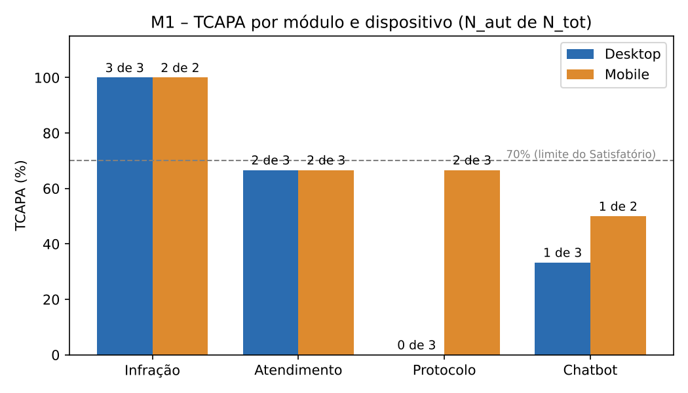
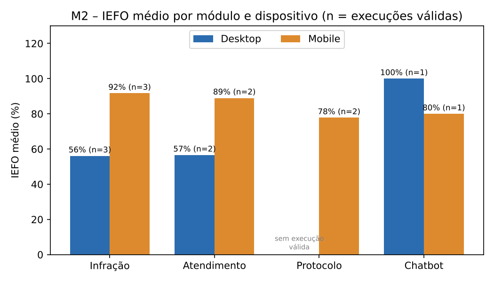
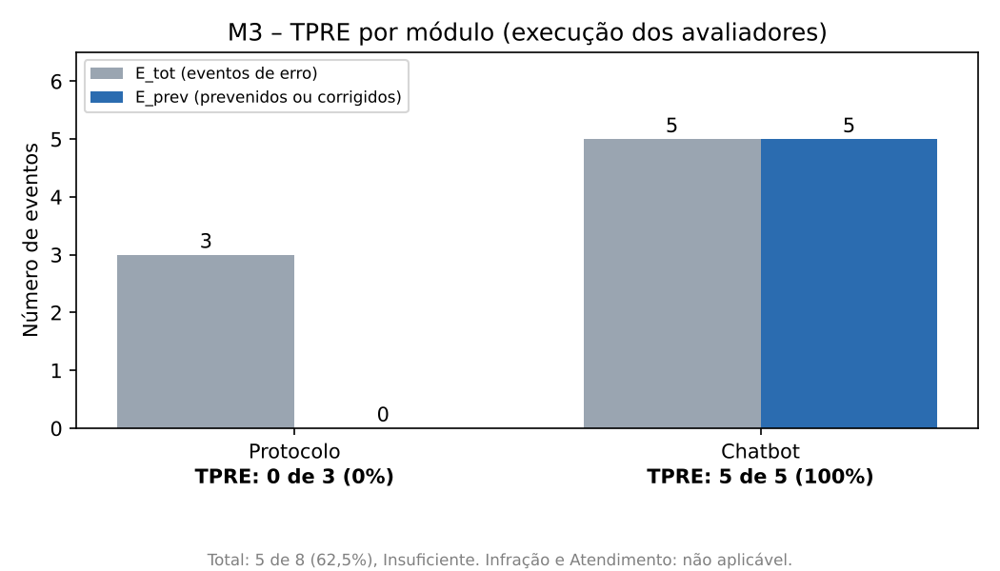
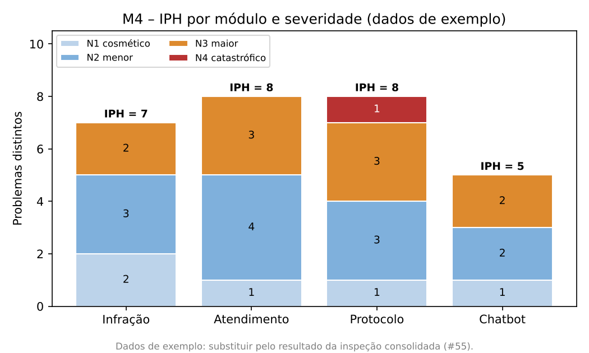
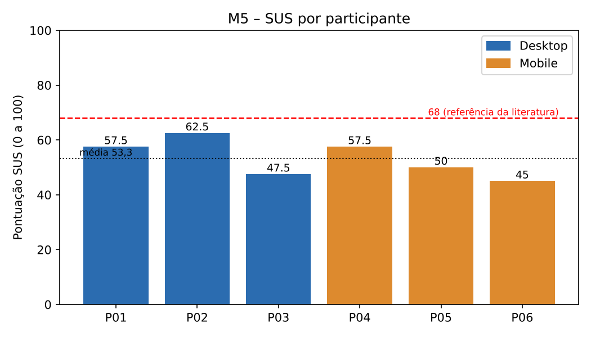

# Resultados Empíricos e Julgamento – Característica: Capacidade de Interação

**Responsáveis:** Natan França e Yan  
**Característica:** Capacidade de Interação (ISO/IEC 25010:2023)  
**Subcaracterísticas:** Aprendibilidade, Operabilidade e Proteção contra Erros de Usuário  
**Módulos Avaliados:** Infração, Atendimento, Protocolo e Chatbot (Portal Detran Digital DF)  
**Fase Normativa:** Fase 4 (Execução e Julgamento da Avaliação – ISO/IEC 25040)

!!! note "Status do Documento (22/11/2026)"
    Resultados de M1, M2 e M5 calculados a partir das sessões com participantes (dados em `docs/dados/usabilidade/`). A M3 usa a execução dos cenários de erro pelos avaliadores Natan e Yan, porque **não foram realizados cenários de erro nas sessões com participantes**. A M4 (IPH) traz a metodologia e **dados de exemplo**, até a inspeção heurística (#55) ser consolidada. Os cálculos seguem a [Fase 2](../fase2/usabilidade.md), que prevalece sobre qualquer divergência: IEFO por passos, M4 = IPH, M5 = SUS, Q1 a Q3 e H1 a H3.

Os valores vêm de `docs/dados/usabilidade/registro-tarefas-preenchido.csv`, `sus-respostas.csv`, `resultados-consolidados.csv` e `docs/dados/capacidade_interacao/cenarios-de-erro-piloto.csv` (M3). As faixas são as da Seção 4 da Fase 2. Os resultados valem para a amostra e não se generalizam. Em células de módulo e dispositivo, que têm no máximo 3 execuções, são apresentadas contagens, e as faixas são aplicadas apenas ao total de cada métrica (Tabela 5 da [Fase 3](../fase3/usabilidade.md)).

---

## 1. Amostra

| Dispositivo | Participantes | Grupo | Letramento digital | Datas das sessões |
| :--- | :---: | :--- | :---: | :---: |
| Desktop | 3 (P01 a P03) | 3 cidadãos | 3 alto | 21/11/2026 |
| Mobile | 3 (P04 a P06) | 2 cidadãos e 1 engenheiro | 3 alto | 22/11/2026 |

**Tabela 1 – Amostra.** Fonte: Elaborado pelos autores, a partir de `registro-tarefas-preenchido.csv`. O plano previa ao menos 1 cidadão de baixo letramento por dispositivo; os 6 participantes tiveram letramento alto.

---

## 2. M1 – TCAPA

| Módulo (tarefa) | Desktop | Mobile | Total do módulo |
| :--- | :---: | :---: | :---: |
| Infração (T1) | 3 de 3 | 2 de 2 | 5 de 5 (100,0%) |
| Atendimento (T2) | 2 de 3 | 2 de 3 | 4 de 6 (66,7%) |
| Protocolo (T3) | 0 de 3 | 2 de 3 | 2 de 6 (33,3%) |
| Chatbot (T4) | 1 de 3 | 1 de 2 | 2 de 5 (40,0%) |
| **Total** | **6 de 12 (50,0%)** | **7 de 10 (70,0%)** | **13 de 22 (59,1%)** |

**Tabela 2 – TCAPA (N_aut de N_tot).** Fonte: Elaborado pelos autores, a partir de `registro-tarefas-preenchido.csv`. **Nível do total: Insuficiente** (< 70%). N_tot = 22 porque duas execuções ficaram fora do primeiro acesso: T1 de P04 (tarefa já executada antes da sessão) e T4 de P04 (falha técnica externa, o chatbot não respondeu).

{ width="520" }

**Figura 1 – TCAPA por módulo e dispositivo.** Fonte: Elaborado pelos autores.

Registradas à parte: 7 tarefas concluídas **com** auxílio (P02 em T2, T3 e T4; P03 em T3 e T4; P05 em T2; P06 em T4) e 3 não concluídas (P01 em T3 por desistência; P06 em T3 por teto de tempo; P04 em T4 por falha técnica externa).

---

## 3. M2 – IEFO

| Módulo (tarefa) | Desktop | Mobile | Total do módulo |
| :--- | :---: | :---: | :---: |
| Infração (T1) | 56,1% (3 execuções) | 91,7% (3) | 73,9% (6) |
| Atendimento (T2) | 56,6% (2) | 89,0% (2) | 72,8% (4) |
| Protocolo (T3) | sem execução válida | 77,8% (2) | 77,8% (2) |
| Chatbot (T4) | 100,0% (1) | 80,0% (1) | 90,0% (2) |
| **Total** | **63,6% (6)** | **86,1% (8)** | **76,4% (14)** |

**Tabela 3 – IEFO médio.** Fonte: Elaborado pelos autores, a partir de `registro-tarefas-preenchido.csv`. IEFO = P_min ÷ P_exec de cada execução, limitado a 100%; a tabela traz a média dessas execuções. Entram só as tarefas concluídas sem auxílio (14). **Nível do total: Satisfatório** (70% a < 80%). O numerador do total é a soma dos IEFO individuais (10,699) e o denominador é o número de execuções (14).

**Sensibilidade ao critério de agregação.** Com a razão agregada ΣP_min ÷ ΣP_exec = 91 ÷ 141 (64,5%), o nível do total passa a **Insuficiente**. A Fase 2 define o IEFO por tarefa e não fixa a agregação; a dupla deve registrar qual critério adota.

**P_min usado.** Os passos da planilha: T1 = 4 (desktop) e 3 (mobile), T2 = 12, T3 = 7 e T4 = 4, **sem o login**, porque as sessões começaram com a conta já aberta. São diferentes do catálogo da Fase 3 (8, 15, 10 e 3, com login). Com os valores do catálogo, 8 das 21 execuções concluídas teriam P_exec < P_min.

{ width="520" }

**Figura 2 – IEFO médio por módulo e dispositivo.** Fonte: Elaborado pelos autores.

---

## 4. M3 – TPRE

**Origem dos dados.** Não foram realizados cenários de erro nas sessões com participantes. A M3 usa apenas o resultado da execução dos cenários pelos avaliadores Natan e Yan (`cenarios-de-erro-piloto.csv`), em Protocolo e Chatbot. Por isso a TPRE descreve o comportamento do portal diante dos cenários definidos, **não** a recuperação de erros por participantes, e a execução é única, sem separação entre desktop e mobile.

| Módulo | E_prev | E_tot | TPRE | Eventos |
| :--- | :---: | :---: | :---: | :--- |
| Infração | 0 | 0 | não aplicável | Sem campo de entrada: a consulta usa o veículo da conta |
| Atendimento | 0 | 0 | não aplicável | Nenhum erro no agendamento (E-ATE-05) |
| Protocolo | 0 | 3 | 0 de 3 | 3 `sem_erro`: placa incompleta, Renavam curto e objeto vazio avançaram até a assinatura sem alerta |
| Chatbot | 5 | 5 | 5 de 5 | 2 `prevenido` (entrada vazia e só espaços: a caixa treme, sem texto) e 3 `corrigido_1a_tentativa` (texto incoerente, fora do escopo e símbolos) |
| **Total** | **5** | **8** | **62,5%** | |

**Tabela 4 – TPRE (E_prev de E_tot).** Fonte: Elaborado pelos autores, a partir de `cenarios-de-erro-piloto.csv`. **Nível do total: Insuficiente** (< 75%). Sem o cenário opcional E-BOT-05, o total é 4 de 7 (57,1%), na mesma faixa. O `sem_erro` conta em E_tot e não em E_prev, porque a interface aceitou a entrada inválida sem alerta.

{ width="520" }

**Figura 3 – TPRE por módulo (E_prev e E_tot).** Fonte: Elaborado pelos autores, a partir de `cenarios-de-erro-piloto.csv`. Infração e Atendimento não aparecem porque não têm eventos (E_tot = 0).

**Observações do Atendimento (qualitativas, fora do cálculo).** Não há tela de resumo antes da ação final, não há opção de cancelar o fluxo, não é possível voltar sem perder o que foi preenchido, e o portal não informa como cancelar ou reagendar depois de concluído. Os cenários de anexo inválido do Protocolo não foram executados.

---

## 5. M4 – IPH

!!! warning "Dados de exemplo"
    As Tabelas 7 a 13 e a leitura da Seção 5.4 usam **dados de exemplo**, porque `inspecao-heuristica.csv` e `inspecao-heuristica-consolidada.csv` ainda não têm registros (issue #55). Eles mostram o formato e não são resultado da avaliação. Substituam pelos valores da inspeção consolidada e removam este aviso. Os vereditos da Seção 7 não usam esses valores.

### 5.1 Como o IPH é calculado

O IPH de um módulo é a soma dos problemas distintos, após a consolidação, com severidade de 1 a 4:

$$IPH_{m} = \sum_{s=1}^{4} N_{s}$$

O total é sempre apresentado junto da distribuição por severidade ($N_1$ a $N_4$). Problemas de severidade 0 não entram na contagem. A especificação não define faixas de julgamento para o IPH, então os valores são lidos pela distribuição e em conjunto com as demais métricas.

| Severidade | Significado | Contabiliza |
| :---: | :--- | :---: |
| 0 | Não é problema | Não |
| 1 | Cosmético: incômodo sem efeito na tarefa | $N_1$ |
| 2 | Menor: o usuário contorna sem esforço relevante | $N_2$ |
| 3 | Maior: o usuário perde tempo, erra ou pode abandonar | $N_3$ |
| 4 | Catastrófico: tarefa impossível ou risco de ação irreversível | $N_4$ |

**Tabela 5 – Escala de severidade.** Fonte: Elaborado pelos autores, com base no guia de severidade da Fase 3.

As heurísticas são indicadas pelo código **NH1** a **NH10**, para não confundir com as hipóteses H1 a H3 da Fase 2.

| Código | Heurística | Código | Heurística |
| :---: | :--- | :---: | :--- |
| NH1 | Visibilidade do estado do sistema | NH6 | Reconhecimento em vez de memorização |
| NH2 | Correspondência com o mundo real | NH7 | Flexibilidade e eficiência de uso |
| NH3 | Controle e liberdade do usuário | NH8 | Estética e design minimalista |
| NH4 | Consistência e padrões | NH9 | Ajudar a reconhecer e corrigir erros |
| NH5 | Prevenção de erros | NH10 | Ajuda e documentação |

**Tabela 6 – Heurísticas de Nielsen.** Fonte: Elaborado pelos autores.

### 5.2 Resultado por módulo

| Módulo | $N_1$ | $N_2$ | $N_3$ | $N_4$ | **IPH** |
| :--- | :---: | :---: | :---: | :---: | :---: |
| Infração | 2 | 3 | 2 | 0 | **7** |
| Atendimento | 1 | 4 | 3 | 0 | **8** |
| Protocolo | 1 | 3 | 3 | 1 | **8** |
| Chatbot | 1 | 2 | 2 | 0 | **5** |
| **Total** | 5 | 12 | 10 | 1 | **28** |

**Tabela 7 – IPH por módulo (dados de exemplo).** Fonte: Elaborado pelos autores.

{ width="520" }

**Figura 4 – IPH por módulo e severidade (dados de exemplo).** Fonte: Elaborado pelos autores, a partir da Tabela 7.

#### 5.2.1 Por dispositivo

Um problema que ocorre nos dois dispositivos (`D+M`) entra nas duas contagens, sem alterar a fórmula. Já no resultado geral por módulo (Tabela 7), cada problema é contado **uma única vez**, esteja em um dispositivo ou nos dois. Por isso a soma dos IPH por dispositivo não é igual ao total geral: 21 + 23 = 44, que corresponde aos 28 problemas distintos mais os 16 problemas `D+M`, contados uma vez em cada dispositivo.

| Módulo | Desktop ($N_1$/$N_2$/$N_3$/$N_4$) | IPH Desktop | Mobile ($N_1$/$N_2$/$N_3$/$N_4$) | IPH Mobile |
| :--- | :---: | :---: | :---: | :---: |
| Infração | 1 / 3 / 2 / 0 | 6 | 1 / 3 / 2 / 0 | 6 |
| Atendimento | 1 / 3 / 2 / 0 | 6 | 0 / 3 / 3 / 0 | 6 |
| Protocolo | 0 / 3 / 2 / 1 | 6 | 1 / 2 / 3 / 1 | 7 |
| Chatbot | 1 / 1 / 1 / 0 | 3 | 0 / 2 / 2 / 0 | 4 |
| **Total** | 3 / 10 / 7 / 1 | **21** | 2 / 10 / 10 / 1 | **23** |

**Tabela 8 – IPH por módulo e dispositivo (dados de exemplo).** Fonte: Elaborado pelos autores.

A Tabela 9 reconcilia os totais com os problemas consolidados das Tabelas 10 a 13, contando cada um pela coluna "Disp." (D, M ou D+M).

| Módulo | Só D | Só M | D+M | Total distinto | Desktop (Só D + D+M) | Mobile (Só M + D+M) |
| :--- | :---: | :---: | :---: | :---: | :---: | :---: |
| Infração | 1 | 1 | 5 | 7 | 6 | 6 |
| Atendimento | 2 | 2 | 4 | 8 | 6 | 6 |
| Protocolo | 1 | 2 | 5 | 8 | 6 | 7 |
| Chatbot | 1 | 2 | 2 | 5 | 3 | 4 |
| **Total** | 5 | 7 | **16** | **28** | **21** | **23** |

**Tabela 9 – Reconciliação entre o IPH geral e o IPH por dispositivo (dados de exemplo).** Fonte: Elaborado pelos autores.

Os 16 problemas `D+M` são: CONS-INF-001 a 005; CONS-ATE-001, 002, 004 e 005; CONS-PRO-001, 002, 003, 005 e 007; CONS-BOT-003 e 004. Conferência: 5 + 7 + 16 = 28 problemas distintos; Desktop = 5 + 16 = 21; Mobile = 7 + 16 = 23; 21 + 23 = 44 = 28 + 16.

### 5.3 Problemas consolidados

Legenda de dispositivo: **D** = Desktop, **M** = Mobile, **D+M** = ambos.

#### 5.3.1 Infração

| ID | Disp. | Tela ou fluxo | Heurística | Problema | Sev. |
| :---: | :---: | :--- | :---: | :--- | :---: |
| CONS-INF-001 | D+M | Histórico de Infrações por Veículo | NH1 | Sem veículo na conta, a tela não lista nada e não mostra mensagem de estado vazio. | 3 |
| CONS-INF-002 | D+M | Menu de veículos | NH4 | O mesmo caminho se chama "Consultar Débitos" no desktop e "Consultar Veículo" no mobile. | 2 |
| CONS-INF-003 | D+M | Página inicial | NH8 | O aviso "É GOLPE!" bloqueia a tela até o clique em "ENTENDI". Registrado com a data da inspeção, pois pode não existir depois. Heurística secundária: NH3, pelo caráter bloqueante do aviso. | 2 |
| CONS-INF-004 | D+M | Lista de veículos | NH1 | A lista não indica quais veículos têm débitos, e o usuário precisa abrir um por um. | 2 |
| CONS-INF-005 | D+M | Detalhe do débito | NH2 | Termos como "enquadramento" aparecem sem explicação para o cidadão. | 3 |
| CONS-INF-006 | D | Histórico de Infrações | NH8 | O texto explicativo acima da lista é longo e empurra a lista para fora da primeira tela. | 1 |
| CONS-INF-007 | M | Débitos | NH4 | O botão de voltar fica em posição diferente da usada nas demais telas. | 1 |

**Tabela 10 – Problemas do módulo Infração (dados de exemplo).** Fonte: Elaborado pelos autores.

#### 5.3.2 Atendimento

| ID | Disp. | Tela ou fluxo | Heurística | Problema | Sev. |
| :---: | :---: | :--- | :---: | :--- | :---: |
| CONS-ATE-001 | D+M | Novo Agendamento (Unidade e Data) | NH1 | Ao escolher a unidade e a data, não há sinal visível de que a seleção foi registrada, e o usuário toca de novo. | 3 |
| CONS-ATE-002 | D+M | Formulário de agendamento | NH5 | O botão "Concluir agendamento" aparece sem tela de resumo para conferir os dados antes da ação final. | 3 |
| CONS-ATE-003 | M | Novo Agendamento | NH3 | O botão voltar do navegador sai do fluxo e descarta os campos já preenchidos. | 3 |
| CONS-ATE-004 | D+M | Etapas após a categoria | NH6 | A categoria escolhida não fica visível nas etapas seguintes. | 2 |
| CONS-ATE-005 | D+M | Consentimento | NH2 | O termo de consentimento não explica, em linguagem simples, o que está sendo autorizado. | 2 |
| CONS-ATE-006 | D | Data | NH7 | O calendário não sugere a primeira data disponível, e o usuário percorre os dias manualmente. | 2 |
| CONS-ATE-007 | M | Unidade | NH7 | A lista de unidades é longa e não tem busca nem filtro. | 2 |
| CONS-ATE-008 | D | Etapas do formulário | NH4 | Os botões "Avançar" e "Continuar" são usados com o mesmo sentido em etapas diferentes. | 1 |

**Tabela 11 – Problemas do módulo Atendimento (dados de exemplo).** Fonte: Elaborado pelos autores.

#### 5.3.3 Protocolo

| ID | Disp. | Tela ou fluxo | Heurística | Problema | Sev. |
| :---: | :---: | :--- | :---: | :--- | :---: |
| CONS-PRO-001 | D+M | Assinar Documento | NH5 | A prévia do documento não avisa nem permite editar antes da assinatura com validade legal. | 4 |
| CONS-PRO-002 | D+M | Requerimento Geral | NH2 | O campo "Objeto" não tem exemplo nem explicação do que escrever. | 2 |
| CONS-PRO-003 | D+M | Formulário do requerimento | NH3 | Não há rascunho: sair do formulário descarta tudo o que foi preenchido. | 3 |
| CONS-PRO-004 | M | Nova solicitação | NH1 | Após escolher o tipo de solicitação, a tela não indica em que etapa o usuário está nem quantas faltam. | 3 |
| CONS-PRO-005 | D+M | Formulário do requerimento | NH9 | A mensagem de campo obrigatório é genérica e não aponta qual campo corrigir. | 3 |
| CONS-PRO-006 | D | Nova solicitação | NH10 | Não há orientação sobre qual tipo de solicitação escolher para cada necessidade. | 2 |
| CONS-PRO-007 | D+M | Menu | NH4 | A opção "Protocoloe" aparece repetida em dois níveis seguidos do menu. | 2 |
| CONS-PRO-008 | M | Nova solicitação | NH8 | Os rótulos dos cartões de tipo de solicitação aparecem cortados. | 1 |

**Tabela 12 – Problemas do módulo Protocolo (dados de exemplo).** Fonte: Elaborado pelos autores.

#### 5.3.4 Chatbot

| ID | Disp. | Tela ou fluxo | Heurística | Problema | Sev. |
| :---: | :---: | :--- | :---: | :--- | :---: |
| CONS-BOT-001 | M | Conversa com o assistente | NH1 | O assistente não responde e não informa que houve falha, deixando o usuário sem saber se deve esperar. | 3 |
| CONS-BOT-002 | M | Página inicial em 360 px | NH8 | O avatar do chatbot e o cartão flutuante cobrem o título e parte do conteúdo. Confirmar em aparelho real. | 2 |
| CONS-BOT-003 | D+M | Resposta do assistente | NH10 | As respostas não trazem link para a página oficial, e o conteúdo varia entre desktop e mobile para a mesma pergunta. Heurística secundária: NH4, pelas divergências entre dispositivos. | 3 |
| CONS-BOT-004 | D+M | Início da conversa | NH6 | Não há sugestões de perguntas, e o usuário precisa formular tudo do zero. | 2 |
| CONS-BOT-005 | D | Ícone do assistente | NH4 | O ícone muda de posição entre páginas do portal. | 1 |

**Tabela 13 – Problemas do módulo Chatbot (dados de exemplo).** Fonte: Elaborado pelos autores.

### 5.4 Leitura dos resultados

* **Protocolo** tem o único problema de severidade 4: a assinatura com validade legal sem aviso nem possibilidade de edição (CONS-PRO-001). A severidade 4 se justifica porque a assinatura com gov.br tem validade legal e, uma vez concluída, o usuário não tem como revisá-la, editá-la nem desfazê-la pela interface. A prévia do documento não avisa que o conteúdo não pode ser alterado e não oferece caminho de correção antes da assinatura. Assim, há risco de uma ação irreversível, o que o guia de severidade classifica como catastrófico (nível 4).
* **Atendimento** e **Infração** concentram problemas de severidade 3 ligados ao retorno ao usuário (NH1) e à ausência de resumo antes da ação final (NH5).
* **Chatbot** tem o menor total, mas dois problemas de severidade 3 que afetam a confiança na resposta.
* O **Mobile** soma mais problemas de severidade 3 e 4 do que o Desktop (11 contra 8). Uma possível explicação é que o toque e a tela pequena dificultam a operação, mas isso é uma **hipótese levantada pela inspeção**, e não uma causa comprovada. Ela deve ser confirmada com os dados dos participantes (M1, M2 e M3) e com testes em aparelho real.
* O total não deve ser lido isoladamente: um módulo com poucos problemas de severidade 4 pode ser mais crítico do que outro com muitos problemas cosméticos.

---

## 6. M5 – SUS

| Participante | Dispositivo | Grupo | Pontuação SUS |
| :---: | :---: | :---: | :---: |
| P01 | Desktop | cidadão | 57,5 |
| P02 | Desktop | cidadão | 62,5 |
| P03 | Desktop | cidadão | 47,5 |
| P04 | Mobile | cidadão | 57,5 |
| P05 | Mobile | cidadão | 50,0 |
| P06 | Mobile | engenheiro | 45,0 |
| **Média (n = 6)** | | | **53,3** |
| Média Desktop (n = 3) | | | 55,8 |
| Média Mobile (n = 3) | | | 50,8 |

**Tabela 14 – SUS.** Fonte: Elaborado pelos autores, a partir de `sus-respostas.csv`. Escala de 0 a 100, que não é percentual. A especificação não define faixas de julgamento; a literatura cita 68 como referência. Mediana 53,75; mínimo 45; máximo 62,5; desvio-padrão amostral 6,8. Os 6 valores ficam abaixo de 68. Escopo: portal como um todo, sem considerar o login do gov.br.

{ width="520" }

**Figura 5 – SUS por participante.** Fonte: Elaborado pelos autores.

---

## 7. Verificação das hipóteses

| Hipótese | Veredito proposto | Evidência |
| :---: | :---: | :--- |
| **H1** – aprendizado mais fácil em Infração e Chatbot do que em Protocolo e Atendimento | **Inconclusiva** | Infração teve a maior TCAPA (5 de 5) e Protocolo a menor (2 de 6), como previsto. O Chatbot (2 de 5) ficou abaixo do Atendimento (4 de 6), contra o agrupamento previsto. Agrupados, Infração e Chatbot somam 7 de 10 contra 6 de 12 de Protocolo e Atendimento, diferença que 22 execuções não sustentam. A T1 de P04 e a T4 de P04 ficaram fora de N_tot. |
| **H2** – operabilidade melhor em desktop do que em mobile | **Refutada nos indicadores de desempenho, com ressalvas** | IEFO médio de 63,6% no desktop (6 execuções) contra 86,1% no mobile (8); TCAPA de 6 de 12 contra 7 de 10. O SUS segue o sentido previsto (55,8 contra 50,8), mas a diferença é menor que o desvio-padrão (6,8). Ressalvas: o desktop não tem execução válida de T3 (0 de 3 sem auxílio) e metade das execuções desktop concluídas teve auxílio e saiu do IEFO. Uma falha do chatbot em mobile (P04, T4) vai no sentido da hipótese, mas é um caso isolado. |
| **H3** – fragilidades na proteção contra erros | **Confirmada, com ressalvas** | No Protocolo, os 3 cenários executados (0 de 3) avançaram sem alerta, e o Atendimento não tem resumo antes da ação final nem opção de cancelar, o que confirma fragilidades. O Chatbot respondeu bem (5 de 5), embora sem atendimento humano e, na entrada vazia, só com feedback visual. Ressalvas: a evidência vem da execução dos avaliadores, não de participantes; são 8 eventos; a Infração não é avaliável por M3; e as mensagens genéricas ou técnicas previstas na hipótese não foram observadas, porque o Protocolo não exibiu mensagem alguma. |

**Tabela 15 – Hipóteses.** Fonte: Elaborado pelos autores. Os vereditos são propostos e dependem da confirmação da dupla. Nenhum se generaliza além da amostra.

---

## 8. Limitações

- **Amostra pequena e de conveniência:** 6 participantes (3 por dispositivo), com no máximo 3 execuções por célula de módulo e dispositivo.
- **Letramento:** todos os participantes tiveram letramento alto; o perfil de baixo letramento previsto no plano não foi coberto.
- **Datas:** as sessões de P04 a P06 foram em 22/11/2026, depois da data de encerramento da coleta prevista no cronograma (21/11/2026).
- **Versão do portal:** os resultados refletem o portal na data da coleta (21 e 22/11/2026).
- **M3 sem participantes:** não foram realizados cenários de erro nas sessões. A TPRE usa a execução dos avaliadores Natan e Yan, com 8 eventos, em Protocolo e Chatbot, sem separação por dispositivo. Isso difere do plano da Fase 3, que previa os cenários nas sessões, e não mede a correção pelo participante. A Infração não tem campo de entrada, e os cenários de anexo inválido do Protocolo não são executados (assinatura com validade legal).
- **P_min sem login:** o IEFO usa o fluxo de referência sem os passos de login, diferente do catálogo da Fase 3.
- **IEFO:** só entram tarefas concluídas sem auxílio, o que deixa 6 execuções no desktop e 8 no mobile, e o critério de agregação muda a faixa do total.
- **Inspeção heurística:** os valores de M4 são de exemplo, sem registros consolidados. O IPH conta os problemas encontrados e não estima o total do portal, e a inspeção é um julgamento de especialista que não substitui a observação de usuários (M1, M2, M3 e M5). Nenhum dado real foi enviado e nenhuma transação foi concluída durante a inspeção.
- **Acessibilidade:** a avaliação não equivale a uma auditoria de acessibilidade; leitores de tela e contraste ficam fora do escopo.
- **Caixa-preta:** só o que é observável na interface; sem acesso ao código-fonte.

---

## 9. Recomendações Ergonômicas e Propostas de Interface

Síntese das melhorias de capacidade de interação prioritárias sugeridas para o Portal Detran Digital DF com foco no cidadão usuário. Será preenchida na issue de oportunidades de melhoria.