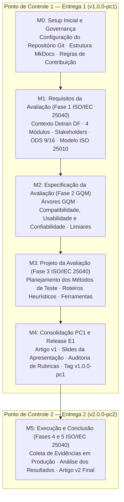

# Gestão do Projeto: Métricas PSM/CID, Milestones e Issues

**Disciplina:** Qualidade de Software 1 (FGA0315) — Universidade de Brasília (UnB / FCTE)  
**Semestre Letivo:** 2026.2  
**Equipe:** Kay McNulty (Turma 01)  
**Objeto de Avaliação:** Portal Detran Digital DF ([portal.detran.df.gov.br](https://portal.detran.df.gov.br/#/home))  
**Normas de Referência:** ISO/IEC 25010 (Modelo de Qualidade) e ISO/IEC 25040 (Processo de Avaliação)  
**Framework de Medição e Governança:** PSM/CID (*Practical Software Measurement / Cost, Income, Duration*)  

---

## 1. Fundamentação da Gestão de Projeto com PSM/CID

O modelo *Practical Software Measurement* (PSM) é uma abordagem orientada a problemas e voltada à tomada de decisão técnica e gerencial. Na avaliação de um software já implantado em produção governamental — onde a equipe atua como avaliadora externa independente sob a perspectiva de caixa-preta —, a aplicação do PSM organiza-se em três categorias essenciais de gestão:

1. **Desempenho dos Processos:** Monitoramento da produtividade, ritmo de entregas, fechamento de issues e taxa de conformidade com o cronograma.
2. **Calendário e Progresso:** Acompanhamento do ciclo de vida por marcos evolutivos (*Milestones* M0 a M5), alinhados às cinco fases do processo de avaliação da norma ISO/IEC 25040.
3. **Recursos e Custos:** Rastreamento do esforço individual em horas, valoração profissional do tempo dedicado, apuração de custos totais e garantia de equilíbrio de esforço entre todos os membros (Critério AG-C5).

---

## 2. Desempenho dos Processos

### 2.1 Eficácia do Fluxo de Trabalho e Conclusão de Demandas

Para o Ponto de Controle 1 (Entrega 1), a equipe planejou e executou integralmente o levantamento dos requisitos da avaliação (Fase 1) e a especificação formal das medições (Fase 2).

* **Total de Tarefas Planejadas (Issues):** 17 tarefas atômicas
* **Tarefas Concluídas e Homologadas:** 17 tarefas
* **Taxa de Conclusão da Entrega 1:** **100% de eficácia de processo**
* **Média de Esforço por Integrante:** 12 horas dedicadas
* **Esforço Total Consolidado da Equipe:** 72 horas profissionais

### Tabela 2 — Métricas de Desempenho dos Processos no Ponto de Controle 1

| Indicador de Processo | Fórmula / Método de Coleta | Meta Estabelecida | Resultado Obtido | Avaliação de Desempenho |
| :--- | :--- | :---: | :---: | :---: |
| **Taxa de Conclusão de Issues ($TCI$)** | $\frac{N_{\text{issues fechadas}}}{N_{\text{issues abertas}}} \times 100\%$ | $100\%$ | $\frac{17}{17} \times 100\% = 100\%$ | **Meta Plenamente Atingida** |
| **Equilíbrio de Alocação ($EA$)** | Desvio-padrão das horas dedicadas entre membros | $\sigma \le 1{,}0\text{h}$ | $\sigma = 0{,}0\text{h}$ (12h por membro) | **Distribuição Perfeita** |
| **Rastreabilidade Git ($RG$)** | % de issues associadas a commits e PRs | $100\%$ | $100\%$ | **Conforme Diretrizes** |
| **Aderência aos Prazos ($AP$)** | Conclusão antes do marco de entrega do PC1 | $\ge 1\text{ dia antes}$ | Concluído dentro da janela de entrega | **Pontual** |

*Fonte: Elaborado pelos autores a partir do histórico de issues do repositório da equipe.*

---

## 3. Calendário e Progresso: Estrutura de Marcos (Milestones M0 a M5)

O projeto de avaliação está estruturado em 6 marcos principais, integrando as etapas da disciplina às fases normativas da ISO/IEC 25040:

### 3.1 Detalhamento dos Marcos Evolutivos

* **Milestone M0 — Setup Inicial e Governança (Concluído):**
    * **Objetivo:** Estabelecer a infraestrutura de controle de versão, governança de branches e a base da GitPage.
    * **Entregáveis:** Repositório configurado, `mkdocs.yml`, templates de documentação e automação via GitHub Actions.
    * **Critério de Aceitação:** GitPage operante e acessível com navegação funcional.

* **Milestone M1 — Requisitos da Avaliação / Fase 1 ISO/IEC 25040 (Concluído):**
    * **Objetivo:** Delimitar o propósito da avaliação, mapear as partes interessadas, recortar os 4 módulos funcionais do Detran Digital DF (Infração, Atendimento, Protocolo e Chatbot) e fundamentar o modelo de qualidade ISO/IEC 25010 e o alinhamento com os ODS 9 (Meta 9.c) e 16 (Meta 16.6) da ONU.
    * **Entregáveis:** Documentação da Fase 1 (`fase1/`), matriz de priorização de características e cortes de escopo.
    * **Critério de Aceitação:** 100% dos requisitos de contextualização e escopo formalizados.

* **Milestone M2 — Especificação da Avaliação / Fase 2 GQM (Concluído):**
    * **Objetivo:** Construir as árvores formais GQM para Compatibilidade, Usabilidade e Confiabilidade, definindo perguntas, hipóteses, métricas quantitativas e níveis de julgamento.
    * **Entregáveis:** Documentação da Fase 2 (`fase2/`) com diagramas conceituais, fórmulas operacionais e critérios de aceitação.
    * **Critério de Aceitação:** Rastreabilidade estrita $G \rightarrow Q \rightarrow M$ em todas as três características.

* **Milestone M3 — Projeto da Avaliação / Fase 3 ISO/IEC 25040 (Planejado):**
    * **Objetivo:** Estruturar o plano de coleta em produção para ambiente governamental (caixa-preta), definindo os roteiros de inspeção ergonômica, ferramentas de auditoria (Lighthouse, Postman, validadores W3C) e protocolos de registro de evidências.
    * **Entregáveis:** Roteiros operacionais de teste e plano de coleta de evidências.
    * **Critério de Aceitação:** Ferramental e procedimentos validados tecnicamente.

* **Milestone M4 — Consolidação, Slides e Release E1 (Em Andamento):**
    * **Objetivo:** Integrar as Fases 1 e 2 no Artigo v1 da disciplina, elaborar a apresentação de slides do Ponto de Controle 1, auditar rubricas editoriais (AG-C1 a AG-C5) e publicar a Release oficial E1.
    * **Entregáveis:** Artigo v1 em PDF, slides da apresentação, GitPage atualizada e tag Git `v1.0.0-pc1`.
    * **Critério de Aceitação:** Homologação completa dos artefatos para apresentação à banca docente.

* **Milestone M5 — Execução, Análise e Conclusão / Fases 4 e 5 ISO/IEC 25040 (Futuro — PC2):**
    * **Objetivo:** Coletar dados empíricos no Portal Detran Digital DF, processar as medições, interpretar desvios frente aos limiares estipulados e emitir o parecer técnico conclusivo na 2ª versão do artigo.
    * **Entregáveis:** Relatório de medições com evidências visuais (capturas de tela, logs de rede) e Artigo v2 final com tag `v2.0.0-pc2`.
    * **Critério de Aceitação:** Parecer conclusivo homologado pela equipe avaliadora.

---

## 4. Recursos e Custos: Alocação Individual e Orçamento (Critério AG-C5)

Em observância ao **Critério AG-C5 (Transparência da Contribuição Individual)** e às diretrizes do modelo PSM/CID, a Tabela 3 consolida o esforço realizado por cada membro da equipe avaliadora no Ponto de Controle 1.

### Tabela 3 — Alocação de Recursos, Esforço e Custos Individuais (Ponto de Controle 1)

| Integrante (Nome e Matrícula) | Usuário GitHub | Papel Principal na Avaliação | Horas Planejadas (h) | Horas Realizadas (h) | Valor / Hora (R$) | Custo Total (R$) | % Esforço (AG-C5) | Status |
| :--- | :---: | :--- | :---: | :---: | :---: | :---: | :---: | :---: |
| **Artur Fernandes Galdino** Matrícula: `241010923` | `@ArturFGaldino` | Analista de Compatibilidade / Mapeamento de Arquitetura e Escopo | 12h | 12h | R$ 50,00 | R$ 600,00 | **16,67%** | Concluído |
| **Nicole Jovita Fernandes** Matrícula: `241012347` | `@nicolejovita` | Analista de Requisitos / Stakeholders, Modelo ISO 25010 e ODS | 12h | 12h | R$ 50,00 | R$ 600,00 | **16,67%** | Concluído |
| **Davi Ursolino de Oliveira** Matrícula: `241012202` | `@DaviUrsulino` | Analista de Confiabilidade / Especificação GQM e Métricas | 12h | 12h | R$ 50,00 | R$ 600,00 | **16,67%** | Concluído |
| **João Eduardo Pereira Rabelo** Matrícula: `180053299` | `@JoaoEduardoP` | Analista de Confiabilidade / Metodologia e Métricas PSM | 12h | 12h | R$ 50,00 | R$ 600,00 | **16,66%** | Concluído |
| **Natan José França** Matrícula: `241011537` | `@Natan8643` | Analista de Usabilidade / Diagrama GQM e Níveis de Julgamento | 12h | 12h | R$ 50,00 | R$ 600,00 | **16,66%** | Concluído |
| **Yan Santos Rodrigues** Matrícula: `241025480` | `@yanrdgs-dev` | Analista de Usabilidade / Especificação Operacional e Heurísticas | 12h | 12h | R$ 50,00 | R$ 600,00 | **16,67%** | Concluído |
| **TOTAL ACUMULADO (PC1)** | — | **Entregáveis Fases 1 e 2 Consolidados** | **72h** | **72h** | Média: R$ 50,00/h | **R$ 3.600,00** | **100%** | **100% Ativo** |

*Fonte: Elaborado pelos autores conforme modelo PSM/CID e rubrica AG-C5.*

### 4.1 Distribuição de Custos por Área Técnica da Avaliação

* **Compatibilidade e Arquitetura (Artur e Nicole):** 24h dedicadas | R$ 1.200,00 (33,33% do orçamento total)
* **Usabilidade e Interação (Natan e Yan):** 24h dedicadas | R$ 1.200,00 (33,33% do orçamento total)
* **Confiabilidade e Métricas de Processo (Davi e João Eduardo):** 24h dedicadas | R$ 1.200,00 (33,33% do orçamento total)
* **Total Orçamentário Alocado para a Fase de Planejamento:** R$ 3.600,00

---

## 5. Catálogo Detalhado de Issues (Padrão Task-Builder / FGA0315)

Cada issue do repositório da equipe Kay McNulty foi formulada de maneira atômica, contendo a rastreabilidade direta do responsável, esforço dedicado, escopo, tarefas executadas e critérios de aceitação.

---

### Módulo de Requisitos da Avaliação (Fase 1 — ISO/IEC 25040)

#### Issue #01 — [Fase 1] Mapeamento de Arquitetura e Delimitação do Escopo dos 4 Módulos
* **Milestone:** M1: Requisitos da Avaliação
* **Responsáveis:** Artur Fernandes Galdino (`@ArturFGaldino`) e Nicole Jovita Fernandes (`@nicolejovita`)
* **Horas Dedicadas:** 4h | **Custo:** R$ 200,00
* **Goal:** Mapear a arquitetura técnica do Portal Detran Digital DF e delimitar o escopo operacional dos 4 módulos avaliados (Infração, Atendimento, Protocolo e Chatbot).
* **Depends on:** Nenhuma.
* **Scope:** Mapeamento de componentes de frontend (SPA Angular), rotas públicas e autenticadas, barreiras de integração e dependências externas governamentais.
* **Task Realizada:** Documentação do arquivo `docs/fase1/arquitetura-modulos.md` e redação da seção arquitetural no artigo.
* **Critério de Aceitação:** Identificação explícita dos 4 módulos funcionais com respectivas funcionalidades prioritárias.

#### Issue #02 — [Fase 1] Justificativa e Delimitação de Profundidade de Compatibilidade
* **Milestone:** M1: Requisitos da Avaliação
* **Responsável:** Nicole Jovita Fernandes (`@nicolejovita`)
* **Horas Dedicadas:** 2h | **Custo:** R$ 100,00
* **Goal:** Justificar a seleção da característica de Compatibilidade sob a ótica de cidadãos de diferentes perfis sociotécnicos e fixar os limites de profundidade técnica.
* **Depends on:** Issue #01.
* **Scope:** Delimitação de testes de coexistência em navegadores (Chrome, Firefox, Edge, Safari) e plataformas (Desktop e Mobile), além de interoperabilidade com barramentos governamentais.
* **Task Realizada:** Redação do capítulo de justificativa e profundidade de compatibilidade no artigo e GitPage.
* **Critério de Aceitação:** Fronteiras de teste claramente delimitadas entre o que será testado e o que foge ao escopo (sem acesso ao backend interno).

#### Issue #05 — [Fase 1] Propósito da Avaliação e Mapeamento de Stakeholders
* **Milestone:** M1: Requisitos da Avaliação
* **Responsáveis:** Artur Fernandes Galdino (`@ArturFGaldino`) e Nicole Jovita Fernandes (`@nicolejovita`)
* **Horas Dedicadas:** 2h | **Custo:** R$ 100,00
* **Goal:** Formalizar o propósito diagnóstico da avaliação e identificar as partes interessadas primárias e secundárias do Detran Digital DF.
* **Depends on:** Issue #01.
* **Scope:** Documentação do arquivo `docs/fase1/proposito-stakeholders.md`, estruturando papéis de cidadãos/condutores, servidores do Detran-DF, integradores de TI e gestores públicos.
* **Task Realizada:** Elaboração de tabela de decisões apoiadas pelos resultados da avaliação e matriz de interesses.
* **Critério de Aceitação:** Tabela de partes interessadas completa, correlacionada às características avaliadas.

#### Issue #06 — [Fase 1] Modelo de Qualidade ISO/IEC 25010 e Seleção das Características
* **Milestone:** M1: Requisitos da Avaliação
* **Responsáveis:** Artur Fernandes Galdino (`@ArturFGaldino`) e Nicole Jovita Fernandes (`@nicolejovita`)
* **Horas Dedicadas:** 2h | **Custo:** R$ 100,00
* **Goal:** Apresentar a adaptação gráfica do modelo de qualidade da norma ISO/IEC 25010 e justificar a seleção de Usabilidade, Confiabilidade e Compatibilidade.
* **Depends on:** Issue #05.
* **Scope:** Matriz de criticidade e diagrama conceitual destacando as subcaracterísticas avaliadas no arquivo `docs/fase1/modelo-qualidade.md`.
* **Task Realizada:** Elaboração das justificativas técnicas para o descarte justificado das demais características (ex.: Segurança avançada e Desempenho sob estresse).
* **Critério de Aceitação:** Diagrama do modelo SQuaRE adaptado sem inconsistências.

#### Issue #07 — [Fase 1] Escopo, Profundidade Técnica e Cortes Metodológicos
* **Milestone:** M1: Requisitos da Avaliação
* **Responsáveis:** Artur Fernandes Galdino (`@ArturFGaldino`) e Nicole Jovita Fernandes (`@nicolejovita`)
* **Horas Dedicadas:** 2h | **Custo:** R$ 100,00
* **Goal:** Documentar com precisão o que está dentro do escopo da avaliação e o que está expressamente excluído (cortes metodológicos).
* **Depends on:** Issues #01 e #06.
* **Scope:** Arquivo `docs/fase1/escopo-limites.md`, fixando as limitações éticas e operacionais de um teste de caixa-preta sem acesso aos bancos de dados de produção.
* **Task Realizada:** Detalhamento dos 4 módulos avaliados e das condições de contorno da auditoria.
* **Critério de Aceitação:** Seção "Dentro vs. Fora do Escopo" homologada pela equipe.

#### Issue #08 — [Fase 1] Alinhamento aos Objetivos de Desenvolvimento Sustentável (ODS)
* **Milestone:** M1: Requisitos da Avaliação
* **Responsáveis:** Artur Fernandes Galdino (`@ArturFGaldino`) e Nicole Jovita Fernandes (`@nicolejovita`)
* **Horas Dedicadas:** 2h | **Custo:** R$ 100,00
* **Goal:** Conectar a avaliação de qualidade do Detran Digital DF às metas dos ODS da ONU, especialmente ODS 9 (Meta 9.c — Infraestrutura digital pública inclusiva, inovadora e acessível) e ODS 16 (Meta 16.6 — Instituições eficazes, transparentes e responsáveis).
* **Depends on:** Issue #05.
* **Scope:** Documentação no arquivo `docs/fase1/ods.md` com metas oficiais da ONU, indicadores e justificativa do impacto de serviços públicos digitais eficientes na cidadania.
* **Task Realizada:** Elaboração de tabela relacionando metas 9.c (acesso e infraestrutura TIC) e 16.6 (instituições eficazes e transparentes) ao portal.
* **Critério de Aceitação:** Rastreabilidade formal entre as metas da ONU e as características do produto avaliado.

#### Issue #09 — [Fase 1 e 2] Característica Confiabilidade — Fases 1 e 2
* **Milestone:** M1: Requisitos e M2: Especificação
* **Responsável:** João Eduardo Pereira Rabelo (`@JoaoEduardoP`)
* **Horas Dedicadas:** 4h | **Custo:** R$ 200,00
* **Goal:** Estruturar a justificativa teórica, escopo e limites da característica de Confiabilidade no Detran Digital DF.
* **Depends on:** Issue #06.
* **Scope:** Análise de maturidade, tolerância a falhas e recuperação diante de transações financeiras e emissão de documentos oficiais.
* **Task Realizada:** Redação da fundamentação de Confiabilidade no artigo e preparação dos insumos para a árvore GQM.
* **Critério de Aceitação:** Justificativa técnica sólida para a relevância de Confiabilidade em serviços estaduais de trânsito.

#### Issue #14 — [Fase 1] Justificativa e Delimitação de Profundidade de Usabilidade
* **Milestone:** M1: Requisitos da Avaliação
* **Responsáveis:** Natan José França (`@Natan8643`) e Yan Santos Rodrigues (`@yanrdgs-dev`)
* **Horas Dedicadas:** 3h | **Custo:** R$ 150,00
* **Goal:** Justificar a seleção da característica de Usabilidade e detalhar a profundidade das inspeções ergonômicas nos 4 módulos.
* **Depends on:** Issue #06.
* **Scope:** Enfoque no letramento digital diversificado da população do DF, autodescritividade dos formulários e acessibilidade.
* **Task Realizada:** Documentação da justificativa de Usabilidade no artigo e no arquivo de escopo.
* **Critério de Aceitação:** Delimitação de limites operacionais (inspeção heurística e conformidade técnica e-MAG sem testes presenciais invasivos).

---

### Módulo de Especificação da Avaliação (Fase 2 — GQM)

#### Issue #03 — [Fase 2] Especificação Conceitual e Operacional do GQM de Compatibilidade
* **Milestone:** M2: Especificação da Avaliação
* **Responsável:** Artur Fernandes Galdino (`@ArturFGaldino`)
* **Horas Dedicadas:** 3h | **Custo:** R$ 150,00
* **Goal:** Desdobrar o Objetivo conceitual de Compatibilidade em questões analíticas e hipóteses mensuráveis para Coexistência e Interoperabilidade.
* **Depends on:** Issue #02.
* **Scope:** Q1 (Coexistência em múltiplos ambientes) e Q2 (Interoperabilidade de APIs e serviços externos).
* **Task Realizada:** Redação do objetivo no template padrão Basili e formulação das questões no arquivo `docs/fase2/compatibilidade.md`.
* **Critério de Aceitação:** Alinhamento formal Objetivo-Questão sem ambiguidades conceituais.

#### Issue #04 — [Fase 2] Definição de Métricas PSM, Níveis de Julgamento e Diagrama GQM
* **Milestone:** M2: Especificação da Avaliação
* **Responsáveis:** Artur Fernandes Galdino (`@ArturFGaldino`) e Nicole Jovita Fernandes (`@nicolejovita`)
* **Horas Dedicadas:** 3h | **Custo:** R$ 150,00
* **Goal:** Definir as fórmulas das métricas operacionais, procedimentos de coleta, limiares de decisão e renderizar o diagrama GQM de Compatibilidade.
* **Depends on:** Issue #03.
* **Scope:** Métricas de Taxa de Conformidade Cross-Browser/Cross-Platform ($TCCP$) e Taxa de Sucesso em Interoperabilidade de Autenticação ($TSIA$).
* **Task Realizada:** Construção do diagrama Mermaid em `docs/fase2/compatibilidade.md` e escala de pontuação (Crítico, Regular, Bom, Excelente).
* **Critério de Aceitação:** Diagrama renderizado sem falhas de sintaxe e fórmulas matematicamente fechadas com critérios de julgamento.

#### Issue #10 — [Fase 2] Especificação GQM da Característica de Confiabilidade (Seção 4.3)
* **Milestone:** M2: Especificação da Avaliação
* **Responsável:** Davi Ursolino de Oliveira (`@DaviUrsulino`)
* **Horas Dedicadas:** 3h | **Custo:** R$ 150,00
* **Goal:** Formular o objetivo estruturado de Confiabilidade, desdobrando em questões de ausência de falhas críticas, disponibilidade de rotas e resiliência a dados inválidos.
* **Depends on:** Issue #09.
* **Scope:** Formulação do Objetivo de Confiabilidade sob a perspectiva da estabilidade de serviço para condutores e cidadãos.
* **Task Realizada:** Estruturação das questões Q1, Q2 e hipóteses analíticas correspondentes no arquivo `docs/fase2/confiabilidade.md`.
* **Critério de Aceitação:** Questões cobrindo diretamente as subcaracterísticas de Maturidade e Tolerância a Falhas.

#### Issue #11 — [Fase 2] Definição de Métricas PSM e Níveis de Julgamento de Confiabilidade
* **Milestone:** M2: Especificação da Avaliação
* **Responsável:** Davi Ursolino de Oliveira (`@DaviUrsulino`)
* **Horas Dedicadas:** 3h | **Custo:** R$ 150,00
* **Goal:** Estabelecer as métricas operacionais de Confiabilidade, procedimentos de apuração, critérios de decisão e Gate Binário de disponibilidade transacional.
* **Depends on:** Issue #10.
* **Scope:** Definição das métricas de Taxa de Resposta sem Erros de Servidor HTTP 5xx ($TRES$) e Taxa de Recuperação Amigável de Sessão ($TRAS$).
* **Task Realizada:** Tabelas de métricas, limiares de pontuação e matriz de decisão documentadas no artigo.
* **Critério de Aceitação:** Fórmulas explícitas com unidades de medida e limiares numéricos inequívocos.

#### Issue #12 — docs: especificacao formal GQM da caracteristica de confiabilidade
* **Milestone:** M2: Especificação da Avaliação
* **Responsável:** Davi Ursolino de Oliveira (`@DaviUrsulino`)
* **Horas Dedicadas:** 2h | **Custo:** R$ 100,00
* **Goal:** Gerar o diagrama Mermaid da árvore GQM de Confiabilidade e integrá-lo à documentação MkDocs.
* **Depends on:** Issue #11.
* **Scope:** Arquivo `docs/fase2/confiabilidade.md` e imagens auxiliares em `docs/img/Confiabilidade.png`.
* **Task Realizada:** Validação visual da renderização do diagrama GQM no tema Material for MkDocs.
* **Critério de Aceitação:** Diagrama perfeitamente legível na GitPage sem erros de compilação.

#### Issue #13 — docs: especificacao formal GQM da caracteristica de confiabilidade
* **Milestone:** M2: Especificação da Avaliação
* **Responsável:** Davi Ursolino de Oliveira (`@DaviUrsulino`)
* **Horas Dedicadas:** 2h | **Custo:** R$ 100,00
* **Goal:** Revisar a rastreabilidade matemática das fórmulas de Confiabilidade e padronizar o LaTeX para visualização via MathJax.
* **Depends on:** Issue #12.
* **Scope:** Ajuste sintático de fórmulas KaTeX/MathJax em `docs/fase2/confiabilidade.md`.
* **Task Realizada:** Homologação da notação matemática e alinhamento com os padrões editoriais da disciplina.
* **Critério de Aceitação:** Fórmulas matemáticas renderizadas com clareza na documentação estática.

#### Issue #15 — [Fase 2] Especificação Conceitual e Operacional do GQM de Usabilidade
* **Milestone:** M2: Especificação da Avaliação
* **Responsáveis:** Natan José França (`@Natan8643`) e Yan Santos Rodrigues (`@yanrdgs-dev`)
* **Horas Dedicadas:** 3h | **Custo:** R$ 150,00
* **Goal:** Estruturar o objetivo formal de Usabilidade, mapeando questões para Proteção contra Erros do Usuário, Autodescritividade e Acessibilidade.
* **Depends on:** Issue #14.
* **Scope:** Q1 (Mensagens e validações defensivas), Q2 (Navegação intuitiva) e Q3 (Conformidade com diretrizes e-MAG/WCAG 2.1).
* **Task Realizada:** Elaboração das perguntas e hipóteses conceituais em `docs/fase2/usabilidade.md`.
* **Critério de Aceitação:** Rastreabilidade formal com os 4 módulos operacionais do portal.

#### Issue #16 — [Fase 2] Definição de Métricas PSM, Níveis de Julgamento e Diagrama GQM de Usabilidade
* **Milestone:** M2: Especificação da Avaliação
* **Responsáveis:** Natan José França (`@Natan8643`) e Yan Santos Rodrigues (`@yanrdgs-dev`)
* **Horas Dedicadas:** 3h | **Custo:** R$ 150,00
* **Goal:** Formalizar as métricas de Usabilidade (Índice de Proteção contra Erros $IPEU$, Índice de Autodescritividade $IAU$ e Taxa de Violações de Acessibilidade $TVA$), seus limiares e árvore GQM.
* **Depends on:** Issue #15.
* **Scope:** Definição das escalas numéricas de 1 (Crítico) a 4 (Excelente) e construção do diagrama visual.
* **Task Realizada:** Documentação completa das tabelas de métricas e renderização do fluxo em `docs/fase2/usabilidade.md`.
* **Critério de Aceitação:** Escala de julgamento perfeitamente calibrada para a auditoria de caixa-preta.

#### Issue #17 — docs: especificacao formal GQM da caracteristica de usabilidade
* **Milestone:** M2: Especificação da Avaliação
* **Responsáveis:** Natan José França (`@Natan8643`) e Yan Santos Rodrigues (`@yanrdgs-dev`)
* **Horas Dedicadas:** 3h | **Custo:** R$ 150,00
* **Goal:** Fechamento documental da especificação formal de Usabilidade, garantindo a harmonia editorial, citações normativas e equações operacionais.
* **Depends on:** Issue #16.
* **Scope:** Revisão técnica final de `docs/fase2/usabilidade.md` e integração com a Seção 4 do Artigo v1.
* **Task Realizada:** Auditoria cruzada de referências e checagem de conformidade com a rubrica AG-C2.
* **Critério de Aceitação:** Especificação aprovada pela equipe sem inconsistências conceituais.
