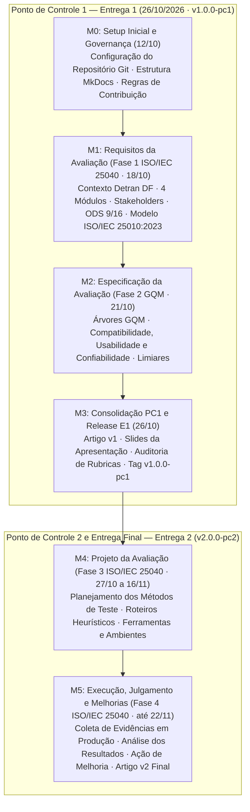

# Gestão do Projeto: Métricas PSM/CID, Milestones e Issues

**Disciplina:** Qualidade de Software 1 (FGA0315) — Universidade de Brasília (UnB / FCTE)  
**Semestre Letivo:** 2026.2  
**Equipe:** Kay McNulty (Turma 01)  
**Objeto de Avaliação:** Portal Detran Digital DF ([portal.detran.df.gov.br](https://portal.detran.df.gov.br/#/home))  
**Normas de Referência:** ISO/IEC 25010:2023 (Modelo de Qualidade do Produto, família SQuaRE — *Systems and software Quality Requirements and Evaluation*) e ISO/IEC 25040 (Processo de Avaliação)  
**Framework de Medição e Governança:** PSM/CID (*Practical Software and Systems Measurement / Cost, Income, Duration*)  

---

## 1. Fundamentação da Gestão de Projeto com PSM/CID

O modelo *Practical Software and Systems Measurement* (PSM) é uma abordagem orientada a problemas e voltada à tomada de decisão técnica e gerencial. Na avaliação de um software já implantado em produção governamental — onde a equipe atua como avaliadora externa independente sob a perspectiva de caixa-preta —, a aplicação do PSM/CID organiza-se em três das sete categorias de informação do PSM, selecionadas pela equipe para este projeto:

1. **Desempenho dos Processos (*Process Performance*):** Monitoramento da produtividade, ritmo de entregas, fechamento de issues e taxa de conformidade com o cronograma.
2. **Calendário e Progresso (*Schedule and Progress*):** Acompanhamento do ciclo de vida por marcos evolutivos (*Milestones* M0 a M5), alinhados às cinco fases do processo de avaliação da norma ISO/IEC 25040.
3. **Recursos e Custos (*Resources and Cost*):** Rastreamento do esforço individual em horas, valoração profissional do tempo dedicado (valor/hora de referência de R$ 50,00 adotado pela equipe), apuração de custos totais e garantia de equilíbrio de esforço entre todos os membros (Critério AG-C5).

De forma complementar, as métricas de commits e de linhas adicionadas/removidas (Seção 3.2) correspondem à categoria *Product Size and Stability* (Tamanho e Estabilidade do Produto) e são usadas como evidência auxiliar do ritmo de integração.

### 1.1 Necessidades de Informação

Cada medida desta página existe para responder a uma pergunta da equipe e para sustentar uma decisão. Esta subseção liga cada necessidade de informação à medida que a responde, ao critério usado para interpretá-la, ao resultado observado na Entrega 1 e à decisão que o resultado motiva. Os dados vêm das issues e dos pull requests do repositório, coletados em 10/11/2026.

#### Necessidade 1: o trabalho é fechado aos poucos ou em bloco?

| Campo | Especificação |
| :--- | :--- |
| **Categoria PSM** | Calendário e Progresso |
| **Necessidade de informação** | Saber se as issues de uma fase fecham ao longo do prazo ou se o trabalho é integrado todo de uma vez, o que esconde atrasos e atrapalha a revisão. |
| **Medida base** | Data de fechamento de cada issue (`closed_at`) e total de issues da fase. |
| **Indicador** | Maior fração de issues fechadas em um único dia: `issues fechadas no dia de pico / total de issues da fase`. |
| **Critério de interpretação** | Até 50%: fechamento distribuído. Acima de 50%: fechamento em bloco. |
| **Resultado na Entrega 1** | 10 das 14 issues fecharam em 18/10, o que dá 71%. Outras 3 fecharam em 19/10 e 1 em 21/10. Fechamento em bloco, embora todas tenham fechado antes do prazo de 26/10. |
| **Decisão** | Na Entrega 2, dividir as issues em tarefas menores e dar a cada uma um prazo intermediário, para que o fechamento acompanhe o andamento real. |
| **Relação com a Tabela 2** | Usa as colunas de issues fechadas e taxa de conclusão. |
| **Fonte e coleta** | API do GitHub (issues). Automatizada: o script `.github/scripts/update_metrics.py` recalcula o indicador a cada push na `main` (workflow `Métricas PSM`). |
| **Quando revisar** | Antes do Ponto de Controle 2 (16/11 ou 18/11) e antes da entrega final (22/11). |

**Medição automatizada (atualizada pelo pipeline):**

--8<-- "necessidade-1-fechamento.md"

#### Necessidade 2: os pull requests são revisados por outra pessoa?

| Campo | Especificação |
| :--- | :--- |
| **Categoria PSM** | Desempenho dos Processos |
| **Necessidade de informação** | Saber se o que entra na `main` passa pelo olhar de outra pessoa da equipe antes do merge. |
| **Medida base** | Pull requests mergeados e, para cada um, as revisões feitas por pessoas diferentes do autor. |
| **Indicador** | `PRs mergeados com revisão de outra pessoa / PRs mergeados`. |
| **Critério de interpretação** | Meta de 100%. Abaixo disso, o processo de revisão não está funcionando. |
| **Resultado na Entrega 1** | 1 dos 4 PRs mergeados teve revisão de outra pessoa, o que dá 25%. O PR #18 foi revisado pelo Natan cerca de 9 horas depois de aberto. |
| **Decisão** | Todo PR passa a ter um revisor definido na abertura e só é mergeado depois da revisão. Se um PR ficar 24 horas sem revisão, o autor avisa no grupo. |
| **Relação com a Tabela 2** | Indicador novo, ainda sem coluna na tabela. |
| **Fonte e coleta** | API do GitHub (pull requests e revisões). Automatizada: o script `.github/scripts/update_metrics.py` recalcula o indicador a cada push na `main` (workflow `Métricas PSM`). |
| **Quando revisar** | Antes do Ponto de Controle 2 (16/11 ou 18/11) e antes da entrega final (22/11). |

**Medição automatizada (atualizada pelo pipeline):**

--8<-- "necessidade-2-revisao-prs.md"

#### Necessidade 3: quanto esforço cada integrante dedica?

| Campo | Especificação |
| :--- | :--- |
| **Categoria PSM** | Recursos e Custos |
| **Necessidade de informação** | Saber quantas horas cada pessoa dedica a cada issue, para equilibrar a carga e estimar melhor as próximas entregas. |
| **Medida base** | Campo `Horas Dedicadas` preenchido no corpo de cada issue. |
| **Indicador** | `issues fechadas com horas registradas / issues fechadas`. |
| **Critério de interpretação** | Meta de 100%. Abaixo disso, a distribuição de esforço e o custo não são confiáveis. |
| **Resultado na Entrega 1** | A equipe não registrou horas nas issues. Os valores de horas e custo da Entrega 1 são estimativas e não medições. |
| **Decisão** | A partir da Entrega 2, usar o template padrão de issue e só fechar a issue com `Horas Dedicadas` preenchido. |
| **Relação com a Tabela 2** | Alimenta a coluna de horas. |
| **Fonte e coleta** | Corpo das issues, lido pelo script `.github/scripts/update_metrics.py`. |
| **Quando revisar** | Antes do Ponto de Controle 2 (16/11 ou 18/11) e antes da entrega final (22/11). |

*Fonte: elaborado pela equipe a partir das issues e dos pull requests do repositório, 10/11/2026.*

---

## 2. Desempenho dos Processos

### 2.1 Eficácia do Fluxo de Trabalho e Conclusão de Demandas

Para o Ponto de Controle 1 (Entrega 1), a equipe planejou e executou integralmente o levantamento dos requisitos da avaliação (Fase 1) e a especificação formal das medições (Fase 2), além de iniciar o planejamento do projeto da avaliação (Fase 3, Milestone M4). Os dados consolidados a seguir são extraídos diretamente do repositório:

### Tabela 1 — Resumo Consolidado do Processo no Ponto de Controle 1

--8<-- "resumo-processo.md"

### Tabela 2 — Métricas de Desempenho dos Processos no Ponto de Controle 1

--8<-- "process-performance-table.md"

*Fonte: Gerada pelo pipeline a partir do histórico de issues do repositório e do catálogo homologado de esforço.*

**Fórmulas e metas dos indicadores:**

* **Taxa de Conclusão (%)** = (Issues Fechadas ÷ Issues Atribuídas) × 100 — meta do PC1: 100%.
* **Horas por integrante (h)** = Σ (horas da issue ÷ número de responsáveis da issue).
* **Média de esforço por integrante (h)** = Esforço Total da Equipe ÷ 6 integrantes.
* O total de issues da Tabela 2 corresponde a **atribuições** (issue × responsável): uma issue com dois responsáveis é contada uma vez para cada um.

### 2.2 Painel Automatizado de Tarefas e Resolução de Demanda

Abaixo são apresentados os gráficos e a síntese analítica gerados de forma contínua pelo pipeline de automação da equipe, consolidando a distribuição de tarefas por integrante e respectivo status de homologação:

=== "Tarefas Resolvidas"
    ```mermaid
    --8<-- "resolved-issues.mmd"
    ```

=== "Issues Atribuídas"
    ```mermaid
    --8<-- "assigned-issues.mmd"
    ```

=== "Quadro Resumo de Issues"
    --8<-- "issues-summary.md"

---

## 3. Calendário e Progresso: Estrutura de Marcos (Milestones M0 a M5)

O projeto de avaliação está estruturado em 6 marcos principais integrando as etapas e datas do calendário acadêmico às fases normativas da ISO/IEC 25040:



### 3.1 Detalhamento dos Marcos Evolutivos

* **Milestone M0 — Setup Inicial e Governança (Concluído em 12/10/2026):**
    * **Objetivo:** Estabelecer a infraestrutura de controle de versão, governança de branches e a base da GitPage.
    * **Entregáveis:** Repositório configurado, `mkdocs.yml`, templates de documentação e automação via GitHub Actions.
    * **Critério de Aceitação:** GitPage operante e acessível com navegação funcional.

* **Milestone M1 — Requisitos da Avaliação / Fase 1 ISO/IEC 25040 (Concluído em 18/10/2026):**
    * **Objetivo:** Delimitar o propósito da avaliação, mapear as partes interessadas, recortar os 4 módulos funcionais do Detran Digital DF (Infração, Atendimento, Protocolo e Chatbot) e fundamentar o modelo de qualidade ISO/IEC 25010:2023 e o alinhamento com os ODS 9 (Meta 9.c) e 16 (Meta 16.6) da ONU.
    * **Entregáveis:** Documentação da Fase 1 (`fase1/`), matriz de priorização de características e cortes de escopo.
    * **Critério de Aceitação:** 100% dos requisitos de contextualização e escopo formalizados.

* **Milestone M2 — Especificação da Avaliação / Fase 2 GQM (*Goal-Question-Metric*) (Concluído em 21/10/2026):**
    * **Objetivo:** Construir as árvores formais GQM para Compatibilidade, Usabilidade (Capacidade de Interação) e Confiabilidade, definindo perguntas, hipóteses, métricas quantitativas e níveis de julgamento.
    * **Entregáveis:** Documentação da Fase 2 (`fase2/`) com diagramas conceituais, fórmulas operacionais e critérios de aceitação.
    * **Critério de Aceitação:** Rastreabilidade estrita $G \rightarrow Q \rightarrow M$ em todas as três características.

* **Milestone M3 — Consolidação PC1 e Release E1 (Concluído em 26/10/2026):**
    * **Objetivo:** Integrar as Fases 1 e 2 no Artigo v1 da disciplina, elaborar a apresentação de slides do Ponto de Controle 1, auditar rubricas editoriais (AG-C1 a AG-C5) e publicar a Release oficial E1 (`v1.0.0-pc1`).
    * **Entregáveis:** Artigo v1 em PDF, slides da apresentação, GitPage atualizada e tag Git `v1.0.0-pc1`.
    * **Critério de Aceitação:** Homologação completa dos artefatos para apresentação à banca docente e submissão no Moodle.

* **Milestone M4 — Projeto da Avaliação / Fase 3 ISO/IEC 25040 (Em Andamento — 27/10 a 16/11/2026):**
    * **Objetivo:** Estruturar o plano de coleta em produção para ambiente governamental (caixa-preta), definindo os roteiros de inspeção ergonômica, ferramentas de auditoria (Lighthouse, Postman, validadores W3C) e protocolos de registro de evidências.
    * **Entregáveis:** Roteiros operacionais de teste, especificação de ambientes e plano de coleta de evidências.
    * **Critério de Aceitação:** Ferramental e procedimentos validados tecnicamente pela equipe.

* **Milestone M5 — Execução, Julgamento e Melhorias / Fase 4 ISO/IEC 25040 (Futuro — até 22/11/2026):**
    * **Objetivo:** Coletar dados empíricos no Portal Detran Digital DF, processar as medições, interpretar desvios frente aos limiares, implementar ação de melhoria técnica obrigatória e emitir o parecer conclusivo na 2ª versão do artigo.
    * **Entregáveis:** Relatório de medições com evidências visuais (capturas de tela, logs de rede), ação de melhoria técnica documentada e Artigo v2 final com tag `v2.0.0-pc2`.
    * **Critério de Aceitação:** Parecer conclusivo e ação de melhoria homologados pela equipe avaliadora.

### 3.2 Velocidade de Commits e Fluxo de Integração Contínua

O histórico evolutivo de commits e alterações no repositório ao longo das semanas de desenvolvimento é monitorado dinamicamente.

=== "Velocidade de Commits"
    ```mermaid
    --8<-- "commit-velocity.mmd"
    ```

=== "Linhas Adicionadas (+)"
    ```mermaid
    --8<-- "code-additions.mmd"
    ```

=== "Linhas Removidas (-)"
    ```mermaid
    --8<-- "code-deletions.mmd"
    ```

**Legenda das linhas:**

| Cor | Integrante | Usuário GitHub |
| :---: | :--- | :---: |
| <span style="display:inline-block;width:16px;height:16px;border-radius:3px;background:#e6194B;"></span> | Artur Fernandes Galdino | `@ArturFGaldino` |
| <span style="display:inline-block;width:16px;height:16px;border-radius:3px;background:#3cb44b;"></span> | Nicole Jovita Fernandes | `@nicolejovita` |
| <span style="display:inline-block;width:16px;height:16px;border-radius:3px;background:#4363d8;"></span> | Davi Ursolino de Oliveira | `@DaviUrsulino` |
| <span style="display:inline-block;width:16px;height:16px;border-radius:3px;background:#f58231;"></span> | João Eduardo Pereira Rabelo | `@JoaoEduardoP` |
| <span style="display:inline-block;width:16px;height:16px;border-radius:3px;background:#911eb4;"></span> | Natan José França | `@Natan8643` |
| <span style="display:inline-block;width:16px;height:16px;border-radius:3px;background:#9a6324;"></span> | Yan Santos Rodrigues | `@yanrdgs-dev` |

### 3.3 Cronograma e Progresso das Próximas Entregas

#### Progresso medido da Entrega 1

Os valores abaixo vêm das issues do repositório em 10/11/2026. O progresso é a razão entre issues fechadas e issues existentes, e não pondera esforço, porque a equipe não registrou horas na Entrega 1.

| Recorte | Issues | Fechadas | Progresso |
| :--- | :---: | :---: | :---: |
| Milestone "Entrega 1" (prazo 26/10/2026) | 13 | 13 | 100% |
| Issues sem milestone | 1 | 1 | 100% |
| **Total da Entrega 1** | **14** | **14** | **100%** |

As 14 issues foram fechadas entre 18/10 e 21/10, com 13 delas em 18/10 e 19/10. A Release E1 (tag `v1.0.0-pc1`) ainda não foi criada no GitHub.

#### Linha do tempo até a entrega final

Datas do calendário oficial da disciplina, versão 2 (02/11/2026). A linha laranja marca 10/11/2026.

<div class="cron">
  <div class="cron-proximos">
    <div class="cron-proximo urgente"><strong>1 dia</strong><span>Apresentação das métricas PSM (11/11)</span></div>
    <div class="cron-proximo"><strong>6 a 8 dias</strong><span>Ponto de Controle 2 (16/11 ou 18/11)</span></div>
    <div class="cron-proximo"><strong>12 dias</strong><span>Entrega final do trabalho (22/11)</span></div>
  </div>
  <div class="cron-eixo"><span></span><div class="cron-escala"><span style="left:0.98%">12/10</span><span style="left:28.43%">26/10</span><span style="left:55.88%">09/11</span><span style="left:83.33%">23/11</span><span style="left:100.98%">02/12</span></div><span></span></div>
  <div class="cron-linha">
    <div class="cron-rotulo">Entrega 1<small>Fases 1 e 2</small></div>
    <div class="cron-trilho"><div class="cron-barra feito" style="left:0.00%;width:29.41%"></div><div class="cron-marco feito" style="left:14.71%"></div><div class="cron-hoje" style="left:57.84%"></div></div>
    <div class="cron-data">até 26/10</div>
  </div>
  <div class="cron-linha">
    <div class="cron-rotulo">Fases 3 e 4<small>Projeto e execução da avaliação</small></div>
    <div class="cron-trilho"><div class="cron-barra andamento" style="left:29.41%;width:52.94%"></div><div class="cron-hoje" style="left:57.84%"></div></div>
    <div class="cron-data">27/10 a 22/11</div>
  </div>
  <div class="cron-linha">
    <div class="cron-rotulo">Apresentação PSM<small>Métricas de gestão</small></div>
    <div class="cron-trilho"><div class="cron-marco andamento" style="left:59.80%"></div><div class="cron-hoje" style="left:57.84%"></div></div>
    <div class="cron-data">11/11</div>
  </div>
  <div class="cron-linha">
    <div class="cron-rotulo">Ponto de Controle 2<small>Dia da equipe não divulgado</small></div>
    <div class="cron-trilho"><div class="cron-barra confirmar" style="left:68.63%;width:5.88%"></div><div class="cron-hoje" style="left:57.84%"></div></div>
    <div class="cron-data">16/11 ou 18/11</div>
  </div>
  <div class="cron-linha">
    <div class="cron-rotulo">Entrega final<small>Artigo, GitPage e release</small></div>
    <div class="cron-trilho"><div class="cron-marco critico" style="left:81.37%"></div><div class="cron-hoje" style="left:57.84%"></div></div>
    <div class="cron-data">22/11</div>
  </div>
  <div class="cron-linha">
    <div class="cron-rotulo">Avaliação cruzada 2<small>Com autoavaliação 2</small></div>
    <div class="cron-trilho"><div class="cron-barra " style="left:82.35%;width:19.61%"></div><div class="cron-hoje" style="left:57.84%"></div></div>
    <div class="cron-data">23/11 a 02/12</div>
  </div>
  <div class="cron-linha">
    <div class="cron-rotulo">Apresentações finais<small>3 a 4 equipes por dia</small></div>
    <div class="cron-trilho"><div class="cron-barra " style="left:82.35%;width:15.69%"></div><div class="cron-hoje" style="left:57.84%"></div></div>
    <div class="cron-data">23, 25 e 30/11</div>
  </div>
  <div class="cron-linha">
    <div class="cron-rotulo">TAF<small>Teste de Avaliação Final</small></div>
    <div class="cron-trilho"><div class="cron-marco " style="left:100.98%"></div><div class="cron-hoje" style="left:57.84%"></div></div>
    <div class="cron-data">02/12</div>
  </div>
  <div class="cron-legenda">
    <span><i style="background:var(--cron-feito)"></i>Concluído</span>
    <span><i style="background:var(--cron-andamento)"></i>Em andamento ou próximo</span>
    <span><i style="background:var(--cron-futuro)"></i>Futuro</span>
    <span><i style="background:var(--cron-hoje)"></i>Entrega final e data de hoje</span>
  </div>
</div>

O Ponto de Controle 2 aparece nas duas datas porque o calendário não informa o dia de cada equipe. A Release E1 (tag `v1.0.0-pc1`) ainda não foi criada no GitHub. O percentual de conclusão das Fases 3 e 4 só pode ser medido quando existir um milestone da Entrega 2 com as issues dessas fases.

---

## 4. Recursos e Custos: Alocação Individual e Orçamento (Critério AG-C5)

Em observância ao **Critério AG-C5 (Transparência da Contribuição Individual)** e às diretrizes do modelo PSM/CID, a Tabela 3 consolida o esforço realizado por cada membro da equipe avaliadora no Ponto de Controle 1.

### Tabela 3 — Alocação de Recursos, Esforço e Custos Individuais (Ponto de Controle 1)

--8<-- "alocacao-recursos-custos.md"

*Fonte: Elaborado pelos autores e atualizado dinamicamente via pipeline de automação conforme modelo PSM/CID e rubrica AG-C5.*

**Fórmulas:** Custo Total (R$) = Horas Realizadas × Valor/Hora (R$ 50,00); % Esforço = Horas do integrante ÷ Horas totais da equipe × 100. Em issues com mais de um responsável, as horas são divididas igualmente entre eles.

### 4.1 Distribuição de Custos por Área Técnica da Avaliação

--8<-- "distribuicao-custos-areas.md"

### 4.2 Painel Dinâmico de Contribuição e Esforço (Critério AG-C5)

A tabela abaixo reflete as métricas calculadas em tempo real a partir dos commits, linhas alteradas (+/-), issues fechadas e valoração do esforço individual:

--8<-- "contributions-summary.md"

---

## 5. Catálogo Detalhado de Issues (Padrão Task-Builder / FGA0315)

Cada issue do repositório da equipe Kay McNulty foi formulada de maneira atômica, contendo a rastreabilidade direta do responsável, esforço dedicado, escopo, tarefas executadas e critérios de aceitação. O catálogo abaixo cobre os marcos M1 e M2 (Fases 1 e 2); o esforço dos marcos M0, M3 e M4 não está discriminado por issue. Valor/hora de referência: R$ 50,00.

---

### Módulo de Requisitos da Avaliação (Fase 1 — ISO/IEC 25040)

#### Issue #01 — [Fase 1] Mapeamento de Arquitetura e Delimitação do Escopo dos 4 Módulos
* **Milestone:** M1: Requisitos da Avaliação
* **Responsáveis:** Artur Fernandes Galdino (`@ArturFGaldino`) e Nicole Jovita Fernandes (`@nicolejovita`)
* **Horas Dedicadas:** 4h | **Custo:** R$ 200,00
* **Goal:** Mapear a arquitetura técnica do Portal Detran Digital DF e delimitar o escopo operacional dos 4 módulos avaliados (Infração, Atendimento, Protocolo e Chatbot).
* **Depends on:** Nenhuma.
* **Scope:** Mapeamento de componentes de frontend (SPA Angular), rotas públicas e autenticadas, barreiras de integração e dependências externas governamentais.
* **Task Realizada:** Documentação do arquivo `docs/fase1/arquitetura-modulos.md` e redação da seção arquitetural no artigo.
* **Critério de Aceitação:** Identificação explícita dos 4 módulos funcionais com respectivas funcionalidades prioritárias.

#### Issue #02 — [Fase 1] Justificativa e Delimitação de Profundidade de Compatibilidade
* **Milestone:** M1: Requisitos da Avaliação
* **Responsável:** Nicole Jovita Fernandes (`@nicolejovita`)
* **Horas Dedicadas:** 2h | **Custo:** R$ 100,00
* **Goal:** Justificar a seleção da característica de Compatibilidade sob a ótica de cidadãos de diferentes perfis sociotécnicos e fixar os limites de profundidade técnica.
* **Depends on:** Issues #01 e #06.
* **Scope:** Delimitação de testes de coexistência em navegadores (Chrome, Firefox, Edge, Safari) e plataformas (Desktop e Mobile), além de interoperabilidade com barramentos governamentais.
* **Task Realizada:** Redação do capítulo de justificativa e profundidade de compatibilidade no artigo e GitPage.
* **Critério de Aceitação:** Fronteiras de teste claramente delimitadas entre o que será testado e o que foge ao escopo (sem acesso ao backend interno).

#### Issue #05 — [Fase 1] Propósito da Avaliação e Mapeamento de Stakeholders
* **Milestone:** M1: Requisitos da Avaliação
* **Responsáveis:** Artur Fernandes Galdino (`@ArturFGaldino`) e Nicole Jovita Fernandes (`@nicolejovita`)
* **Horas Dedicadas:** 2h | **Custo:** R$ 100,00
* **Goal:** Formalizar o propósito diagnóstico da avaliação e identificar as partes interessadas primárias e secundárias do Detran Digital DF.
* **Depends on:** Issue #01.
* **Scope:** Documentação do arquivo `docs/fase1/proposito-stakeholders.md`, estruturando papéis de cidadãos/condutores, servidores do Detran-DF, integradores de TI e gestores públicos.
* **Task Realizada:** Elaboração de tabela de decisões apoiadas pelos resultados da avaliação e matriz de interesses.
* **Critério de Aceitação:** Tabela de partes interessadas completa, correlacionada às características avaliadas.

#### Issue #06 — [Fase 1] Modelo de Qualidade ISO/IEC 25010:2023 e Seleção das Características
* **Milestone:** M1: Requisitos da Avaliação
* **Responsáveis:** Artur Fernandes Galdino (`@ArturFGaldino`) e Nicole Jovita Fernandes (`@nicolejovita`)
* **Horas Dedicadas:** 2h | **Custo:** R$ 100,00
* **Goal:** Apresentar a adaptação gráfica do modelo de qualidade da norma ISO/IEC 25010:2023 e justificar a seleção de Usabilidade (Capacidade de Interação, *Interaction Capability*), Confiabilidade (*Reliability*) e Compatibilidade (*Compatibility*).
* **Depends on:** Issue #05.
* **Scope:** Matriz de criticidade e diagrama conceitual destacando as subcaracterísticas avaliadas no arquivo `docs/fase1/modelo-qualidade.md`.
* **Task Realizada:** Elaboração das justificativas técnicas para o descarte justificado das demais características (ex.: Segurança avançada e Desempenho sob estresse).
* **Critério de Aceitação:** Diagrama do modelo SQuaRE adaptado sem inconsistências.

#### Issue #07 — [Fase 1] Escopo, Profundidade Técnica e Cortes Metodológicos
* **Milestone:** M1: Requisitos da Avaliação
* **Responsáveis:** Artur Fernandes Galdino (`@ArturFGaldino`) e Nicole Jovita Fernandes (`@nicolejovita`)
* **Horas Dedicadas:** 2h | **Custo:** R$ 100,00
* **Goal:** Documentar com precisão o que está dentro do escopo da avaliação e o que está expressamente excluído (cortes metodológicos).
* **Depends on:** Issues #01 e #06.
* **Scope:** Arquivo `docs/fase1/escopo-limites.md`, fixando as limitações éticas e operacionais de um teste de caixa-preta sem acesso aos bancos de dados de produção.
* **Task Realizada:** Detalhamento dos 4 módulos avaliados e das condições de contorno da auditoria.
* **Critério de Aceitação:** Seção "Dentro vs. Fora do Escopo" homologada pela equipe.

#### Issue #08 — [Fase 1] Alinhamento aos Objetivos de Desenvolvimento Sustentável (ODS)
* **Milestone:** M1: Requisitos da Avaliação
* **Responsáveis:** Artur Fernandes Galdino (`@ArturFGaldino`) e Nicole Jovita Fernandes (`@nicolejovita`)
* **Horas Dedicadas:** 2h | **Custo:** R$ 100,00
* **Goal:** Conectar a avaliação de qualidade do Detran Digital DF às metas dos ODS da ONU, especialmente ODS 9 (Meta 9.c — Ampliação do acesso às tecnologias de informação e comunicação) e ODS 16 (Meta 16.6 — Instituições eficazes, responsáveis e transparentes).
* **Depends on:** Issue #05.
* **Scope:** Documentação no arquivo `docs/fase1/ods.md` com metas oficiais da ONU, indicadores e justificativa do impacto de serviços públicos digitais eficientes na cidadania.
* **Task Realizada:** Elaboração de tabela relacionando metas 9.c (acesso e infraestrutura TIC) e 16.6 (instituições eficazes e transparentes) ao portal.
* **Critério de Aceitação:** Rastreabilidade formal entre as metas da ONU e as características do produto avaliado.

#### Issue #09 — [Fase 1] Característica Confiabilidade — Justificativa, Escopo e Limites
* **Milestone:** M1: Requisitos da Avaliação
* **Responsável:** João Eduardo Pereira Rabelo (`@JoaoEduardoP`)
* **Horas Dedicadas:** 4h | **Custo:** R$ 200,00
* **Goal:** Estruturar a justificativa teórica, escopo e limites da característica de Confiabilidade (*Reliability*) no Detran Digital DF, preparando os insumos para a árvore GQM da Fase 2.
* **Depends on:** Issue #06.
* **Scope:** Análise de ausência de falhas (*Faultlessness*), disponibilidade (*Availability*), tolerância a falhas (*Fault tolerance*) e recuperabilidade (*Recoverability*) diante de transações financeiras e emissão de documentos oficiais.
* **Task Realizada:** Redação da fundamentação de Confiabilidade no artigo e preparação dos insumos para a árvore GQM.
* **Critério de Aceitação:** Justificativa técnica sólida para a relevância de Confiabilidade em serviços estaduais de trânsito.

#### Issue #14 — [Fase 1] Justificativa e Delimitação de Profundidade de Usabilidade
* **Milestone:** M1: Requisitos da Avaliação
* **Responsáveis:** Natan José França (`@Natan8643`) e Yan Santos Rodrigues (`@yanrdgs-dev`)
* **Horas Dedicadas:** 3h | **Custo:** R$ 150,00
* **Goal:** Justificar a seleção da característica de Usabilidade (Capacidade de Interação, *Interaction Capability*) e detalhar a profundidade das inspeções ergonômicas nos 4 módulos.
* **Depends on:** Issue #06.
* **Scope:** Enfoque no letramento digital diversificado da população do DF, autodescritividade (*Self-descriptiveness*) dos formulários e inclusividade (acessibilidade).
* **Task Realizada:** Documentação da justificativa de Usabilidade no artigo e no arquivo de escopo.
* **Critério de Aceitação:** Delimitação de limites operacionais (inspeção heurística e conformidade técnica ao e-MAG — Modelo de Acessibilidade em Governo Eletrônico — sem testes presenciais invasivos).

---

### Módulo de Especificação da Avaliação (Fase 2 — GQM)

#### Issue #03 — [Fase 2] Especificação Conceitual e Operacional do GQM de Compatibilidade
* **Milestone:** M2: Especificação da Avaliação
* **Responsável:** Artur Fernandes Galdino (`@ArturFGaldino`)
* **Horas Dedicadas:** 3h | **Custo:** R$ 150,00
* **Goal:** Desdobrar o Objetivo conceitual de Compatibilidade em questões analíticas e hipóteses mensuráveis para Coexistência e Interoperabilidade.
* **Depends on:** Issue #02.
* **Scope:** Q1 (Coexistência em múltiplos ambientes) e Q2 (Interoperabilidade de APIs e serviços externos).
* **Task Realizada:** Redação do objetivo no template padrão Basili e formulação das questões no arquivo `docs/fase2/compatibilidade.md`.
* **Critério de Aceitação:** Alinhamento formal Objetivo-Questão sem ambiguidades conceituais.

#### Issue #04 — [Fase 2] Definição de Métricas PSM, Níveis de Julgamento e Diagrama GQM
* **Milestone:** M2: Especificação da Avaliação
* **Responsáveis:** Artur Fernandes Galdino (`@ArturFGaldino`) e Nicole Jovita Fernandes (`@nicolejovita`)
* **Horas Dedicadas:** 3h | **Custo:** R$ 150,00
* **Goal:** Definir as fórmulas das métricas operacionais, procedimentos de coleta, limiares de decisão e renderizar o diagrama GQM de Compatibilidade.
* **Depends on:** Issue #03.
* **Scope:** Métricas de Taxa de Conformidade Cross-Browser/Cross-Platform ($TCCP$) e Taxa de Sucesso em Interoperabilidade de Autenticação ($TSIA$).
* **Task Realizada:** Construção do diagrama Mermaid em `docs/fase2/compatibilidade.md` e escala de pontuação (Crítico, Regular, Bom, Excelente).
* **Critério de Aceitação:** Diagrama renderizado sem falhas de sintaxe e fórmulas matematicamente fechadas com critérios de julgamento.

#### Issue #10 — [Fase 2] Especificação GQM da Característica de Confiabilidade (Seção 4.3)
* **Milestone:** M2: Especificação da Avaliação
* **Responsável:** Davi Ursolino de Oliveira (`@DaviUrsulino`)
* **Horas Dedicadas:** 3h | **Custo:** R$ 150,00
* **Goal:** Formular o objetivo estruturado de Confiabilidade, desdobrando em questões de ausência de falhas críticas, disponibilidade de rotas e resiliência a dados inválidos.
* **Depends on:** Issue #09.
* **Scope:** Formulação do Objetivo de Confiabilidade sob a perspectiva da estabilidade de serviço para condutores e cidadãos.
* **Task Realizada:** Estruturação das questões Q1, Q2 e hipóteses analíticas correspondentes no arquivo `docs/fase2/confiabilidade.md`.
* **Critério de Aceitação:** Questões cobrindo diretamente as subcaracterísticas de Ausência de Falhas, Disponibilidade e Tolerância a Falhas.

#### Issue #11 — [Fase 2] Definição de Métricas PSM e Níveis de Julgamento de Confiabilidade
* **Milestone:** M2: Especificação da Avaliação
* **Responsável:** Davi Ursolino de Oliveira (`@DaviUrsulino`)
* **Horas Dedicadas:** 3h | **Custo:** R$ 150,00
* **Goal:** Estabelecer as métricas operacionais de Confiabilidade, procedimentos de apuração, critérios de decisão e Gate Binário de disponibilidade transacional.
* **Depends on:** Issue #10.
* **Scope:** Definição das métricas de Taxa de Resposta sem Erros de Servidor HTTP 5xx ($TRES$, Ausência de Falhas/Disponibilidade) e Taxa de Recuperação Amigável de Sessão ($TRAS$, Recuperabilidade).
* **Task Realizada:** Tabelas de métricas, limiares de pontuação e matriz de decisão documentadas no artigo.
* **Critério de Aceitação:** Fórmulas explícitas com unidades de medida e limiares numéricos inequívocos.

> **Nota:** #12, #13 e #17 são *pull requests* de fechamento documental, não issues.
> O esforço delas (7h) é informativo e não entra nas Tabelas 2 e 3, que contabilizam apenas issues.

#### PR #12 — docs: especificacao formal GQM da caracteristica de confiabilidade
* **Milestone:** M2: Especificação da Avaliação
* **Responsável:** Davi Ursolino de Oliveira (`@DaviUrsulino`)
* **Horas (informativo, fora das Tabelas 2 e 3):** 2h
* **Goal:** Gerar o diagrama Mermaid da árvore GQM de Confiabilidade e integrá-lo à documentação MkDocs.
* **Depends on:** Issue #11.
* **Scope:** Arquivo `docs/fase2/confiabilidade.md` e imagens auxiliares em `docs/img/Confiabilidade.png`.
* **Task Realizada:** Validação visual da renderização do diagrama GQM no tema Material for MkDocs.
* **Critério de Aceitação:** Diagrama perfeitamente legível na GitPage sem erros de compilação.

#### PR #13 — docs: especificacao formal GQM da caracteristica de confiabilidade
* **Milestone:** M2: Especificação da Avaliação
* **Responsável:** Davi Ursolino de Oliveira (`@DaviUrsulino`)
* **Horas (informativo, fora das Tabelas 2 e 3):** 2h
* **Goal:** Revisar a rastreabilidade matemática das fórmulas de Confiabilidade e padronizar o LaTeX para visualização via MathJax.
* **Depends on:** PR #12.
* **Scope:** Ajuste sintático de fórmulas KaTeX/MathJax em `docs/fase2/confiabilidade.md`.
* **Task Realizada:** Homologação da notação matemática e alinhamento com os padrões editoriais da disciplina.
* **Critério de Aceitação:** Fórmulas matemáticas renderizadas com clareza na documentação estática.

#### Issue #15 — [Fase 2] Especificação Conceitual e Operacional do GQM de Usabilidade
* **Milestone:** M2: Especificação da Avaliação
* **Responsáveis:** Natan José França (`@Natan8643`) e Yan Santos Rodrigues (`@yanrdgs-dev`)
* **Horas Dedicadas:** 3h | **Custo:** R$ 150,00
* **Goal:** Estruturar o objetivo formal de Usabilidade (Capacidade de Interação), mapeando questões para Proteção contra Erros do Usuário (*User error protection*), Autodescritividade (*Self-descriptiveness*) e Inclusividade (acessibilidade).
* **Depends on:** Issue #14.
* **Scope:** Q1 (Mensagens e validações defensivas), Q2 (Navegação intuitiva) e Q3 (Conformidade com as diretrizes e-MAG 3.1 e WCAG 2.1 como referência complementar).
* **Task Realizada:** Elaboração das perguntas e hipóteses conceituais em `docs/fase2/usabilidade.md`.
* **Critério de Aceitação:** Rastreabilidade formal com os 4 módulos operacionais do portal.

#### Issue #16 — [Fase 2] Definição de Métricas PSM, Níveis de Julgamento e Diagrama GQM de Usabilidade
* **Milestone:** M2: Especificação da Avaliação
* **Responsáveis:** Natan José França (`@Natan8643`) e Yan Santos Rodrigues (`@yanrdgs-dev`)
* **Horas Dedicadas:** 3h | **Custo:** R$ 150,00
* **Goal:** Formalizar as métricas de Usabilidade (Índice de Proteção contra Erros $IPEU$, Índice de Autodescritividade $IAU$ e Taxa de Violações de Acessibilidade $TVA$), seus limiares e árvore GQM.
* **Depends on:** Issue #15.
* **Scope:** Definição das escalas numéricas de 1 (Crítico) a 4 (Excelente) e construção do diagrama visual.
* **Task Realizada:** Documentação completa das tabelas de métricas e renderização do fluxo em `docs/fase2/usabilidade.md`.
* **Critério de Aceitação:** Escala de julgamento perfeitamente calibrada para a auditoria de caixa-preta.

#### PR #17 — docs: especificacao formal GQM da caracteristica de usabilidade
* **Milestone:** M2: Especificação da Avaliação
* **Responsáveis:** Natan José França (`@Natan8643`) e Yan Santos Rodrigues (`@yanrdgs-dev`)
* **Horas (informativo, fora das Tabelas 2 e 3):** 3h
* **Goal:** Fechamento documental da especificação formal de Usabilidade, garantindo a harmonia editorial, citações normativas e equações operacionais.
* **Depends on:** Issue #16.
* **Scope:** Revisão técnica final de `docs/fase2/usabilidade.md` e integração com a Seção 4 do Artigo v1.
* **Task Realizada:** Auditoria cruzada de referências e checagem de conformidade com a rubrica AG-C2.
* **Critério de Aceitação:** Especificação aprovada pela equipe sem inconsistências conceituais.