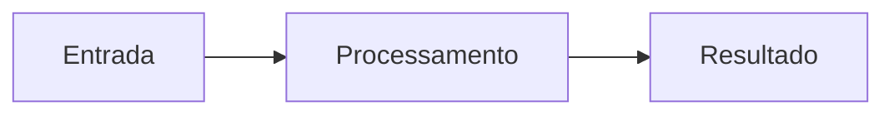

# Nome do Projeto

Uma frase objetiva que explica o que o projeto faz e para quem ele serve.

[Começar agora](primeiros-passos/instalacao.md){ .md-button .md-button--primary }
[Ver no GitHub](https://github.com/SEU-USUARIO/NOME-DO-REPO){ .md-button }

---

## Por que usar

<div class="grid cards" markdown>

- :material-rocket-launch: **Rápido de começar**

    Instale e rode em poucos minutos, sem configuração complicada.

- :material-puzzle: **Flexível**

    Adapte o projeto ao seu fluxo de trabalho com poucas linhas.

- :material-shield-check: **Confiável**

    Testado, documentado e mantido de forma contínua.

- :material-open-source-initiative: **Código aberto**

    Contribuições são bem-vindas. Veja o guia em [Contribuindo](contribuindo.md).

</div>

## Visão rápida

=== "Instalar"

    ```bash
    pip install nome-do-projeto
    ```

=== "Usar"

    ```python
    import nome_do_projeto

    nome_do_projeto.executar()
    ```

## Como funciona



## Próximos passos

- [Instalação](primeiros-passos/instalacao.md)
- [Configuração](primeiros-passos/configuracao.md)
- [Guia de uso](guia/visao-geral.md)
- [Perguntas frequentes](faq.md)